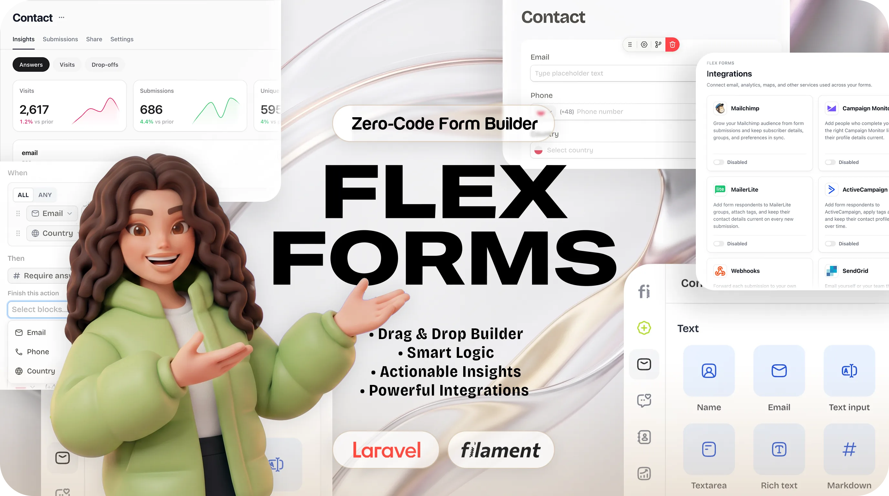
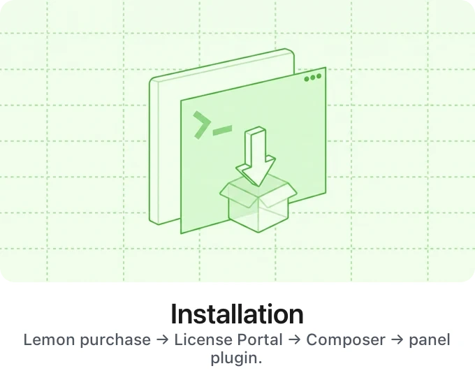
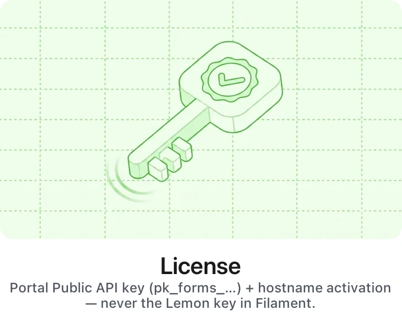
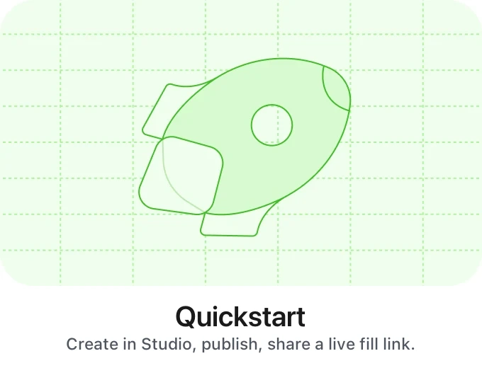
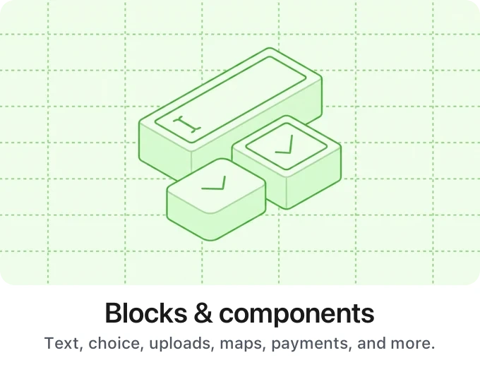
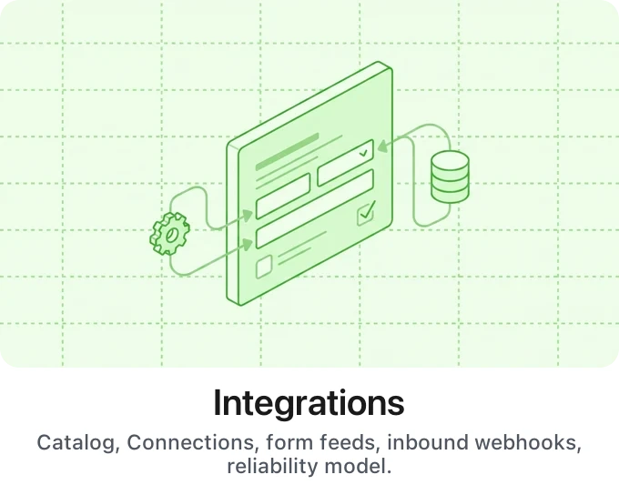
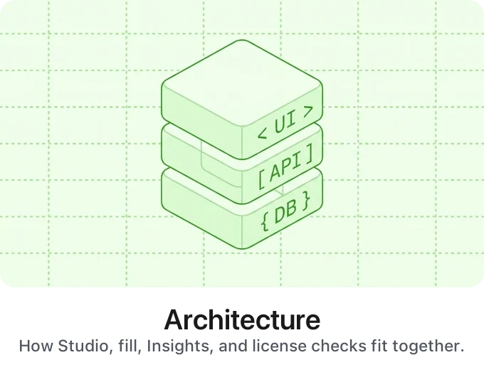
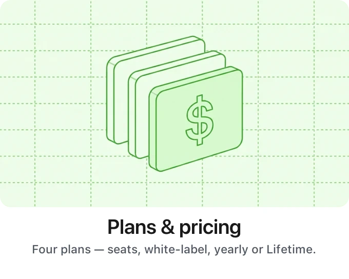
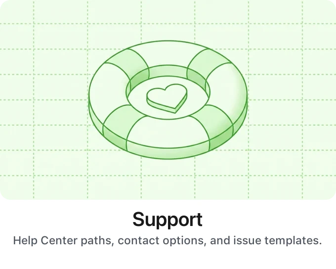

<p align="center" class="filament-hidden">
  
</p>

<h1 align="center" class="filament-hidden">Filament Flex Forms</h1>

<p align="center" class="filament-hidden">
  The form platform for Filament that stays in <strong>your</strong> app.<br>
  Studio · fill &amp; embed · Insights · integrations · Stripe — without a SaaS silo.
</p>

<p align="center" class="filament-hidden">
  <a href="https://flexforms.bjanczak.com" target="_blank" rel="noopener noreferrer"></a>
  &nbsp;
  <a href="https://shop.bjanczak.com/checkout/buy/3d3a0d72-c9d5-4cfd-90c9-26869c444bb0" target="_blank" rel="noopener noreferrer"></a>
</p>

<p align="center" class="filament-hidden">
  <a href="https://youtu.be/n7zSCFTeH2I"><strong>Watch the product walkthrough →</strong></a>
</p>


<p align="center"class="filament-hidden">
  <a href="https://github.com/janczakb/filament-flex-forms/blob/main/LICENSE"></a>
  <a href="https://flexforms.bjanczak.com"></a>
  <a href="https://shop.bjanczak.com/checkout/buy/3d3a0d72-c9d5-4cfd-90c9-26869c444bb0"></a>
  <a href="https://github.com/janczakb/filament-flex-forms"></a>
  <a href="https://github.com/janczakb/filament-flex-forms/stargazers"></a>
  <a href="https://github.com/janczakb/filament-flex-forms/issues"></a>
  <a href="https://github.com/janczakb/filament-flex-forms/releases"></a>
  <a href="https://github.com/janczakb/filament-flex-forms"></a>
</p>

<p align="center" class="filament-hidden">
  <a href="https://www.php.net/releases/8.3/en.php"></a>
  <a href="https://laravel.com"></a>
  <a href="https://livewire.laravel.com"></a>
  <a href="https://filamentphp.com"></a>
  <a href="https://github.com/janczakb/filament-flex-fields"></a>
</p>

<p align="center" class="filament-hidden">
  Built on
  <a href="https://github.com/janczakb/filament-flex-fields">Filament Flex Fields</a>
  ·
  <a href="https://flex-fields.mintlify.app/">Fields docs</a>
</p>

---

**Filament Flex Forms** is the commercial form platform for Filament v5: a full **Studio** in your panel, a dedicated **fill & embed** runtime for respondents, **submissions** and **Contacts** in your database, **Insights** you can operate under load, **Stripe** payments, and **native integrations** — all behind the auth and policies you already run.

<p align="center">
  
</p>

### Built for production Filament apps

| Pillar | What you get |
| --- | --- |
| **Studio** | Drag-and-drop canvas, multi-page forms, Logic Board, calculated fields, Design + custom CSS, Publish when the draft is ready |
| **Lean fill** | Separate fill/embed assets (not panel bloat), access gates, CAPTCHA, partials — served from *your* app |
| **Your data** | Submissions & Contacts in Laravel; optional answer encryption; CSV / Excel export |
| **Insights** | Visits → starts → completes → drop-offs; today buffer + rollups; optional Redis for heavy unique counts |
| **Integrations** | Save first, deliver async — Connections, delivery ledger + Replay, circuit breaker, SSRF-aware outbound HTTP |
| **Payments** | Stripe Payment block + Transactions hub inside the same product |
| **Extensible** | Custom drivers reuse the same FieldMapper / Connections / ledger path as first-party feeds |
| **Flex Fields** | Studio blocks sit on the Flex Fields component family — one design system across Studio and classic resources |

<p align="center">
  <a href="https://flexforms.bjanczak.com"><strong>Read the Help Center →</strong></a>
  ·
  <a href="https://flexforms.bjanczak.com/resources/compare"><strong>Where Flex Forms fits →</strong></a>
  ·
  <a href="https://flexforms.bjanczak.com/integrations/overview"><strong>Integrations & reliability →</strong></a>
  ·
  <a href="https://flexforms.bjanczak.com/architecture/overview"><strong>Architecture →</strong></a>
</p>

---

## Start here

Same entry points as the [Help Center home](https://flexforms.bjanczak.com) — install, activate, then go deep.

<table width="100%">
  <tr>
    <td width="33%" align="center" valign="top"><a href="https://flexforms.bjanczak.com/get-started/installation"></a></td>
    <td width="33%" align="center" valign="top"><a href="https://flexforms.bjanczak.com/get-started/activate-license"></a></td>
    <td width="33%" align="center" valign="top"><a href="https://flexforms.bjanczak.com/get-started/first-form"></a></td>
  </tr>
  <tr>
    <td width="33%" align="center" valign="top"><a href="https://flexforms.bjanczak.com/features/blocks/overview"></a></td>
    <td width="33%" align="center" valign="top"><a href="https://flexforms.bjanczak.com/integrations/overview"></a></td>
    <td width="33%" align="center" valign="top"><a href="https://flexforms.bjanczak.com/features/insights/overview"></a></td>
  </tr>
  <tr>
    <td width="33%" align="center" valign="top"><a href="https://flexforms.bjanczak.com/architecture/overview"></a></td>
    <td width="33%" align="center" valign="top"><a href="https://flexforms.bjanczak.com/plans/overview"></a></td>
    <td width="33%" align="center" valign="top"><a href="https://flexforms.bjanczak.com/resources/support"></a></td>
  </tr>
</table>

---

## Requirements

- **PHP 8.3+**, **Laravel 11+ / 12+**, **Livewire 4**, **Filament v5** panel
- A **paid license** (yearly plans or Lifetime — no free production edition)
- Queue worker recommended for integrations and Insights; optional **Redis** for high-traffic Insights ([guide](https://flexforms.bjanczak.com/guides/redis-production))

---

## Installation

1. Buy a license on Lemon Squeezy, then open the [License Portal](https://license.bjanczak.com/flex-forms/panel).
2. **Register** with your **email**, a **portal password**, and your **Lemon Squeezy license key**. The portal then **generates** your Composer token (`cmp_…`) and Public API key (`pk_forms_…`).
3. Do **not** paste the Lemon key into Filament or use it as a Composer password — only the portal-generated keys.
4. Install from the private registry:

```bash
composer config repositories.flex-forms composer https://composer.bjanczak.com
composer config --auth http-basic.composer.bjanczak.com token YOUR_COMPOSER_TOKEN

composer require janczakb/filament-flex-forms
```

5. Register the plugin on your Filament panel:

```php
use Bjanczak\FilamentFlexForms\FilamentFlexFormsPlugin;

public function panel(Panel $panel): Panel
{
    return $panel->plugin(
        FilamentFlexFormsPlugin::make()
    );
}
```

6. Run migrations / setup as documented, whitelist your hostname in the portal, paste `pk_forms_…` into **Global Settings → License**, and reload.

Step-by-step (migrations, config, CI secrets, Setup Wizard): [Installation](https://flexforms.bjanczak.com/get-started/installation) · [Activate license](https://flexforms.bjanczak.com/get-started/activate-license)

> Keep `auth.json` out of git. Never commit your `cmp_…` token.

---

## Plans

<p align="center">
  
</p>

<p align="center">
  <strong>Standard</strong> $99/yr · <strong>Pro</strong> $199/yr · <strong>Enterprise</strong> $799/yr · <strong>Lifetime</strong> $899 once<br>
  Seats <strong>2 / 6 / 100 / 10</strong> · Design on every plan · Hide branding on Pro+ / Lifetime
</p>

<p align="center">
  Full Studio, Insights, and integrations on every paid plan — plans change seats, white-label, support, and billing.<br>
  <a href="https://shop.bjanczak.com/checkout/buy/3d3a0d72-c9d5-4cfd-90c9-26869c444bb0"><strong>Buy a license →</strong></a>
  ·
  <a href="https://flexforms.bjanczak.com/plans/overview">Compare plans →</a>
</p>

**Upgrades:** buy the higher plan in the [store](https://shop.bjanczak.com/checkout/buy/3d3a0d72-c9d5-4cfd-90c9-26869c444bb0), then in the [License Portal](https://license.bjanczak.com/flex-forms/panel) use **Change license key** and paste the new Lemon key. Plan features and seats refresh on the next license check — no app redeploy.

**If a yearly license expires or is cancelled:** Studio editing and publishing lock, public fill and new submissions pause, and Composer downloads stop until you renew (short grace may apply). Data already stored in your application database is never deleted. **Lifetime** keeps runtime and package updates permanently.

---

## FAQ

- **Is there a free / OSS edition?** No — commercial license only.
- **Where does my data live?** In *your* Laravel database under *your* auth and policies — not a third-party form SaaS.
- **How many domains?** Standard **2** · Pro **6** · Enterprise **100** · Lifetime **10** hostnames (staging counts).
- **Design / custom CSS?** Included on **all** plans. Hide branding is Pro+ (and Lifetime).
- **Queue / Redis?** Recommended queue for integrations & Insights; Redis optional for heavy Insights uniques.

More: [Welcome](https://flexforms.bjanczak.com/) · [Plans](https://flexforms.bjanczak.com/plans/overview) · [Architecture](https://flexforms.bjanczak.com/architecture/overview)

---

## Flex family

Studio blocks run on **[Filament Flex Fields](https://github.com/janczakb/filament-flex-fields)** — 70+ Filament components and the same design system, usable also in classic resource forms (without Studio).

<p align="center">
  <a href="https://github.com/janczakb/filament-flex-fields">
    
  </a>
</p>

<p align="center">
  <a href="https://github.com/janczakb/filament-flex-fields">GitHub</a>
  ·
  <a href="https://flex-fields.mintlify.app/">Docs</a>
  ·
  <a href="https://packagist.org/packages/janczakb/filament-flex-fields">Packagist</a>
</p>

---

## Support

- Docs: [flexforms.bjanczak.com](https://flexforms.bjanczak.com)
- Support: [flexforms.bjanczak.com/resources/support](https://flexforms.bjanczak.com/resources/support)
- License portal: [license.bjanczak.com](https://license.bjanczak.com/flex-forms/panel)
- Changelog: [CHANGELOG.md](./CHANGELOG.md)
- Security: [SECURITY.md](./SECURITY.md) — private disclosure only (do not open public issues for vulnerabilities)
- Bugs & ideas: [GitHub Issues](https://github.com/janczakb/filament-flex-forms/issues)
- Privacy: [Help Center](https://flexforms.bjanczak.com/resources/privacy) · Terms: [Help Center](https://flexforms.bjanczak.com/resources/terms)

> **Multi-admin installs:** configure Spatie / `FilamentFlexFormsPlugin::authorizeAbilityUsing` and consider `FLEX_FORMS_PERMISSIONS_STRICT=true` so missing grants deny instead of allow. See [Studio permissions](https://flexforms.bjanczak.com/developers/studio-permissions).

---

## License

Copyright © 2026 Bartłomiej Janczak. All rights reserved.

This is **proprietary commercial software**. Use requires a valid paid license. See [`LICENSE`](./LICENSE) for the full agreement.

Unauthorized copying, redistribution, license-key sharing, or circumvention is prohibited.
