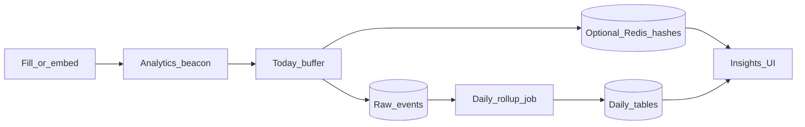

Understanding the pipeline helps you trust the numbers and choose Redis when traffic grows.

## Flow

## Pieces

| Piece | Role |
|-------|------|
| Beacon | Browser sends interaction batches from fill |
| Today buffer | Fast path for “today” metrics |
| Raw events | Source of truth for detailed / filtered queries |
| Daily rollups | Pre-aggregated history for snappy ranges (one queued job per day on multi-day catch-up) |
| Redis (optional) | HLL uniques + today hashes under load |

## What you configure

- Form-level: nothing required — Insights works out of the box after publish + traffic
- Global settings: Insights Redis mode, connection, prefix, HLL, today hashes — see [Redis scaling](/features/insights/redis-scaling)
- App schedule: Flex Forms registers a nightly rollup; multi-day catch-up (`--from` / `--to`) queues one job per date so workers can parallelize and retry safely
- GeoIP: CDN headers by default; optional local MaxMind. External ip-api Pro HTTPS is opt-in only (`FLEX_FORMS_GEO_IP_EXTERNAL_API` + API key) — see [Config & env](/developers/config-env)

<Check>
Before a launch campaign, walk through the [Redis production checklist](/guides/redis-production).
</Check>

<Panel>
Related: [Insights overview](/features/insights/overview) · [OpenAPI beacon](/developers/openapi-beacon)
</Panel>
