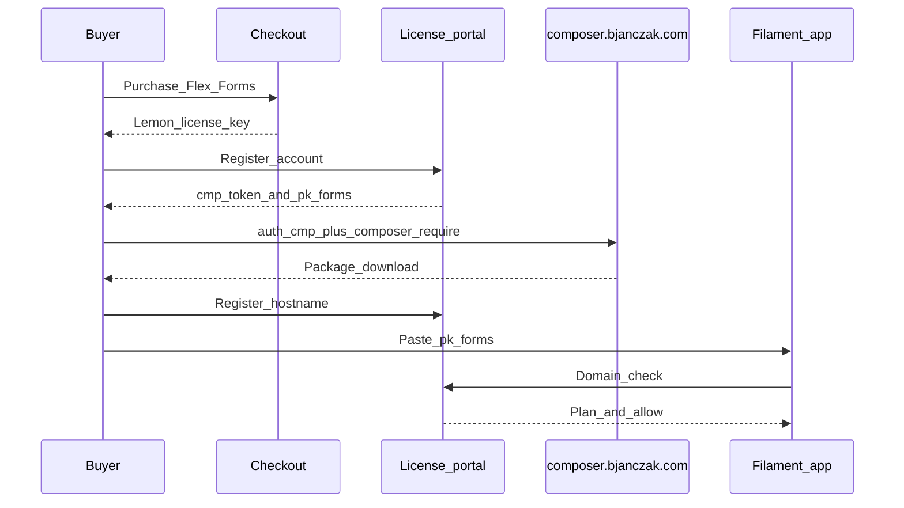

Flex Forms licensing has a clear customer path: buy → install with Composer → activate domain → build.

## End-to-end

## Lemon key statuses

| Status | What it means for you |
|--------|------------------------|
| Inactive | Paid / valid, no domains activated yet — add a hostname in the portal |
| Active | At least one domain is activated |
| Expired / Disabled | Your license is no longer valid — renew or contact support |

Removing every domain returns the key to **inactive**. You can still add domains again and Composer access remains available while the purchase is valid.

## If the subscription expires or is cancelled

| Surface | What happens |
|---------|----------------|
| Studio (edit / publish) | Blocked until you renew |
| Public fill & new submissions | Paused |
| Composer downloads (`cmp_…`) | Stopped |
| Data already in your database | **Kept** — never deleted by Flex Forms |

Renew or restore entitlement in the [License Portal](https://license.bjanczak.com/flex-forms/panel) / Lemon Squeezy, then re-check the domain. See [Activate license](/get-started/activate-license) and [Plans](/plans/overview).

## What you use day to day

| Artifact | Purpose |
|----------|---------|
| Lemon license key | Create / relink portal account only |
| Composer token `cmp_…` | Download / update from `composer.bjanczak.com` |
| Public key `pk_forms_…` | Stored in Global settings for Studio unlock |
| Portal domain list | Which hostnames may run the product |
| Plan (Standard / Pro / …) | Feature flags such as hide branding |

<Steps>
  <Step title="Install">
    Follow [Installation](/get-started/installation) — repository + `cmp_…` auth + `composer require`.
  </Step>
  <Step title="Activate">
    Follow [Activate license](/get-started/activate-license).
  </Step>
  <Step title="Build">
    Use Studio freely on activated hosts.
  </Step>
</Steps>

<Info>
If something is locked, it is almost always a hostname mismatch or a missing public key in Global settings — not a Composer problem.
</Info>

<Panel>
Related: [License Portal](/plans/license-portal) · [Plans](/plans/overview) · [Hide branding](/plans/hide-branding) · [Support](/resources/support)
</Panel>
