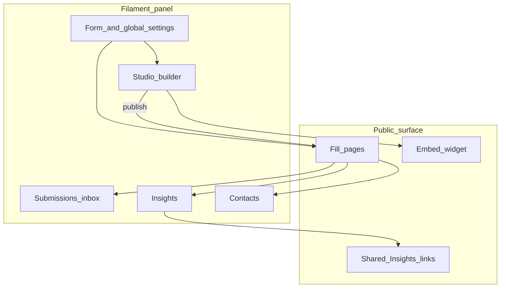
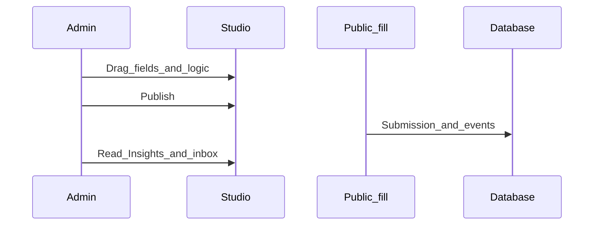
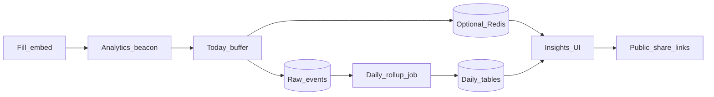

This page explains how the **product** works inside your Filament app. It is for teams shipping forms — not for packaging internals.

## Big picture

## Studio → publish → fill

1. You design pages and fields in **Studio** (draft schema).
2. **Publish** promotes the schema so public fill routes use it.
3. Respondents open the **fill link** or an **embed**; answers become **submissions**.
4. **Insights** aggregates visits, answers, and drop-offs; **Contacts** consolidates respondents.

## Why this architecture

| Surface | What you get |
|---------|----------------|
| Studio | Canvas + left field settings + Logic / calculated / design — autosaves drafts |
| Form hub | Insights · Submissions · Share · Integrations — ops without leaving Filament. Form settings open from Studio as a modal. |
| Fill / embed | Dedicated runtime assets (not panel bloat), access gates, CAPTCHA, partials |
| Insights | Beacon → today buffer → rollups; optional Redis for uniques under load |
| License | Hostname + public key checked at runtime before Studio mutations and live submits |

That split is intentional: **builders** stay in Studio, **operators** stay in the hub, **respondents** hit a lean fill surface, and **your DB** remains the source of truth.

## Insights path (high level)

Beacons from fill feed a today buffer (optionally Redis), then daily rollups power Answers / Visits / Drop-offs. Details: [Insights pipeline](/architecture/insights-pipeline) and [Redis scaling](/features/insights/redis-scaling).

## License gate (runtime)

On each request Flex Forms checks whether this hostname is allowed for your public key. Allowed apps get the full product; denied apps cannot mutate Studio data or accept live submissions.

See [Activate license](/get-started/activate-license) and [License flow](/architecture/license-flow).

## Where to go next

<CardGroup cols={2}>
  <Card title="Studio" icon="pencil-ruler" href="/features/studio/overview">
    Builder, logic, design, publish.
  </Card>
  <Card title="Embed API" icon="code-xml" href="/developers/embed-api">
    Drop forms on any website.
  </Card>
  <Card title="Webhooks" icon="webhook" href="/developers/webhooks">
    Push submissions to your stack.
  </Card>
  <Card title="Extensibility" icon="puzzle" href="/developers/extensibility-overview">
    Events, FieldMapper, custom integrations, Connections, actions.
  </Card>
  <Card title="Config & env" icon="settings" href="/developers/config-env">
    Optional published configuration.
  </Card>
</CardGroup>
