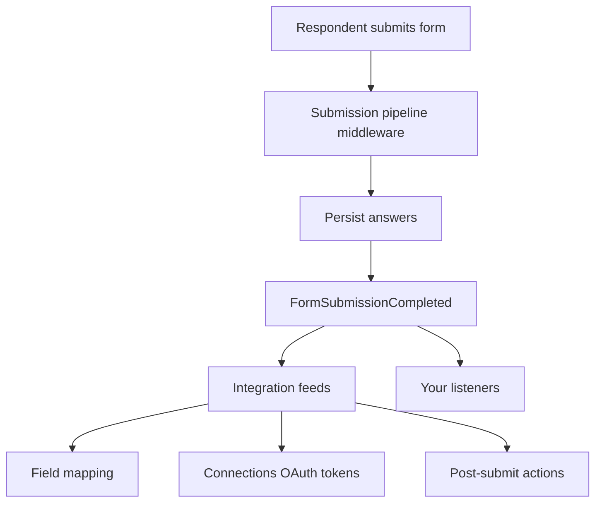

Flex Forms is built for Laravel hosts that need more than no-code feeds — custom CRMs, tenant-scoped models, OAuth-backed connections, and server-side logic on every submission.

This page is the map. Each child page covers one extension surface with copy-paste examples.



## Extension surfaces

<CardGroup cols={2}>
  <Card title="Public API list" icon="book-marked" href="/developers/PUBLIC_API">
    Canonical stable surface — prefer these classes over anything marked `@internal`.
  </Card>
  <Card title="Events & hooks" icon="bell" href="/developers/events-hooks">
    Listen for `FormSubmissionCompleted`, integration dispatch events, and form publish lifecycle. Prefer events over Eloquent observers.
  </Card>
  <Card title="Submission pipeline" icon="git-branch" href="/developers/events-hooks#submission-pipeline-middleware">
    Laravel-style middleware on answers **before** persistence — validate, enrich, or abort with a message.
  </Card>
  <Card title="Field mapping" icon="arrow-right-left" href="/developers/field-mapping">
    Map form answers to integration payloads with transforms, nested paths, and static values.
  </Card>
  <Card title="Custom integrations" icon="plug" href="/developers/custom-integrations">
    Register drivers for your API — config, discovery folder, or Artisan generator.
  </Card>
  <Card title="OAuth integrations" icon="key" href="/developers/oauth-integrations">
    Two-tier model: OAuth driver + reusable **Connections** that store tokens per account.
  </Card>
  <Card title="OAuth token management" icon="shield" href="/developers/oauth-token-management">
    Redirect/callback routes, refresh lifecycle, encrypted credential storage.
  </Card>
  <Card title="Post-submit actions" icon="zap" href="/developers/post-submit-actions">
    Server-side actions after a completed submission — alongside feeds and listeners.
  </Card>
  <Card title="Custom models" icon="database" href="/developers/custom-models">
    Swap `FlexForm`, submission, connection, or delivery models for multi-tenant schemas.
  </Card>
  <Card title="Admin customization" icon="layout-panel-left" href="/developers/admin-customization">
    Navigation, Studio branding, forms table columns, and permission overrides via the plugin.
  </Card>
</CardGroup>

## Config entry point

Publish config to register pipeline middleware and integration drivers:

```php title="config/filament-flex-forms.php"
'extensibility' => [
    'submission_middleware' => [
        \App\FlexForms\EnrichSubmissionMetadata::class,
    ],
    'integrations' => [
        'drivers' => [
            \App\Integrations\AcmeCrmDriver::class,
        ],
        'discover' => [
            app_path('Integrations/FlexForms'),
        ],
        'allow_override' => false,
    ],
],
```

Full env and config reference: [Config & env](/developers/config-env).

## Stability & deprecation

Public extension points are listed in [`PUBLIC_API.md`](/developers/PUBLIC_API). Classes outside that list may change without a major version bump — prefer documented APIs. When we deprecate a public method or event, we keep it working for **at least one minor release** and document the replacement in Upgrading notes and the changelog.

## Related developer docs

| Topic | Page |
|-------|------|
| Embed `postMessage` events | [Embed widget API](/developers/embed-api) |
| Outbound webhook payload | [Webhooks](/developers/webhooks) |
| Insights pipeline | [Insights pipeline](/architecture/insights-pipeline) |
| Multi-tenant recipe | [Multi-tenancy](/developers/multi-tenancy) |
| RBAC | [Studio permissions](/developers/studio-permissions) |

<Panel>
**Start here:** [Events & hooks](/developers/events-hooks) for listeners, or [Custom integrations](/developers/custom-integrations) if you are shipping a new feed driver.
</Panel>
