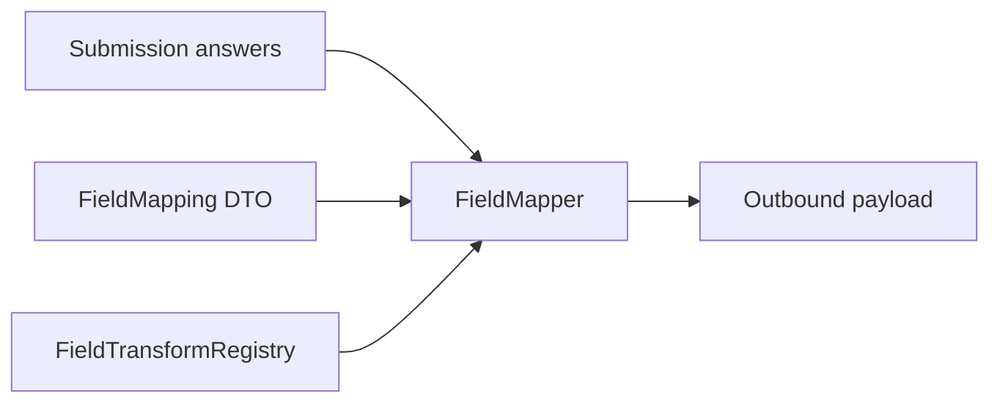

Integration feeds (CRM, webhooks, spreadsheets) rarely accept raw form field names. Flex Forms **field mapping** renames keys, applies transforms, injects static values, and supports nested target paths — the same engine powers Studio mapping UI and programmatic dispatch.



## How mapping works

1. **Field mappings** — `{ "source_field": "target_key" }` pairs copy values from answers to the output.
2. **Transformations** — optional per-source transform applied before the value is written.
3. **Static values** — constants merged into the output (campaign IDs, record types, tags).
4. **Unmapped fields** — optionally include remaining answers under a prefix.

Sources use dot notation for nested answers (`address.city`). Targets use dot notation for nested output (`contact.address.city`).

## Built-in transforms

| Transform | Effect |
|-----------|--------|
| `none` | Pass through (default) |
| `trim` | Trim strings |
| `uppercase` / `lowercase` | Case change |
| `string` / `number` / `integer` / `boolean` | Type coercion |
| `date_iso` / `date_us` / `date_eu` | Format dates (`Y-m-d`, `m/d/Y`, `d/m/Y`) |
| `json` | Encode array → JSON string, or decode JSON string → array |
| `comma_separated` | Join array values with commas |
| `first_item` / `last_item` | Pick from array |
| `count` | Count array elements |
| `slug` | Laravel `Str::slug()` |
| `md5` / `sha256` | Hash scalar values |
| `empty_to_null` | `''` or `[]` → `null` |
| `merge_template` | Replace `{{field}}` tokens from answers |
| `split_name` / `join_name` | Split/join first+last name |
| `phone_e164` | Digits / `+` normalization |
| `file_url` / `file_name` | Prefer upload array `url` / `name` |

Chain transforms with `|` (e.g. `trim|lowercase`).

Register custom transforms:

```php
use Bjanczak\FilamentFlexForms\Integrations\Mapping\FieldMapper;
use Bjanczak\FilamentFlexForms\Integrations\Mapping\FieldTransformRegistry;

FieldMapper::extend('acme_code', fn (mixed $value): mixed => /* … */ $value);
// or
app(FieldTransformRegistry::class)->extend('acme_code', fn (mixed $value): mixed => $value);
```

## Conditions

Optional `conditions` on `FieldMapping`:

- **Global** (no `source`): if any fail, only `staticValues` are returned.
- **Per-source** (`source` matches a mapped field): skip that row when the condition fails.

Operators: `filled`, `empty`, `equals`, `not_equals`, `truthy`, `falsy`.

## FieldMapping DTO

```php
use Bjanczak\FilamentFlexForms\Integrations\Mapping\FieldMapping;

$mapping = new FieldMapping(
    fieldMappings: [
        'email' => 'contact.email',
        'full_name' => 'contact.name',
        'company' => 'account.name',
    ],
    transformations: [
        'email' => 'lowercase|trim',
        'full_name' => 'trim',
    ],
    staticValues: [
        'source' => 'flex-forms',
        'pipeline.stage' => 'new',
    ],
    includeUnmappedFields: false,
    unmappedPrefix: 'extra_',
);

// From feed JSON stored on the form:
$mapping = FieldMapping::from($feed['mapping'] ?? []);
```

## FieldMapper::map example

```php
use Bjanczak\FilamentFlexForms\Integrations\Mapping\FieldMapper;

$answers = [
    'email' => '  Jane@Example.com ',
    'full_name' => 'Jane Doe',
    'plan' => ['pro', 'support'],
    'address' => ['city' => 'Gdansk'],
];

$mapped = app(FieldMapper::class)->map($answers, $mapping);

/*
[
    'contact' => ['email' => 'jane@example.com', 'name' => 'Jane Doe'],
    'account' => ['name' => null],
    'source' => 'flex-forms',
    'pipeline' => ['stage' => 'new'],
]
*/
```

### Nested paths

```php
$mapping = new FieldMapping(
    fieldMappings: [
        'address.city' => 'properties.city',
        'address.postcode' => 'properties.zip',
    ],
);
```

`Arr::get` / `Arr::set` power both sides — deep paths work out of the box.

### Static values

Static values are written **after** field mappings and can define nested keys:

```php
staticValues: [
    'tags' => ['web-form', 'enterprise'],
    'owner.id' => '005xx000001234',
],
```

### Preview

Use the same mapper for admin previews and tests:

```php
$preview = app(FieldMapper::class)->preview($sampleAnswers, $mapping, $formSchema);
```

`preview()` is an alias of `map()` — pass the form schema when a transform needs block metadata from `$context['schema']`.

<Info>
  Conditional feeds in Studio can attach mapping per branch. See [Conditional feeds](/integrations/conditional-feeds).
</Info>

<Panel>
**Next:** [Custom integrations](/developers/custom-integrations) · [Webhooks](/developers/webhooks) · [Post-submit actions](/developers/post-submit-actions)
</Panel>
