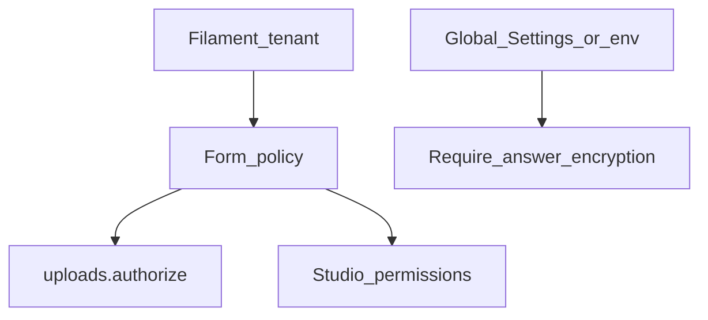

Flex Forms does not ship a separate tenancy engine. On Filament multi-tenant panels you keep using **your** tenant model and policies — then wire three package hooks so one tenant never reads another tenant’s forms, files, or exports.



## 1. Scope forms to the tenant

Store forms under the tenant the same way you store other Filament resources (global scopes, `team_id`, Filament tenancy relationship, etc.). Studio list/edit already go through your panel auth — make sure `FlexForm` queries cannot cross tenants.

## 2. Lock uploads & signed file URLs

Without `uploads.authorize`, any authenticated panel user can upload/view files for **any** form. For SaaS hosts, fail closed:

```php title="config/filament-flex-forms.php"
'uploads' => [
    'authorize' => fn ($user, $form) => $user?->can('update', $form) ?? false,
    'require_authorize_callback' => true,
],
```

Env equivalent: `FLEX_FORMS_REQUIRE_AUTHORIZE=true`. Details: [Upload disks](/developers/upload-disks) · [Config & env](/developers/config-env).

## 3. Gate Studio actions

Use Spatie / Shield permission names, or:

```php
FilamentFlexFormsPlugin::make()
    ->authorizeAbilityUsing(function (StudioAbility $ability, $user, $form): ?bool {
        if ($form === null) {
            return null;
        }

        return $user?->can('update', $form) ? null : false;
    });
```

Full ability map: [Studio permissions](/developers/studio-permissions).

## 4. Scope Integration Connections

Connections store encrypted credentials. Scope them the same way you scope forms:

```php
FilamentFlexFormsPlugin::make()
    ->resolveConnectionTenantIdUsing(fn () => (string) Filament::getTenant()?->getKey())
    ->modifyConnectionsEloquentQueryUsing(function ($query) {
        $tenantId = (string) Filament::getTenant()?->getKey();

        return $query->where('tenant_id', $tenantId);
    });
```

`created_by` is set automatically from the authenticated panel user when a Connection is created.

## 5. Require encrypted answers (optional hard policy)

For forms that collect sensitive data, enable **Encrypt submission answers** per form (Form Settings → General).

For organization-wide compliance, turn on **Require encryption on all forms** under **Global Settings → Security**, or set:

```bash
FLEX_FORMS_FORCE_SUBMISSION_ENCRYPTION=true
```

When either is on, every form stores answer payloads encrypted at rest (Laravel `Crypt` / `APP_KEY`) — including both answer rows and the submission `payload` JSON. Studio, exports, and emails decrypt for display. See [General Settings](/features/settings/general) and [Privacy](/resources/privacy).

<Warning>
  Rotating `APP_KEY` after encryption is enabled makes existing sealed answers unreadable. Treat key rotation like a data-migration event.
</Warning>

## Checklist before production

- [ ] Tenant-scoped `FlexForm` queries / policies
- [ ] Tenant-scoped Integration Connections (`modifyConnectionsEloquentQueryUsing`)
- [ ] `uploads.authorize` + `require_authorize_callback`
- [ ] Studio ability grants for multi-admin teams
- [ ] Encryption policy decided (per form vs global / env)

**Next:** [Config & env](/developers/config-env) · [Studio permissions](/developers/studio-permissions) · [Upload disks](/developers/upload-disks)
