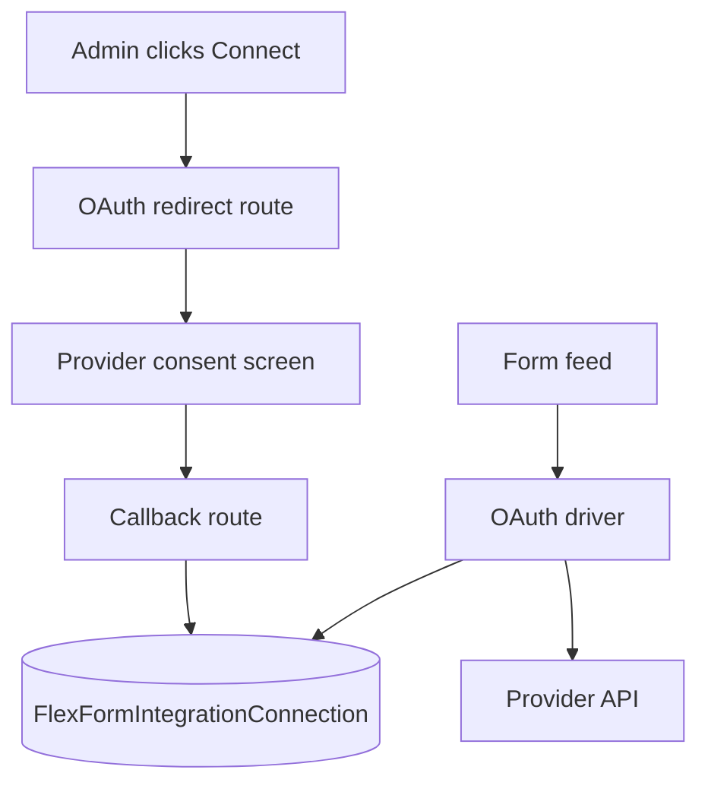

Some providers (CRM suites, spreadsheets, help desks) expect **OAuth 2.0** instead of a static API key pasted into Global Settings. Flex Forms uses a **two-tier** model:

1. **Integration driver** — defines scopes, token URLs, feed fields, and dispatch logic.
2. **Connection** — a saved OAuth account (tokens + metadata) admins authorize once and reuse across forms.



## Why two tiers?

| Layer | Stores | Reused by |
|-------|--------|-----------|
| **Driver** | How to talk to the API (endpoints, mapping shape, required scopes) | All Connections of that `driver_key` |
| **Connection** | Encrypted tokens, account label, health status | Many form feeds pointing at the same account |

Admins connect **once** under **Integrations → Connections** (hub tab), then pick that connection on each form feed — no re-pasting refresh tokens per form.

## Auth from a Connection

In `dispatch()` and `testConnection()`, resolve credentials from the linked connection instead of inline global config:

```php
public function dispatch(
    FlexForm $form,
    FlexFormSubmission $submission,
    array $globalConfig,
    array $feed,
): IntegrationDispatchResult {
    $connection = $this->connectionFromFeed($feed); // your helper

    $token = app(OAuthTokenManager::class)->accessToken($connection);

    $client = $this->httpClient(bearerToken: $token);

    // …
}
```

Global config fields on OAuth drivers typically shrink to:

- **Client ID** / **Client secret** (app registration)
- Optional **default scopes**
- **Connection picker** on the form feed (required)

Legacy manual token fields remain supported for air-gapped installs — OAuth Connections are the recommended path.

## Driver responsibilities

OAuth drivers extend the same `IntegrationDriver` contract with:

- `getOAuthConfig()` — authorize URL, token URL, scopes, redirect URI, `uses_pkce` (never includes `client_secret`)
- `oauthClientId()` / `oauthClientSecret()` — read credentials for token exchange / storage only
- `usesPkce()` — default `true` (S256); override only for legacy providers
- `exchangeOAuthCode($code, $connectionId, $codeVerifier = null)` — token exchange
- Tokens refresh via `OAuthTokenManager` (mutex + `needs_reauth`)

Built-in examples in the Help Center: [Google Sheets](/integrations/google-sheets), [Salesforce](/integrations/salesforce), [Help Scout](/integrations/helpscout).

## Studio UX

1. Admin registers the OAuth app (client ID/secret) under **Integrations**.
2. Clicks **Connect account** → redirect flow → new row in **Connections**.
3. On a form feed, selects **Connection: Marketing Hub (user@company.com)**.
4. Field mapping and conditional rules behave like any other feed.

<Info>
  Connections are panel-wide. Scope them to tenants in multi-tenant apps via custom connection models — see [Custom models](/developers/custom-models).
</Info>

<Panel>
**Next:** [OAuth token management](/developers/oauth-token-management) · [Custom integrations](/developers/custom-integrations)
</Panel>
