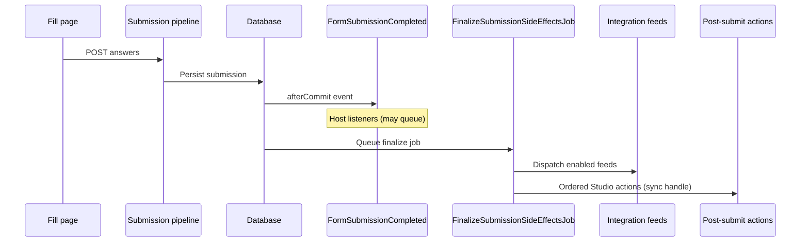

"Post-submit" means anything that happens **after** a respondent finishes a form (not partial save). Flex Forms runs side effects in a predictable order so you can choose the lightest hook.



## Choose the right hook

| Approach | Best for | Runs |
|----------|----------|------|
| **Integration feed** | CRM, email, webhook, spreadsheet | Queued finalize job; retries + delivery log |
| **`FormSubmissionCompleted` listener** | App-specific workflows (Slack internal, ERP) | After persist, **before** integrations; use `ShouldQueue` on the **listener** |
| **Studio post-submit action** | Ordered thank-you actions | Sync `handle()` inside finalize job — do **not** implement `ShouldQueue` on the action class |
| **Custom driver `dispatch()`** | Reusable productized outbound API | With other feeds; recorded in delivery table |
| **Submission pipeline middleware** | Block or mutate **before** save | Synchronous during submit — not post-submit |

<Info>
  Partial submissions (`save later`) skip full post-submit integrations unless a feed explicitly allows partials. Completed submissions always run the finalize job.
</Info>

<Warning>
  `FormSubmissionCompleted` fires before integrations. If your listener needs CRM side effects to have finished, listen for `IntegrationDispatchSucceeded` instead.
</Warning>

## Integration feeds (built-in post-submit)

Configure under **Form → Integrations** in Studio. Each feed:

- Normalizes answers (optionally through [field mapping](/developers/field-mapping))
- Respects conditional feed rules — [Conditional feeds](/integrations/conditional-feeds)
- Records success/failure for inbox replay

No-code options: [Webhooks](/integrations/webhooks), [Zapier](/integrations/zapier), CRM catalog under [Integrations](/integrations/overview).

## Queued listener example

```php
use Bjanczak\FilamentFlexForms\Events\FormSubmissionCompleted;
use Illuminate\Contracts\Queue\ShouldQueue;

final class CreateHelpDeskTicket implements ShouldQueue
{
    public function handle(FormSubmissionCompleted $event): void
    {
        if ($event->form->slug !== 'support') {
            return;
        }

        // HelpDeskApi::createTicket(…)
    }
}
```

Register with `Event::listen` or Laravel discovery. Use a dedicated queue name (`integrations`) in production.

## Custom post-submit driver

When multiple forms share the same outbound system, implement a driver ([Custom integrations](/developers/custom-integrations)) instead of duplicating listeners:

- Admins configure feeds in Studio
- Deliveries appear in the integration log with replay
- OAuth Connections supply auth — [OAuth integrations](/developers/oauth-integrations)

## Idempotency and retries

Post-submit actions should tolerate duplicate delivery attempts:

- Key external creates on `submission_id`
- Use `IntegrationDispatchSucceeded` / `IntegrationDispatchFailed` for alerting, not primary business logic
- Replay from the admin UI re-runs `dispatch()` with the same submission snapshot

## What not to do

<Warning>
  Avoid long synchronous HTTP in pipeline middleware when the work can wait — it blocks the respondent. Prefer feeds or queued listeners.
</Warning>

- Do not use Eloquent observers on `FlexFormSubmission` — see [Events & hooks](/developers/events-hooks)
- Do not assume `sync` queue in production — run a worker

<Panel>
**Next:** [Events & hooks](/developers/events-hooks) · [Webhooks](/developers/webhooks) · [Field mapping](/developers/field-mapping)
</Panel>
