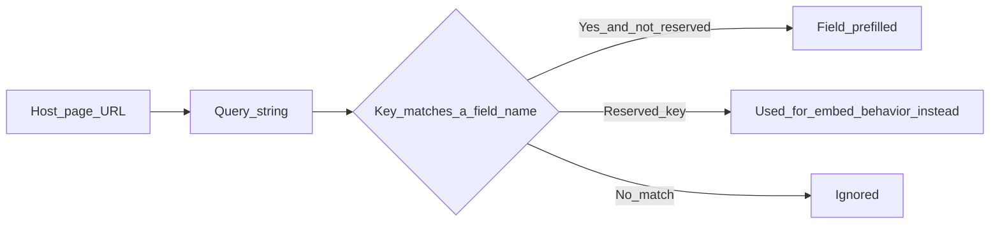

Any query string parameter whose key matches a field's **name** on the form prefills that field — no configuration needed on the form itself. This works on the `embed` and `popup` routes; the plain (non-embed) fill link does not read prefill params.



<CodeGroup>
```html title="Prefill email + a UTM-style field from the host page"
<iframe
  data-flex-form-src="https://your-app.test/forms/demo-request/embed?email=jane%40acme.com&plan=enterprise"
  loading="lazy" width="100%" height="800" frameborder="0"
  title="Demo request"
></iframe>
<script async src="https://your-app.test/vendor/flex-forms/embed.js"></script>
```

```js title="Building the URL from your own page's UTM params"
const url = new URL('https://your-app.test/forms/demo-request/embed');
const params = new URLSearchParams(window.location.search);
['utm_source', 'utm_medium', 'utm_campaign', 'plan'].forEach((key) => {
  if (params.has(key)) url.searchParams.set(key, params.get(key));
});
document.querySelector('iframe[data-flex-form-src]').dataset.flexFormSrc = url.toString();
```
</CodeGroup>

<Note>
The field's **name** is the internal machine name you see in Studio field settings — not its display label. Only scalar (string) values are accepted; anything else is ignored.
</Note>

## Reserved keys

These keys always control embed behavior and are never treated as field names, even if a field happens to share the name:

<Table>
  <thead><tr><th>Key</th><th>Purpose</th></tr></thead>
  <tbody>
    <tr><td><code>hideTitle</code></td><td>Hide the form title</td></tr>
    <tr><td><code>alignLeft</code></td><td>Left-align content</td></tr>
    <tr><td><code>transparentBackground</code></td><td>Transparent iframe background</td></tr>
    <tr><td><code>dynamicHeight</code></td><td>Auto-resize the iframe to content height</td></tr>
    <tr><td><code>preview</code></td><td>Request preview mode (requires a valid signed URL or authenticated Studio viewer; otherwise ignored / draft stays 404)</td></tr>
    <tr><td><code>popup</code></td><td>Internal popup-routing flag</td></tr>
    <tr><td><code>formEventsForwarding</code></td><td>Forward fill lifecycle events via <code>postMessage</code></td></tr>
  </tbody>
</Table>

<Warning>
Prefill values arrive as plain query-string text with no server-side validation against the field's own rules until the respondent submits — treat prefill as a convenience, not a trusted input channel. Never rely on it to pass secrets or values you haven't sanitized on your own page first.
</Warning>

<Tip>
Want UTM values to also show up in [Insights → Visits](/guides/reading-insights) rather than just prefilling a field? Those are captured automatically from the visit's referrer/query string by the analytics beacon — no extra wiring needed.
</Tip>

<AccordionGroup>
  <Accordion title="Why doesn't prefill work on the plain fill link?">
    Prefill-from-query only runs for the embed and popup routes (`isEmbed` in the fill component). If you need prefill on a direct link, wrap it in a Standard embed instead.
  </Accordion>
  <Accordion title="Can I prefill a hidden field?">
    Yes — a field can be prefilled and simultaneously hidden via [Logic](/guides/logic-and-calculated), which is a common pattern for tagging submissions with a UTM source without showing it to the respondent.
  </Accordion>
  <Accordion title="Does prefill work for choice/select fields?">
    Yes, as long as the query value exactly matches one of the field's option values.
  </Accordion>
</AccordionGroup>

<Panel>
**Next:** [Embed widget API](/developers/embed-api) · [Embed on any platform](/guides/embed-platforms) · [Logic & calculated fields](/guides/logic-and-calculated)
</Panel>
