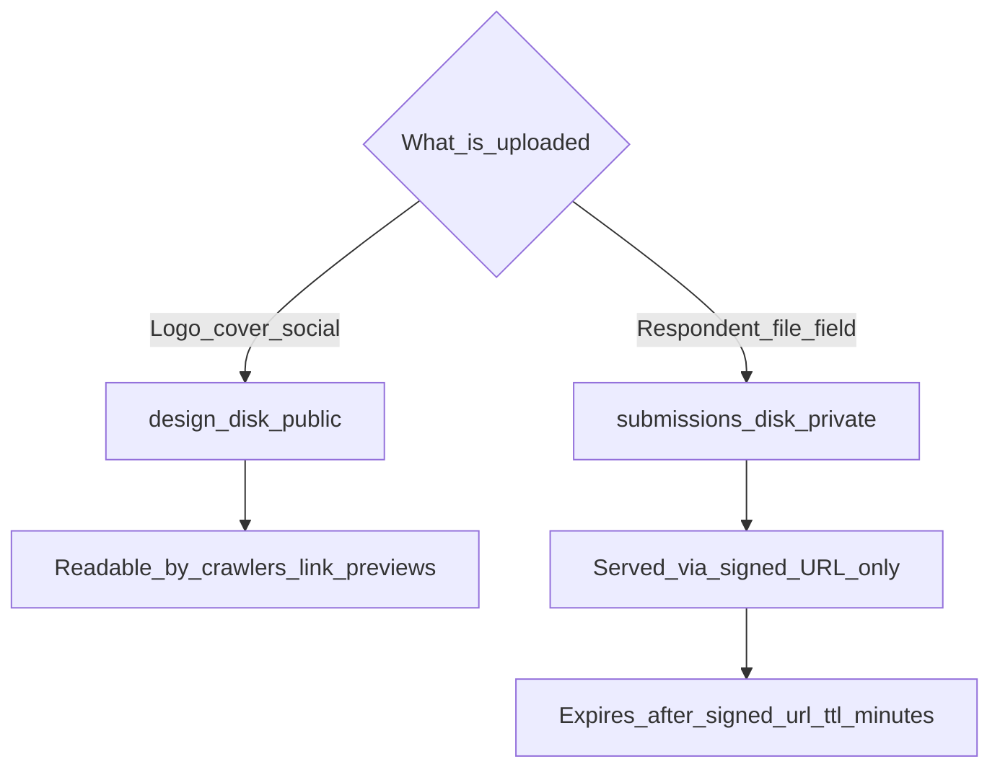

Flex Forms deliberately splits uploads across **two disks** with opposite visibility defaults, because they serve opposite purposes.



<Table>
  <thead><tr><th></th><th>Design assets</th><th>Submission uploads</th></tr></thead>
  <tbody>
    <tr><td>Config key</td><td><code>uploads.design_disk</code></td><td><code>uploads.submissions_disk</code></td></tr>
    <tr><td>Default disk</td><td><code>public</code></td><td><code>local</code></td></tr>
    <tr><td>Visibility</td><td>Public — crawlers need to read OG images</td><td>Private — served via time-limited signed URLs</td></tr>
    <tr><td>Directory</td><td><code>flex-forms/design</code></td><td><code>flex-forms/submissions</code></td></tr>
    <tr><td>Used for</td><td>Logo, cover image, social/OG image</td><td>Any file-upload field a respondent fills in</td></tr>
  </tbody>
</Table>

<Steps>
  <Step title="Keep defaults for a single Laravel disk setup">
    If your app already has `public` and `local` disks configured (the Laravel default), no changes are needed.
  </Step>
  <Step title="Point either disk at S3 (or any Flysystem disk)">
    Set `FLEX_FORMS_DESIGN_DISK` and/or `FLEX_FORMS_SUBMISSIONS_DISK` to any disk name defined in `config/filesystems.php` — S3, DigitalOcean Spaces, or your own driver.
  </Step>
  <Step title="Tune signed URL lifetime">
    `FLEX_FORMS_SIGNED_URL_TTL` (minutes, default 15) controls how long a link to a private submission file stays valid before it needs to be re-signed.
  </Step>
  <Step title="Set a per-form quota">
    `FLEX_FORMS_QUOTA_BYTES_PER_FORM` (default 500 MB) caps total storage per form across all submissions — uploads beyond the quota are rejected.
  </Step>
  <Step title="Lock down multi-tenant access">
    Set `uploads.authorize` to a callback and `FLEX_FORMS_REQUIRE_AUTHORIZE=true` so a panel user can only view/upload files for forms they actually own — full recipe: [Multi-tenancy](/developers/multi-tenancy) · [Config & env](/developers/config-env).
  </Step>
</Steps>

<CodeGroup>
```bash title=".env — S3 for both disks"
FLEX_FORMS_DESIGN_DISK=s3
FLEX_FORMS_SUBMISSIONS_DISK=s3-private
FLEX_FORMS_DESIGN_VISIBILITY=public
FLEX_FORMS_SUBMISSIONS_VISIBILITY=private
```

```php title="config/filesystems.php — a dedicated private disk"
'disks' => [
    's3-private' => [
        'driver' => 's3',
        'key' => env('AWS_ACCESS_KEY_ID'),
        'secret' => env('AWS_SECRET_ACCESS_KEY'),
        'region' => env('AWS_DEFAULT_REGION'),
        'bucket' => env('AWS_SUBMISSIONS_BUCKET'),
        'visibility' => 'private',
    ],
],
```
</CodeGroup>

## Orphan cleanup

Interrupted uploads (a failed atomic commit, an abandoned multi-page fill) can leave unreferenced blobs behind. A scheduled command prunes them automatically based on age:

<Table>
  <thead><tr><th>Setting</th><th>Default</th><th>Why</th></tr></thead>
  <tbody>
    <tr><td><code>design_orphan_ttl_minutes</code></td><td>120</td><td>Design uploads are quick; short grace period</td></tr>
    <tr><td><code>submission_orphan_ttl_minutes</code></td><td>1440 (24h)</td><td>A respondent may leave a multi-page fill mid-way and return later</td></tr>
  </tbody>
</Table>

```bash title="Runs hourly via the scheduler — no manual setup needed"
php artisan flex-forms:prune-design-orphans
```

<Warning>
Do not point `submissions_disk` at a publicly readable bucket/ACL — respondent uploads (IDs, contracts, photos) are only meant to be reachable through the package's signed-URL controller, which enforces the TTL and, when configured, your `uploads.authorize` callback.
</Warning>

## Image variants

Uploaded **images** are optimized automatically (never upscaled). Non-image field uploads stay as a single original file.

<Table>
  <thead><tr><th>Asset</th><th>Variants</th><th>Limits</th></tr></thead>
  <tbody>
    <tr><td>Cover</td><td>normal + thumb (WebP)</td><td>normal max 1500px long edge; thumb max 400px</td></tr>
    <tr><td>Logo</td><td>single (WebP)</td><td>fit in a 500×500 box</td></tr>
    <tr><td>Social / OG</td><td>single (JPEG)</td><td>center-crop 16:9, max 1500px long edge</td></tr>
    <tr><td>Field upload — image</td><td>normal + thumb (WebP)</td><td>normal max 1500px; thumb max 350px</td></tr>
    <tr><td>Field upload — other</td><td>single original</td><td>PDF, video, audio, documents — no image pipeline</td></tr>
  </tbody>
</Table>

Default WebP quality is **80** (`FLEX_FORMS_WEBP_QUALITY`). Schema keys such as `cover_path` / `cover_url` always point at the **normal** file; thumbs are derived beside it.

## Optional Spatie Media Library

Flex Forms stores files on disk by default. If your app already uses [spatie/laravel-medialibrary](https://github.com/spatie/laravel-medialibrary), you can make Spatie the **primary** media driver:

```bash
composer require spatie/laravel-medialibrary
# publish & run Spatie migrations as usual for your app
```

```bash title=".env"
FLEX_FORMS_MEDIA_DRIVER=spatie
# optional:
# FLEX_FORMS_SPATIE_DISK=
# FLEX_FORMS_SPATIE_COLLECTION_PREFIX=flex-forms
# FLEX_FORMS_SPATIE_RESPONSIVE=true
# FLEX_FORMS_SPATIE_QUEUE_CONVERSIONS=false
```

When `FLEX_FORMS_MEDIA_DRIVER=spatie` **and** Media Library is installed:

- Design assets and respondent uploads are stored as Spatie media (schema paths use `ffmedia:{uuid}` tokens; URLs come from Spatie conversions).
- Images get native Spatie conversions (`normal` / `thumb`) with **Fit::Max** (never upscale), WebP quality from config, then the **original is deleted**.
- Cover + field `normal` conversions can generate **responsive image** srcsets (`FLEX_FORMS_SPATIE_RESPONSIVE`, default on).
- Social / OG images are cropped to 16:9 without upscale before attach (JPEG for crawlers).
- Non-image field uploads stay a single original (no conversions).
- Form delete / purpose clear **purge** Spatie media collections.

If Media Library is missing or the driver is `disk`, Flex Forms keeps the built-in disk pipeline — no Global Settings UI is required.

<AccordionGroup>
  <Accordion title="Can design and submissions share the same disk?">
    Yes, as long as visibility is handled correctly — Flex Forms writes design assets as public and submissions as private regardless of whether they share a physical disk, but using two disks makes bucket-level policies simpler to reason about.
  </Accordion>
  <Accordion title="What image sizes are enforced?">
    Logo fits in 500×500, cover normal ≤1500px (thumb ≤400px), social/OG ≤1500px at 16:9 JPEG, and respondent images ≤1500px (thumb ≤350px). Smaller images are never upscaled.
  </Accordion>
</AccordionGroup>

<Panel>
**Next:** [Config & env](/developers/config-env) · [Design & branding](/guides/design-pro) · [Webhooks](/developers/webhooks)
</Panel>
