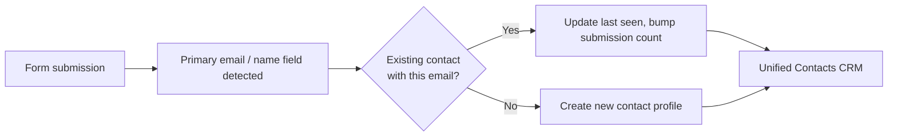

The **Contacts Directory** is a powerful, cross-form CRM that Flex Forms builds for you completely autonomously. 

Instead of treating every submission as an isolated event in a spreadsheet, Flex Forms intelligently scans incoming payload data, identifies the human identity behind the submission, and builds a rich, deduplicated profile mapping their entire lifecycle across all of your forms.

---

## How Contacts are Created

The directory is populated entirely without manual data entry. It operates on a strict, predictable trigger: **The Primary Email**.

When a form is submitted, the backend engine intercepts the payload before it is written to the database. If the form contains an [Email Block](/features/blocks/email) explicitly marked as **Primary** in the Inspector, the engine extracts that email to perform a CRM lookup.

<Steps>
  <Step title="Detection & Exact Matching">
    The engine queries the global Contacts Directory. If `sarah@enterprise.com` already exists in your CRM, the engine seamlessly connects this new submission to her existing profile, avoiding duplicate rows.
  </Step>
  <Step title="Profile Enrichment">
    If the form also contained a **Name** block (or Text input fields for first/last name), the engine can update the contact’s display name on the global profile.
  </Step>
  <Step title="Activity Tracking">
    The engine increments Sarah's total **Submission Count** and updates her **Last Seen** timestamp.
  </Step>
</Steps>

---

## The Contact Schema Architecture

When you open the Contacts Directory from the main navigation, you are presented with a high-level, sortable view of your most engaged leads. 

The schema for a Contact profile contains the following strictly managed fields:

<ParamField path="email" type="string" required>
  **The Identity Key (Email)**
  The absolute, unique identifier that binds their cross-form activity together. A single email can only exist once in the Contacts Directory.
</ParamField>

<ParamField path="name" type="string">
  **Enriched Name**
  Sourced automatically if a text block on your form successfully captured name data.
</ParamField>

<ParamField path="submissions_count" type="integer">
  **Engagement Metric**
  The total volume of submissions this specific person has made across your *entire* form ecosystem. 
  
  *(Example: If Sarah fills out your "Contact Us" form twice, and your "Webinar RSVP" form once, her count is 3).*
</ParamField>

<ParamField path="created_at" type="datetime">
  **Joined (First Seen)**
  The exact timestamp of their very first interaction with any of your forms.
</ParamField>

<ParamField path="updated_at" type="datetime">
  **Last Seen**
  The timestamp of their most recent form submission. Sort by this column to find your most currently active leads.
</ParamField>

---

## Technical Edge Cases & Data Hygiene

<Callout type="info">
  **The Form-vs-Person View:** If Sarah submits 3 different forms, she will appear as 3 separate rows in 3 separate *Submissions Inboxes*. However, in the *Contacts Directory*, she appears as a **single** consolidated row providing a bird's-eye view of her engagement.
</Callout>

**Data Deletion Disconnect:**
The Contacts Directory is a living ledger designed to track human identity, while Submissions are designed to track specific events. If you manually delete a spam row from a form's Submissions Inbox, it does **not** retroactively decrement the Submission Count on the Contact profile. The Contacts Directory represents a lifetime historical record of interaction that is immune to form-level data purging.

<Panel>
  **Next Steps:** [Exporting the CRM](/features/contacts/search-export) · [Configuring Primary Emails](/features/blocks/email)
</Panel>
