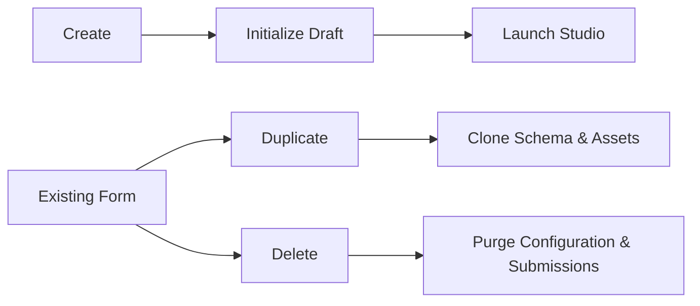

The **Forms Hub** provides robust lifecycle management. Every action is designed to protect your data while maximizing operational velocity.

---

## 1. Create a New Form

<Steps>
  <Step title="Initialize">
    Click **Create Form** in the top right of the Forms Hub (or from the Studio rail).
  </Step>
  <Step title="Define the Title">
    Enter a human-readable title (e.g., `Q3 Customer Feedback`). Flex Forms instantly generates a URL-safe slug from this title.
  </Step>
  <Step title="Enter the Studio">
    You are redirected into the visual Studio. The form is created in a **Draft (Unpublished)** state, guaranteeing no external traffic hits it prematurely.
  </Step>
</Steps>

Want a branching funnel, scored quiz, or lead qualifier? Follow the logic recipes: [PulseFit](/features/studio/logic/recipes/pulsefit) · [Harbor Quiz](/features/studio/logic/recipes/harbor-quiz) · [Apex Qualifier](/features/studio/logic/recipes/apex-qualifier).

---

## 2. Rename a Form

Renaming alters the internal display name and the default header shown to respondents. **It never alters the public URL slug**, ensuring your live links remain intact.

<Steps>
  <Step title="Edit the Name">
    Use the context menu in the Hub, or click the title directly in the Studio's top navigation bar.
  </Step>
  <Step title="Save Automatically">
    If editing in the Studio, the new title is captured during the next auto-save cycle.
  </Step>
</Steps>

---

## 3. Duplicate an Existing Form

Duplication is the ultimate growth hack. It allows you to clone complex architectures—perfect for A/B testing, seasonal campaigns, or multi-language deployments.

<Steps>
  <Step title="Trigger Duplication">
    Select **Duplicate** from the form's row menu in the Hub.
  </Step>
  <Step title="Deep Clone Architecture">
    Flex Forms clones the entire schema: Pages, Blocks, Logic Rules, Calculated Fields, and Settings.
  </Step>
  <Step title="Clone Design Assets">
    Uploaded logos and cover images are physically copied to new storage paths, preventing asset breakage if the original form is deleted.
  </Step>
  <Step title="Review the Draft">
    The cloned form is named `<Title> (copy)` and receives a unique slug. **It is always created as an unpublished Draft.**
  </Step>
</Steps>

<Warning>
  **Integration Feed Warning:** If the original form had active integrations (e.g., Zapier, Mailchimp), they are copied and enabled on the duplicate. Always review your feeds before publishing to prevent test submissions from polluting production systems.
</Warning>

---

## 4. Delete a Form

Deletion is absolute. It purges the configuration and cascades through your data.

<Steps>
  <Step title="Select Forms">
    Check the specific rows in the Hub and click **Delete** (or use the single-row action menu).
  </Step>
  <Step title="Acknowledge the Purge">
    Confirm the destruction dialog. Submissions specifically tied to this form are removed. There is no undo.
  </Step>
</Steps>

<AccordionGroup>
  <Accordion title="Does deletion wipe out my Contacts?">
    No. The respondents themselves are stored in the global **Contacts Directory**. Only the raw submissions linked to the deleted form are purged.
  </Accordion>
  <Accordion title="How can I pause a form instead of deleting it?">
    Simply click **Unpublish** in the Studio. The URL shows Flex Forms’ branded 404, but all data and configuration remain safely stored for future use.
  </Accordion>
</AccordionGroup>

<Panel>
  **Next Steps:** [Understand Fill Links & Slugs](/features/forms/fill-link) · [Enter the Studio](/features/studio/overview)
</Panel>
