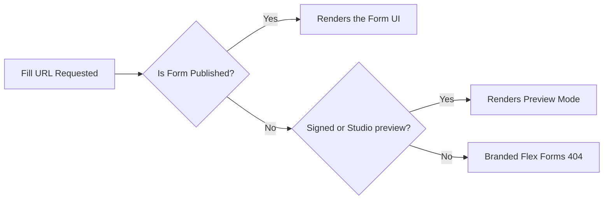

The **Fill Link** is the public-facing URL your respondents use to access your form. It is dynamically constructed from your global configuration, your form's specific slug, and its current publish state.

## URL Anatomy

```text
https://your-app.com/forms/contact-sales
                    └──┬─┘ └───┬───────┘
                     prefix   slug
```

<CardGroup cols={3}>
  <Card title="The Prefix" icon="folder-tree">
    Determined in **Global Settings**. (e.g., `/forms/`, `/s/`). Changes here affect *all* forms.
  </Card>
  <Card title="The Slug" icon="tag">
    Determined per form. Auto-generated from the title, but fully customizable in the Share settings.
  </Card>
  <Card title="The Gate" icon="lock">
    The URL only resolves to the form if it is actively **Published**. Drafts and unknown slugs show Flex Forms’ branded **404** page (HTTP 404) — not your Laravel app’s default error screen.
  </Card>
</CardGroup>

---

## Safe Slug Modification

You can customize a form's slug to match marketing campaigns or SEO requirements.

<Steps>
  <Step title="Access Share Settings">
    From the Forms Hub, click **Share** on your target form.
  </Step>
  <Step title="Edit the Slug">
    Locate the **Public URL Slug** field. You may use lowercase letters, numbers, and hyphens. Invalid characters are stripped automatically.
  </Step>
  <Step title="Save and Validate">
    Click **Update Slug**. Flex Forms automatically checks the database to ensure the slug is globally unique across your installation.
  </Step>
</Steps>

<Warning>
  **Breaking Change Alert:** Changing a slug instantly breaks all existing URLs. There are no automatic redirects. Update your external marketing links, QR codes, and embeds immediately after saving. The old slug is released back into the pool.
</Warning>

---

## The Publish State Gate



New forms and duplicated forms always start in a **Draft** (unpublished) state. 
- The standard Fill Link returns Flex Forms’ branded 404 page (status `404`) to external traffic — including wrong slugs and unpublished forms.
- You can safely review the form using the **Preview** button in the Studio (temporary signed URL — not a public `?preview=1` bypass).

When you click **Publish**, the gate opens and the slug becomes active.

---

## Link Distribution Channels

Once live, your Fill Link powers multiple distribution methods:

<AccordionGroup>
  <Accordion title="Direct URL Sharing">
    Copy the link and distribute it via SMS, email campaigns, or social media. Configure your Open Graph tags in the Share menu for beautiful link previews.
  </Accordion>
  <Accordion title="Web Embeds">
    Power Standard, Popup, or Full-Page embeds. The underlying Javascript securely loads the form via this specific slug. [Learn about Embeds](/features/share/embed-modes).
  </Accordion>
  <Accordion title="URL Prefilling (embed / popup only)">
    Pass dynamic data via query parameters on **embed** or **popup** URLs (e.g., `/forms/contact/embed?email=jane@co.com`). The plain fill link does not prefill. [Learn about Prefilling](/features/share/query-params).
  </Accordion>
</AccordionGroup>

<Panel>
  **Deep Dive:** [Managing Form Lifecycles](/features/forms/create-rename-duplicate) · [The Share Dashboard](/features/share/overview)
</Panel>
