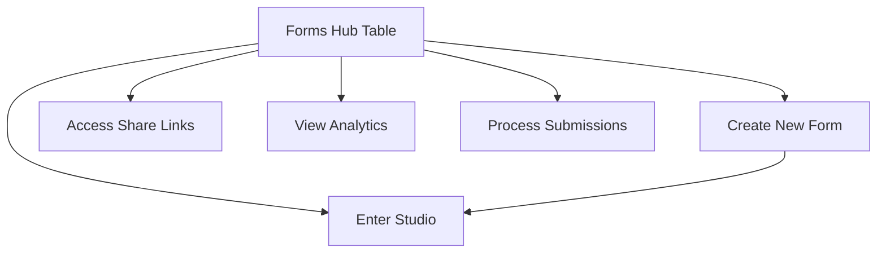

The **Forms Hub** is the nerve center of your Flex Forms ecosystem. It provides a bird's-eye view of every form in your workspace, allowing you to seamlessly manage lifecycles from a single table.

## Hub Capabilities

<CardGroup cols={2}>
  <Card title="Create New" icon="plus">
    Instantly spin up a new draft form and jump straight into the visual Studio.
  </Card>
  <Card title="Rename & Organize" icon="cursor-text">
    Update internal display titles without affecting your live production URLs.
  </Card>
  <Card title="Duplicate Schemas" icon="copy">
    Clone complex architectures (logic, blocks, and design) into a new slug for rapid A/B testing.
  </Card>
  <Card title="Publish & Unpublish" icon="globe">
    Take a draft live or pull a fill link offline from the row **⋯** menu — no need to open Studio.
  </Card>
  <Card title="Account menu" icon="user">
    Under Global Settings, open your avatar for **profile**, **log out**, and any Filament panel user-menu links your host app registered.
  </Card>
  <Card title="Manage Lifecycles" icon="trash-2">
    Safely delete obsolete forms. Flex Forms manages the underlying data cleanup according to your compliance rules.
  </Card>
</CardGroup>

---

## Architectural Workflow

<Steps>
  <Step title="Navigate to Forms">
    Locate **Forms** in your Filament sidebar under the Flex Forms navigation group.
  </Step>
  <Step title="Interact with the Fleet">
    Click a row to edit its schema in the Studio, or use the action buttons (Insights, Share, Submissions) to dive into the data.
  </Step>
  <Step title="Execute Actions">
    Use the context menu (three dots) on any row to Rename, Duplicate, or Delete that specific form.
  </Step>
</Steps>

---

## Mastering the Fill Link

Every form generates a unique, SEO-friendly **public slug**. Altering this slug breaks existing links, so plan your routing carefully. For a deep dive into URL architecture, review the [Fill Link & Slug documentation](/features/forms/fill-link).

<Panel>
  **Next Steps:** [Lifecycle Actions in Depth](/features/forms/create-rename-duplicate) · [Enter the Studio](/features/studio/overview)
</Panel>
