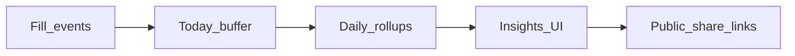

The **Insights Dashboard** is a built-in, real-time analytics suite. Instead of forcing you to export CSVs to third-party BI tools, Flex Forms automatically processes fill events, traffic volume, and abandonment rates into beautiful, presentation-ready visualizations.

---

## The Three Pillars of Insights

The dashboard is divided into three distinct panels, each answering a different strategic question about your form's performance.

<Tabs>
  <Tab title="Answers (What they said)">
    Provides visual distributions (bar charts, pie charts) for every individual question on your form. Essential for visualizing survey results or quiz scores at a glance.
  </Tab>
  <Tab title="Visits (Who they are)">
    Aggregates traffic volume, conversion rates, geographic origins, and device types. Crucial for understanding campaign performance.
  </Tab>
  <Tab title="Drop-offs (Where they left)">
    Generates a step-by-step funnel visualization, showing exactly which question caused respondents to abandon the form. Critical for optimizing completion rates.
  </Tab>
</Tabs>

---

## The Analytical Workflow

<Steps>
  <Step title="Access the Dashboard">
    From your Form Hub, click the **Insights** tab to load the real-time engine.
  </Step>
  <Step title="Define the Temporal Range">
    Use the Date Picker in the toolbar to isolate specific timeframes (e.g., *"Last 7 Days"*, or a custom range matching a specific marketing campaign).
  </Step>
  <Step title="Segment the Data">
    Apply [Live Filters](/features/insights/filters-live) to narrow the data down to a specific cohort (e.g., *"Show me only Mobile users from the United Kingdom"*).
  </Step>
  <Step title="Distribute Findings">
    Create a secure [Public Share Link](/features/insights/public-share) to distribute a read-only version of the dashboard to external clients or stakeholders.
  </Step>
</Steps>

---

## Enterprise-Grade Scaling

If you are running a high-traffic campaign (e.g., a viral giveaway or a global product launch), Flex Forms automatically leverages **Redis** to ensure the Insights dashboard remains perfectly responsive, even when thousands of users are submitting concurrently.

<Panel>
  **Deep Dives:** [Understanding the 3 Panels](/features/insights/answers-visits-dropoffs) · [Redis Scaling Architecture](/features/insights/redis-scaling)
</Panel>
