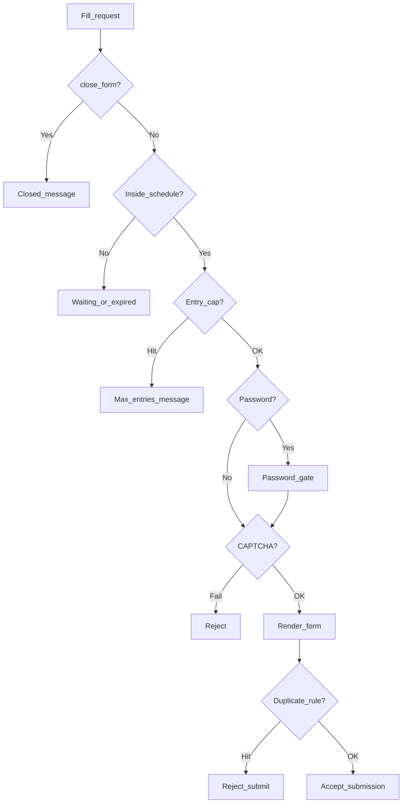

Open **Studio → Form settings (gear) → Access**. Gates are enforced server-side on fill — not only in the browser.

## Controls (1:1 with Settings UI)

### Password

<ParamField path="password_protect" type="toggle" default="false">
  Require a password before the schema is shown. Stored hashed — enter a new password only to replace an existing one.
</ParamField>

### CAPTCHA (one provider)

Visible only when [reCAPTCHA](/integrations/recaptcha) and/or [Turnstile](/integrations/turnstile) are connected under left-rail **Integrations**.

<ParamField path="captcha_provider" type="select" default="none">
  `none` | `recaptcha` | `turnstile`. Exactly **one** provider per form — never both. Not a Studio canvas block.
</ParamField>

### Close form

<ParamField path="close_form" type="toggle" default="false">
  Immediate kill switch — no new responses.
</ParamField>

### Max entries

<ParamField path="limit_submissions" type="toggle" default="false">
  Cap volume with `max_submissions` + frequency (total / day / week / month / per user options from the UI) and a custom `max_submissions_message`.
</ParamField>

### Scheduling

<ParamField path="form_scheduling" type="toggle" default="false">
  Timezone, weekday checkboxes, start/end datetimes, waiting message, expired message.
</ParamField>

### Closed message

<ParamField path="closed_form_message_enabled" type="toggle" default="false">
  Custom copy when the form is manually closed (separate from schedule / cap messages).
</ParamField>

### Duplicate prevention

<ParamField path="prevent_duplicate_submissions" type="toggle" default="false">
  Identify repeats by IP or by a chosen form field (e.g. primary email). Second submit is rejected server-side. Prefer a field (email) when possible. IP mode needs correct [trusted proxies](/get-started/installation#trusted-proxies-production) behind a CDN/load balancer; private/reserved IPs are ignored so a misconfigured proxy cannot lock the form for all visitors.
</ParamField>

<Panel>
  Guide: [Access gates](/guides/access-gates) · Integrations: [reCAPTCHA](/integrations/recaptcha) · [Turnstile](/integrations/turnstile)
</Panel>
