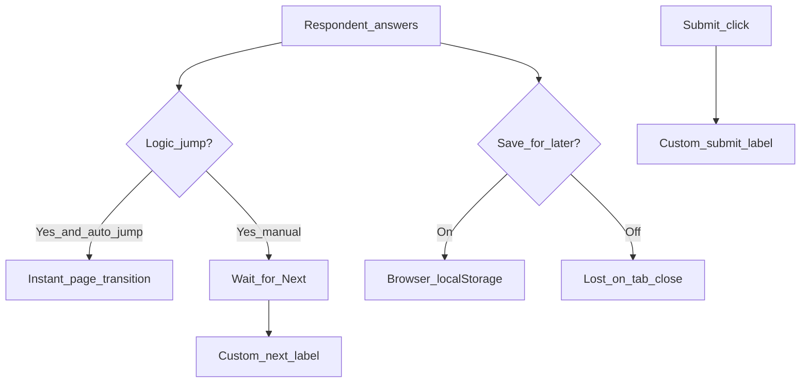

Open **Studio → Form settings (gear) → Behavior**. Save with the Settings bar when dirty.

## Controls (1:1 with Studio)

<ParamField path="auto_jump" type="toggle" default="false">
  When a [Logic Board](/features/studio/logic-board) rule jumps to another page, skip the manual **Next** click and transition immediately after the answer syncs. Best on single-question pages; on dense pages it can feel abrupt. **Next** and **Back** stay available as fallback; **Submit** still appears only on the last page.
</ParamField>

<ParamField path="save_answers_for_later" type="toggle" default="false">
  Writes progress to the respondent’s **browser `localStorage`**. Closing the tab and returning restores answers. Data never hits your server — for server-side abandoned leads use [Partial submissions](/features/settings/general).
</ParamField>

<ParamField path="submit_label" type="string" default="Submit">
  Final button label on the last page (e.g. `Get my quote`, `Register`). You can also edit it from the gear icon next to Submit on the builder canvas.
</ParamField>

<ParamField path="next_label" type="string" default="Next">
  Multi-page **Next** button label. Edit from Form Settings → Behavior or the gear icon beside Next on the canvas (when the form has more than one page).
</ParamField>

<ParamField path="back_label" type="string" default="Back">
  Multi-page **Back** button label. Same editing surfaces as Next.
</ParamField>

<Panel>
  Related: [Logic Board](/features/studio/logic-board) · [Partials guide](/guides/partials-save-later) · [General](/features/settings/general)
</Panel>
