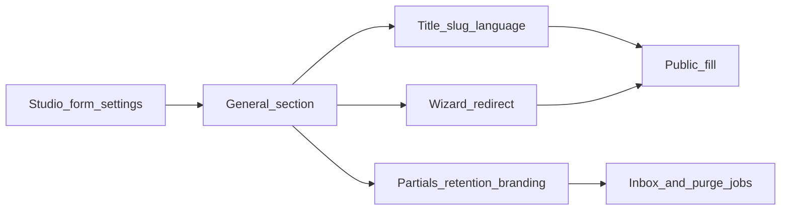

Open **Studio → Form settings (gear) → General**. Changes apply after you click **Save** in the modal footer.

## Identity & localization

<ParamField path="title" type="string" required>
  Form title — used as the public heading and in Studio lists.
</ParamField>

<ParamField path="slug" type="string" required>
  Public URL segment (e.g. `/forms/enterprise-contact`). Use **Update slug** to commit. Changing a live slug breaks existing links and embeds.
</ParamField>

<ParamField path="language" type="select" default="en">
  Fill UI language (Submit, errors, upload hints). Selecting Arabic or Hebrew also sets **text direction** to RTL automatically. Customize or add locales via [Localization & RTL](/get-started/languages-rtl).
</ParamField>

<ParamField path="text_direction" type="select" default="ltr">
  `ltr` or `rtl`. Shown when direction control is enabled for the form language set.
</ParamField>

---

## Redirect & wizard

<ParamField path="redirect_on_completion" type="toggle" default="false">
  When on, respondents leave the thank-you screen and hard-redirect to `redirect_url` after submit.
</ParamField>

<ParamField path="redirect_url" type="string">
  Destination URL when redirect is enabled.
</ParamField>

<ParamField path="wizard_stepper" type="select" default="tiles">
  Multi-page chrome (only when the form has **more than one page**):
  - `tiles` — discrete step tiles
  - `bar` — continuous progress bar through the wizard
  - `none` — hide the stepper

  With **Jump to page** / branching, both styles use the **visited path** for progress. In tiles mode, unvisited branch pages are hidden so respondents only see the path they are on. See [Wizard Stepper](/get-started/progress-bar-wizard).
</ParamField>

<ParamField path="wizard_stepper_color" type="string">
  Accent color for active wizard rails / bar when stepper is not `none`.
</ParamField>

---

## Partials, branding, retention, encryption

<ParamField path="partial_submissions" type="toggle" default="false">
  Persist incomplete answers server-side so abandoned fills appear in the Inbox. Distinct from [Save for later](/features/settings/behavior) (browser `localStorage` only).
</ParamField>

<ParamField path="encrypt_answers" type="toggle" default="false">
  Encrypts the full answer payload at rest (Laravel `Crypt` / your `APP_KEY`) — both `flex_form_submission_answers` rows **and** the submission `payload` JSON column. Use when the form collects sensitive data. Studio, exports, integrations, and notification emails still show decrypted values to authorized users / configured destinations.
</ParamField>

<Tip>
  Organization-wide policy: **Global Settings → Security → Require encryption on all forms**, or `FLEX_FORMS_FORCE_SUBMISSION_ENCRYPTION=true`. Either option locks this toggle on for every form — see [Multi-tenancy](/developers/multi-tenancy).
</Tip>

<ParamField path="show_branding" type="toggle" default="true">
  Show the “Powered by Flex Forms” footer on the public fill page. A Pro badge next to the label explains that hiding branding is available on **Pro** and above; otherwise the toggle stays locked on.
</ParamField>

<ParamField path="data_retention" type="toggle" default="false">
  Automatically purge submissions after a retention window.
</ParamField>

<ParamField path="data_retention_value" type="number" default="3">
  How long to keep submissions when retention is on (paired with `data_retention_unit`).
</ParamField>

<ParamField path="data_retention_unit" type="select" default="month">
  `day`, `week`, `month`, or `year`.
</ParamField>
