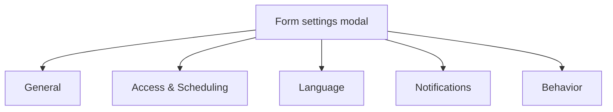

While the Studio canvas controls *what* data is collected, **Form Settings** control who can access the form, what happens after submit, and how the fill experience behaves.

Every form has its own settings. Configuring a locked internal request form never changes your public marketing surveys.

Open settings from the Studio gear icon (Form settings modal). Settings open in a **modal** with sections on the left: General, Access & Scheduling, Language, Notifications, and Behavior. There is no Settings tab on the form hub — hub tabs are Insights, Submissions, Share, and Integrations.

Third-party CRM and webhook feeds are **not** inside Settings — use the hub **Integrations** tab. See [Form-level integrations](/features/settings/integrations).

---

## Sections

<CardGroup cols={2}>
  <Card title="General Settings" icon="sliders-horizontal" href="/features/settings/general">
    URL slug, redirects, branding, and data retention.
  </Card>
  <Card title="Language" icon="languages" href="/features/settings/general">
    Fill UI language and text direction for respondents.
  </Card>
  <Card title="Behavior & UX" icon="workflow" href="/features/settings/behavior">
    Auto-jump, partials / save-for-later, and fill experience toggles.
  </Card>
  <Card title="Access & Security Gates" icon="lock" href="/features/settings/access">
    Passwords, entry caps, schedules, duplicate prevention, and CAPTCHA.
  </Card>
  <Card title="Automated Emails & PDFs" icon="mail" href="/features/settings/emails-pdf">
    Respondent receipts and team alerts, with optional PDF attachments.
  </Card>
  <Card title="Integrations (hub tab)" icon="plug" href="/features/settings/integrations">
    Mailchimp, HubSpot, Zapier, webhooks, and conditional feeds — configured on the form hub Integrations tab.
  </Card>
</CardGroup>

<Callout type="info">
  **Save explicitly:** Form Settings use **Save** in the modal footer when something is dirty. Studio canvas autosave is separate — changing Settings does not apply until you save.
</Callout>

<Panel>
  **Next:** [General Settings](/features/settings/general) · [Access](/features/settings/access) · [Integrations](/features/settings/integrations)
</Panel>
