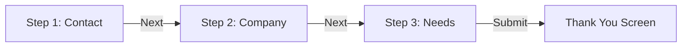

The Studio Canvas is highly reactive. It allows you to rapidly restructure the flow of your data collection by dragging blocks and splitting long forms into intelligent, multi-page wizards.

## Working with Blocks

<Steps>
  <Step title="Insert Blocks">
    Click a block in the catalog to append it to the end of the current page, or drag it directly to a specific position on the canvas.
  </Step>
  <Step title="Reorder">
    Hover over any block on the canvas to reveal its drag handle (the grip icon). Click, hold, and drag to reposition it.
  </Step>
  <Step title="Cross-Page Movement">
    You can drag a block from one page and drop it into the canvas area of a completely different page.
  </Step>
</Steps>

---

## Mastering Pagination

A form always begins as a single page (`Step 1`). For extensive data collection, splitting the form across multiple pages drastically improves completion rates.

<Steps>
  <Step title="Append a Page">
    Scroll to the bottom of your canvas and click the **Add Page** button.
  </Step>
  <Step title="Configure Page Metadata">
    Click the gear icon on the new page's header. Here, you can define a custom Title (which appears in the progress stepper) and select an Icon.
  </Step>
  <Step title="Reorganize Pages">
    Once you have multiple pages, you can reorder them by dragging the page header's grip handle.
  </Step>
</Steps>

<Callout type="info">
  **Capacity Limits:** By default, forms are limited to a maximum of 10 pages to ensure optimal frontend performance. This limit can be overridden by your developers in `config/filament-flex-forms.php`.
</Callout>

---

## Configuring the Progress Stepper

When utilizing multiple pages, you must configure how progress is communicated to the respondent. Navigate to **Form Settings → General** to select a Stepper Style:

| Stepper Style | Visual Experience |
|---------------|-------------------|
| **Tiles + Labels** | Richer navigation. Displays numbered tiles, custom titles, and icons across the top of the form. |
| **Progress Bar Only** | Minimalist. A sleek horizontal bar that advances mathematically with each page turn. |
| **Silent (No Stepper)** | The form advances pages without any visual progress indicator. |

<Tip>
  You can define a specific **Wizard Primary Color** for the active step, entirely independent of your form's global brand color.
</Tip>

---

## Logic & Structural Integrity

<AccordionGroup>
  <Accordion title="Does reordering pages break my Logic Rules?">
    No. The Flex Forms Logic Engine references pages via stable, internal cryptographic IDs—not their sequential position. You can safely drag Page 4 to become Page 2 without breaking your "Jump to Page" rules.
  </Accordion>
  <Accordion title="What happens if I delete a page targeted by a Logic Rule?">
    The Logic Board acts defensively. If it detects a missing target, it flags the broken rule with a warning ("This page was deleted — pick another page") preventing you from publishing a broken flow.
  </Accordion>
</AccordionGroup>

<Panel>
  **Next Steps:** [Field Configuration Panel](/features/studio/field-settings) · [Mastering the Logic Board](/features/studio/logic-board)
</Panel>
