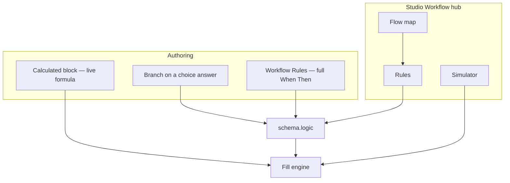

Every Flex Forms rule is one sentence:

**When** something is true about an answer → **Then** do something.

In Studio you author that sentence in two complementary surfaces — not three competing entry points.

---

## Decision guide — where should this live?

| You want to… | Put it here |
|--------------|-------------|
| Per answer: show follow-ups and/or go to a page | **Branch** on that choice field (+ **Otherwise** for the default path) |
| Jumps, hide Submit, complex When groups, multi-action rules | **Workflow → Rules** |
| See pages, jumps, and terminal steps | **Workflow → Flow** |
| Dry-run a path with mock answers | **Workflow → Simulator** |
| A live total / score / glued text | [Calculated](/features/studio/calculated-fields) from the Logic catalog |

<Warning>
  **If / Else canvas cards are removed from the catalog.**  
  Existing forms still load — Studio migrates those rules into **Rules** automatically. Prefer **Branch** or **Rules** for new work. See [If / Else (deprecated)](/features/studio/logic/if-else-block).
</Warning>

---

## Branch (fast path)

On a **choice** question, open **Branch** from the field chrome workflow icon (not by selecting the field alone). For each option:

1. **Show follow-up** — pick field(s) to reveal (complementary hide is compiled automatically).  
2. **Go to page** — jump destination.  
3. **Otherwise** — default path when no option row matched (continue to next page, or jump elsewhere).

On a **non-choice** field (text, number, …), use the same chrome icon (**Show if…**) to pick a source field + operator + value — Studio compiles a Show rule for that target (inverted attachment). Switch to full **When → Then** with **Edit as When → Then** when you need more than a single show condition.

When a field already has advanced Rules Studio cannot represent as simple Branch rows, Branch shows a note with **Open Rules**.

Details: [Field conditions / Branch](/features/studio/logic/field-conditions).

---

## Rules · Flow · Simulator

Open **Workflow** from the Studio center top bar (or ⌘/Ctrl+Shift+L). Inside the hub:

| Surface | Purpose |
|---------|---------|
| **Flow** | Pages as nodes; zoom/pan; solid edges = jumps; dashed = default next; soft outline = page reached only by linear Next (informational); red edge = cycle; **Terminal** badge. Use **Highlight on Flow** from Simulator to show visited pages. |
| **Rules** | Full When → Then editor for form-level and field-anchored rules (optional rule titles) |
| **Simulator** | Mock answers → path with jump reasons, then Field state / Branches; scenarios auto-run on load. File / signature-style fields mock as empty or filled for presence operators. |

**Flow health** sits on the right of the Workflow header (conflict count + tooltip). **Critical** issues — jump cycles, incomplete jump targets, unreachable non-terminals, no reachable terminal — **block Publish**. **Warnings** (unreachable terminals that Fill cannot reach, dual-write calculate/set_value, …) require an explicit acknowledge before Publish continues. Pages reached only by linear **Next** from a non-terminal page (typical quiz spine) are normal and do **not** warn on Publish. The Flow map may still outline pages without an inbound jump for editing clarity — that outline alone is not a publish gate.
Full walkthrough: [The Logic Board](/features/studio/logic-board).

---

## Anatomy of a rule (When → Then)

### When (conditions)

1. Pick a **source field** (what the respondent answered).
2. Pick an **[operator](/features/studio/logic/operators/overview)** (equals, contains, is empty, equals set, …).
3. Pick a **value** — type a literal, use a choice chip, or pick another **input field** (live compare).
4. Combine clauses with **All** (AND) or **Any** (OR). Nest groups for `(A AND B) OR C`.

Studio **only shows operators that fit the field type**.

### Then (actions)

Stack one or more [actions](/features/studio/logic/actions/overview): Show / Hide, Require / Optional, Disable / Enable, Set / Clear value, [Jump to page](/features/studio/logic/actions/jump-to-page), Calculate, Hide submit.

---

## First rule in Studio (5 minutes)

<Steps>
  <Step title="Add the fields you will branch on">
    Example: a **Multiple choice** “Plan” with Free / Pro, plus a **Short text** “VAT number” that should appear only for Pro.
  </Step>
  <Step title="Open Branch on Plan">
    Select **Plan** → set **Branch** for Pro: **Show follow-up** → VAT number. Optionally require VAT from **Rules** if you need mandatory follow-up.
  </Step>
  <Step title="Or build advanced When → Then">
    Hover **Plan** → **Add condition**, or open **Logic** → **Rules**, and set **When** Plan **equals** `Pro` → **Then** Show + Require VAT.
  </Step>
  <Step title="Preview / Simulator">
    Use **Simulator** or Preview. Choose Free → VAT stays hidden. Choose Pro → VAT appears. Change back to Free → VAT hides and its answer is cleared.
  </Step>
</Steps>

---

## Evaluation order (who wins)

On every answer change, fill recomputes on the **server** (Livewire):

1. **Rules** in evaluation order (form-level and field-anchored), top → bottom  
2. **Calculated** Always → Calculate rules in canvas order  
3. **Hidden fields forced not required**  
4. **Hidden answers cleared** so stale data never submits  

If two matching rules fight over the same target, the **later** matching rule wins. Conflict chips flag Show ↔ Hide fights — treat them as release blockers.

---

## Path validation & terminal pages

Multi-page forms track the **visited path**. Submit validates required fields on pages the respondent actually reached — not every page in the form.

Mark **terminal** pages (submit steps) so Map / flow health know where paths should end. Critical health issues block Publish until fixed.

**Warnings** (unreachable terminal pages Fill cannot reach — for example a Fail page after a terminal Pass with no jump to Fail — plus calculate / set-value dual-writes) appear in the Logic health strip. They do **not** hard-block Publish by themselves, but Studio **requires an explicit acknowledge** (confirm) before Publish continues when warnings are present. Criticals must be fixed first. Linear multi-step pages after a non-terminal page do not trigger a Publish confirm.

---

## Cascade scrub (delete safety)

When you **delete a field, page, or choice option**, Studio automatically cleans logic that referenced it (When clauses, Then targets, jump page ids).

You get a **success toast** with how many references were scrubbed (for example “Cleaned 3 logic reference(s) after the change.”). If nothing referenced the deleted item, Studio stays quiet — no orphan jumps left behind.

---

## Blank answers (the #1 source of “my rule never fires”)

| Situation | Result |
|-----------|--------|
| Field not answered yet (`null`, `""`, empty list) | Most operators **do not match** |
| You need “they skipped it” | Use **[Is empty](/features/studio/logic/operators/empty)** |
| You need “they answered something” | Use **[Is not empty](/features/studio/logic/operators/not_empty)** |
| “Not equals Free” on a blank Plan | **Stays false** until they answer — intentional |
| Value set to another field on a later page | Stays blank until that page is reached |

<Note>
  **Is empty** and **Is not empty** are the only operators meant for unanswered fields. Everything else assumes there is something to compare.
</Note>

---

## Compare to another answer

In the **Value** control, type a fixed value **or** pick an **input field**. The clause compares the source field to **whatever the respondent typed in that other field** (live).

If the referenced field is blank, operators that need a value **fail-closed** (clause false).

---

## Calculated vs Calculate action

| Tool | What it is |
|------|------------|
| **Calculated** block | Canvas field that never asks a question; ships with **Always → Calculate** |
| **Then → Calculate** | Same formula engine, attached to any rule (conditional formulas) |

Tokens use **`{blockId}`** — pick fields from **Value** / Formula inserter. Blank number tokens make the **whole numeric result empty**. Details: [Calculated fields](/features/studio/calculated-fields) · [Calculate action](/features/studio/logic/actions/calculate).

---

## Troubleshooting checklist

<AccordionGroup>
  <Accordion title="Rule never fires">
    Check: Is the source field answered? Wrong operator for blanks? Wrong page (later-page answers are empty early)? Rule disabled? Operator not allowed for that field type?
  </Accordion>
  <Accordion title="Show and Hide fight">
    Open **Rules** diagnostics / conflict chips. Reorder rules or narrow When so only one path matches. Later matching rule wins.
  </Accordion>
  <Accordion title="Required field still blocks submit while hidden">
    Hidden fields are forced not required. If submit still fails, another **visible** required field on the visited path is empty.
  </Accordion>
  <Accordion title="Calculate shows blank">
    A token is blank or non-numeric; wrong block id; result type is text but you expected math; division by zero.
  </Accordion>
  <Accordion title="Jump does nothing">
    Target page deleted (should scrub automatically); When not matching yet; another later jump overrides. With **[auto-jump](/features/settings/behavior)** on, any matching Jump advances the page as soon as answers match.
  </Accordion>
  <Accordion title="Publish blocked">
    Fix **flow health** criticals on Map / Rules (cycles, incomplete jumps, no reachable terminal).
  </Accordion>
</AccordionGroup>

---

## Deep dives

| Topic | Page |
|-------|------|
| Rules / Flow / Simulator UI | [Logic Board](/features/studio/logic-board) |
| Branch + Add condition | [Field conditions](/features/studio/logic/field-conditions) |
| Deprecated If / Else card | [If / Else (deprecated)](/features/studio/logic/if-else-block) |
| Live formulas | [Calculated fields](/features/studio/calculated-fields) |
| Every When operator | [Operators](/features/studio/logic/operators/overview) |
| Every Then action | [Actions](/features/studio/logic/actions/overview) |
| Recipes | [Logic & calculated guide](/guides/logic-and-calculated) · [Quiz recipe](/guides/quiz-recipe) |
| Logic recipes | [PulseFit Plan](/features/studio/logic/recipes/pulsefit) · [Harbor Quiz](/features/studio/logic/recipes/harbor-quiz) · [Apex Qualifier](/features/studio/logic/recipes/apex-qualifier) |

<Panel>
  Start building: [Branch / field conditions](/features/studio/logic/field-conditions) · [Workflow → Rules](/features/studio/logic-board) · [Calculated fields](/features/studio/calculated-fields)
</Panel>
