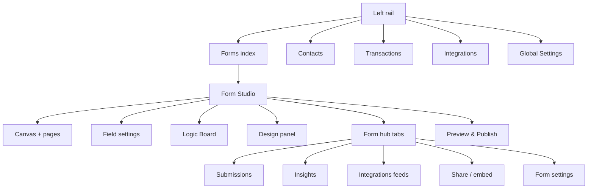

The **Studio** is the visual builder where you design forms, brand them, attach logic, publish live schemas, and manage submissions / Insights / integrations without writing React.

This page is the orientation map. Use the deep links when you need the full how-to.

## What Studio is made of

| Surface | Job |
|---------|-----|
| **Left rail** | Jump between Forms, Contacts, Transactions, Integrations, Global Settings, and your Filament account menu |
| **Canvas** | Drag blocks, order fields, multi-page flows |
| **Field settings** | Per-block name, label, validation, type options (left dock) |
| **Logic Board** | Show / hide / require / jump / calculate from answers |
| **Design** | Branding, layout, logo, cover, custom CSS |
| **Form hub** | Submissions, Insights, Integrations, and Share for the open form. Form settings open from Studio as a modal. |
| **Preview & Publish** | Test the draft; push the live public schema |

---

## Left rail (installation-wide)

| Item | Purpose | Docs |
|------|---------|------|
| **Forms** | Create, open, publish/unpublish forms | This page · [Preview & Publish](/features/studio/preview-publish) |
| **Contacts** | People resolved from submissions | [Contacts](/features/contacts/overview) |
| **Transactions** | Stripe payment ledger | [Transactions](/features/transactions/overview) |
| **Integrations** | Catalog + Connections (not Global Settings) | [Integrations overview](/integrations/overview) |
| **Global Settings** | Appearance, mail logo, security, license, public URLs, Insights Redis | [Global Settings](/get-started/global-settings) |
| **Account menu** | Profile / logout / host panel user-menu items | [Config → Studio account menu](/developers/config-env#studio-account-menu) |

---

## Inside a form: builder vs hub

### Builder panels

<CardGroup cols={2}>
  <Card title="Component catalog" icon="blocks" href="/features/blocks/overview">
    40+ blocks — identity, choices, media, Stripe Payment, and more. CAPTCHA is configured under Form Settings → Access, not as a canvas block.
  </Card>
  <Card title="Canvas & pages" icon="layout-template" href="/features/studio/dnd-pages">
    Drag-and-drop reorder, multi-page steppers, page breaks.
  </Card>
  <Card title="Field settings" icon="sliders" href="/features/studio/field-settings">
    Internal **Name** (integrations / prefills), public **Label**, validation, help text, type-specific options.
  </Card>
  <Card title="Logic Board" icon="git-branch" href="/features/studio/logic-board">
    Conditions, operators, and actions — show/hide, require, jump, calculate, hide submit. See [Logic overview](/features/studio/logic/overview).
  </Card>
  <Card title="Calculated fields" icon="calculator" href="/features/studio/calculated-fields">
    Spreadsheet-style formulas for scores and pricing totals.
  </Card>
  <Card title="Design" icon="palette" href="/features/studio/customize">
    Colors, typography, logos, layout, cover, custom CSS on every plan.
  </Card>
  <Card title="Thank-you" icon="party-popper" href="/features/studio/thank-you">
    Success screen after submit (message, redirect, extras).
  </Card>
  <Card title="Preview & Publish" icon="rocket" href="/features/studio/preview-publish">
    Preview the draft; Publish pushes the live fill URL. Unpublish takes it offline.
  </Card>
</CardGroup>

### Form hub tabs (same form, ops side)

Once a form exists, the hub sits alongside the builder:

| Hub tab | What you do there |
|---------|-------------------|
| **Submissions** | Browse answers, open a record, replay failed integration deliveries |
| **Insights** | Funnels, uniques, geo, share links |
| **Integrations** | Enable feeds, pick Connections, map fields |
| **Share** | Public URL, embed snippets, access gates |
| **Settings** | General, emails/PDF, access, notifications, and more — [Form settings](/features/settings/overview) |

---

## The build cycle

<Steps>
  <Step title="Create or open a form">
    Left rail → Forms → New, or open an existing form into Studio.
  </Step>
  <Step title="Construct">
    Drag blocks from the catalog onto the canvas. Prefer specific blocks (Email, Phone, Currency) over generic text.
  </Step>
  <Step title="Configure">
    Click a field → set **Name**, **Label**, validation. Integrations and query prefills use the internal Name — see [Name & label](/get-started/name-label-fields).
  </Step>
  <Step title="Organize (multi-page)">
    Split long flows into pages. [Drag & Drop Pages](/features/studio/dnd-pages) · [Multi-page guide](/guides/multi-page-stepper).
  </Step>
  <Step title="Inject logic & calculations">
    Logic Board for branching; calculated fields for scores. [Logic & calculations guide](/guides/logic-and-calculated).
  </Step>
  <Step title="Brand">
    Design panel for identity. [Design guide](/guides/design-pro).
  </Step>
  <Step title="Wire ops">
    Hub → Settings (emails, access), Integrations (feeds), Share (URL / embed).
  </Step>
  <Step title="Preview & Publish">
    Preview the draft, then **Publish** so the public fill URL receives the new schema.
  </Step>
</Steps>

<Tip>
  **Autosave vs Publish:** Studio saves the draft continuously. Respondents only see the schema after **Publish** (top bar or Forms index **⋯**). Unpublish takes the public link offline — details in [Preview & Publish](/features/studio/preview-publish).
</Tip>

---

## Logic at a glance

| Topic | Link |
|-------|------|
| Logic Board UI | [Logic Board](/features/studio/logic-board) |
| Conditions model | [Logic overview](/features/studio/logic/overview) |
| Field conditions | [Field conditions](/features/studio/logic/field-conditions) |
| If / else block | [If-else block](/features/studio/logic/if-else-block) |
| Operators | [Operators overview](/features/studio/logic/operators/overview) |
| Actions | [Actions overview](/features/studio/logic/actions/overview) |

---

## Troubleshooting

<AccordionGroup>
  <Accordion title="I see a License Error while saving">
    Studio requires a valid runtime license bound to the current hostname. See [Activate License](/get-started/activate-license).
  </Accordion>
  <Accordion title="My changes aren't showing on the live form">
    You edited the draft. Click **Publish** to push the live schema.
  </Accordion>
  <Accordion title="Integrations fields are empty / wrong account">
    Pick the correct **Connection** on the form feed, or wait for remote catalog sync. See [Integrations overview](/integrations/overview).
  </Accordion>
  <Accordion title="CAPTCHA / Map / Stripe missing">
    Enable the provider under Integrations → Catalog first (reCAPTCHA, Turnstile, Mapbox, Stripe). They are not canvas “integration feeds”.
  </Accordion>
</AccordionGroup>

<Panel>
  **Deep dives:** [Blocks catalog](/features/blocks/overview) · [Multi-page](/guides/multi-page-stepper) · [Logic & calculations](/guides/logic-and-calculated) · [Design](/guides/design-pro) · [Product walkthrough](/resources/product-walkthrough)
</Panel>
