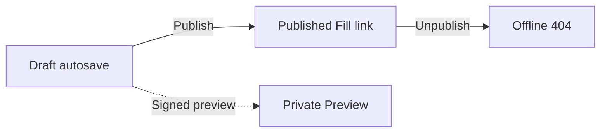

Flex Forms separates **editing a draft** from **releasing a live schema**. Studio autosaves your draft continuously. **Publish** copies that draft to the published snapshot respondents see on the public Fill link.

## The Autosave Engine

In the top navigation bar, a subtle indicator reads **Saving…** or **Saved**. There is no manual 'Save' button in Flex Forms.

Every structural modification, settings tweak, or design update is saved to the **draft** schema. Your work is never lost — and drafts do **not** change what public respondents see until you Publish again.

<Callout type="info">
  **Draft vs published:** Autosave writes the draft. Public Fill and embeds read the **published** schema. When they differ, Studio shows an **Unpublished changes** chip next to Publish.
</Callout>

---

## Private Previews

Click the **Preview** button to launch the form in a new tab as it exists in the **draft**.

<Steps>
  <Step title="Secure Token">
    Studio opens a **temporary signed** preview URL (`preview=1` plus a signature). Only that link — or a signed-in Studio user with view access — can open unpublished drafts. A bare `?preview=1` without a valid signature does **not** unlock drafts.
  </Step>
  <Step title="Draft accuracy">
    Preview always reflects the latest autosaved **draft**, including edits not yet published.
  </Step>
  <Step title="Safe Functional Testing">
    Preview mode is a fully functional UI for testing multi-page flows, Logic, and payment fields. **Submissions are not saved**, and **Stripe payments are not confirmed or recorded** in preview — Publish the form to collect real responses and transactions.
  </Step>
</Steps>

---

## Production Publishing

Clicking **Publish**:

1. Saves the current draft (if needed)
2. Checks [Flow health](/features/studio/logic-board) (criticals block; warnings need acknowledge)
3. Copies the draft → **published** schema and sets the form live (`is_active`)

You can publish or unpublish from:

- The **Publish** button in Studio (top bar)
- The **⋯** menu on the [Forms](/features/forms/overview) index (`/admin/flex-forms`) — **Publish** for drafts, **Unpublish** for live forms

**Flow health:** Critical Workflow issues (jump cycles, incomplete jumps, unreachable non-terminals, no reachable terminal) **block Publish** until fixed. Warnings appear on the Workflow **Rules** surface and **require an explicit acknowledge** (confirm) before Publish continues — criticals must be clear first.

<Warning>
  Editing a live form no longer hot-deploys mid-edit. Respondents keep seeing the last **published** schema until you click **Publish** again.
</Warning>

---

## Form Unpublishing

Unpublishing is an instant, non-destructive kill switch. Accessible from the form’s **⋯** menu on the Forms index (or Studio publish controls), it immediately takes the Fill Link offline. Visitors see Flex Forms’ branded **404** page (HTTP 404) instead of the form.

- **Data Integrity:** Unpublishing **does not** delete your draft, last published schema, logic, submissions, or historical insights.
- **Resumption:** Publish again to restore the Fill link using the latest draft → published copy.

<AccordionGroup>
  <Accordion title="If everything autosaves, what does Publish actually do?">
    Autosave stores the draft. Publish copies that draft into the published snapshot and flips `is_active` so the public Fill link serves it. Until then, public traffic keeps the previous published schema (or a 404 if never published / unpublished).
  </Accordion>
  <Accordion title="Why am I getting a License Error when saving?">
    The Studio's autosave engine requires a cryptographically valid license check against your current hostname. If your domain is not authorized in the [License Portal](https://license.bjanczak.com/flex-forms/panel), the save will be rejected.
  </Accordion>
</AccordionGroup>

<Panel>
  **Related Architecture:** [Fill Link & URL Routing](/features/forms/fill-link) · [Embed Distributions](/features/share/overview)
</Panel>
