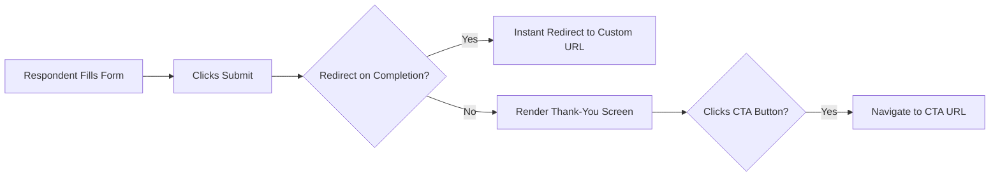

The Thank-You Screen is the final touchpoint in the data collection journey. It is your opportunity to confirm success, set expectations, and drive respondents to the next step in your funnel.

## Designing the Screen

To edit the success screen, click the **Thank you** toggle in the Studio's top navigation bar. The canvas instantly swaps from the block builder to the post-submission editor. 
Click on the Thank-You message to open the Inspector panel on the left.

### Text Configuration

<ParamField path="headline" type="string" required>
  **Headline**
  Customize the primary title. Move beyond a generic "Thank you!" to something on-brand, like *"Your application is under review"* or *"You're on the exclusive list!"*
</ParamField>

<ParamField path="sub_message" type="textarea">
  **Sub Message**
  Use the sub-message area to inform respondents of exactly what happens next (e.g., *"Our enterprise sales team will contact you within 24 hours at the email provided."*).
</ParamField>

### Call-To-Action (CTA) Button

<ParamField path="cta_label" type="string">
  **CTA Label**
  The text displayed on the button (e.g., *"Download PDF"*). Leave this field completely blank to remove the button from the Thank-You screen entirely.
</ParamField>

<ParamField path="cta_url" type="string">
  **CTA URL**
  The destination URL where the respondent is directed when they click the button. Ensure you include the full protocol (e.g., `https://example.com`).
</ParamField>

---

## Routing & Redirection Rules

Understanding exactly what happens when the user clicks 'Submit' is critical for building enterprise flows.

<Warning>
  **The Hard Redirect Override:** If you enable **Redirect on completion** inside your [General Settings](/features/settings/general), the respondent is instantly routed to that URL upon submission. The Thank-You screen will **never** be shown. These two features are mutually exclusive.
</Warning>

---

## Frequently Asked Questions

<AccordionGroup>
  <Accordion title="Can the Thank-You screen display a respondent's calculated score?">
    Not out-of-the-box via dynamic text. However, a powerful workaround is to use a Hard Redirect to pass the submission ID to your own application via query parameters, where you can fetch the data (via Webhook) and render a highly personalized results page.
  </Accordion>
  <Accordion title="Will partial or abandoned submissions trigger the Thank-You screen?">
    No. The screen is strictly gated behind a successful, fully validated submission. Partial submissions are saved silently in the background (if enabled in [Behavior Settings](/features/settings/behavior)).
  </Accordion>
  <Accordion title="Does my custom branding apply to this screen?">
    Absolutely. The Thank-You screen automatically inherits your exact typography, background colors, and button styling defined in the [Design panel](/features/studio/customize).
  </Accordion>
</AccordionGroup>

<Panel>
  **Next Steps:** [General Settings & Redirects](/features/settings/general) · [Previewing Your Flow](/features/studio/preview-publish)
</Panel>
