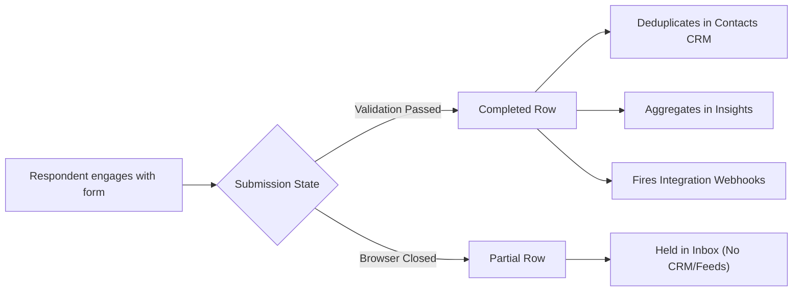

The **Submissions Inbox** is the uncompromised source of truth for your data collection. Every time a respondent engages with your form—whether they successfully complete it or abandon it halfway—their data is instantly and securely routed here. 

From the Inbox, raw data automatically flows downstream into your unified Contacts Directory, the Insights Dashboard, and your third-party integrations (like Salesforce or Webhooks).

---

## Navigating the Inbox Interface

The Submissions interface is designed as a high-performance data grid, allowing you to quickly scan, filter, and act on thousands of rows without crashing your browser.

<Steps>
  <Step title="Access the Global Inbox">
    From the main Form Hub dashboard, click on **Submissions** in the side navigation. This opens the real-time data table.
  </Step>
  <Step title="Browse the Data Architecture">
    - **Rows:** Each horizontal row represents a single respondent's isolated journey. 
    - **Columns:** The columns represent the exact blocks you placed on the Canvas (in their exact order). The newest submissions always cascade to the top.
  </Step>
  <Step title="Filter by Validation Status">
    Use the built-in tab filters at the top of the table to instantly pivot your view:
    - **All:** Displays every piece of data captured.
    - **Completed:** Only displays submissions that successfully passed all validation rules and hit the Thank-You screen.
    - **Partial (Abandoned):** Displays data captured keystroke-by-keystroke from users who closed the tab before finishing (Requires enabling *Partial Submissions* in [General Settings](/features/settings/general)).
  </Step>
</Steps>

---

## Enterprise Data Management

<ParamField path="schema_resilience" type="architecture">
  **Schema Resilience (Data Preservation)**
  One of the most powerful enterprise features of Flex Forms is absolute schema resilience. 
  
  If you delete a block from the Studio Canvas (e.g., you remove a *"Company Name"* question because you no longer need it), **you do not lose historical data**. 
  
  The Submissions Inbox will retain the deleted column for older entries, visually marking it as **(Unpublished)**. New submissions simply won't have that column filled, ensuring your historical data remains perfectly intact regardless of how radically your form evolves over time.
</ParamField>

<ParamField path="integration_deliveries" type="observability">
  **Integration deliveries**
  Open a submission row to see outbound CRM / webhook attempts (succeeded, failed, skipped). Failed deliveries expose a **Replay** action so you can re-queue the job without digging through Laravel `failed_jobs`.
</ParamField>

<ParamField path="csv_export" type="action">
  **Export to CSV**
  Click the **Export** button to generate a pristine, spreadsheet-ready CSV file of your current view. 
  
  *Crucial detail: The export engine respects your current filters. If you are viewing the "Partial" tab, clicking Export will strictly download the partial submissions, allowing for highly targeted data extraction.*
</ParamField>

<ParamField path="row_deletion" type="action">
  **GDPR Manual Deletion**
  You have full sovereign control over your data lifecycle. To adhere to Right-to-be-Forgotten requests or to simply clean up your own testing data, you can permanently delete rows.
  
  <Warning>
    **Irreversible Deletion:** Selecting rows and clicking the red "Delete" button purges them from the database instantaneously and permanently. There is no trash can. If you need a backup, ensure you **Export to CSV** before executing a bulk deletion.
  </Warning>
</ParamField>

---

<CardGroup cols={2}>
  <Card title="Exporting Data" icon="download" href="/features/submissions/export-csv">
    Deep-dive into CSV encoding and Tableau readiness.
  </Card>
  <Card title="The Contacts Directory" icon="users" href="/features/contacts/overview">
    See how completed submissions automatically build a deduplicated CRM.
  </Card>
  <Card title="Insights Dashboard" icon="chart-column" href="/features/insights/overview">
    Visualize submission trends and conversion drop-offs.
  </Card>
  <Card title="Form Settings" icon="sliders" href="/features/settings/general">
    Learn how to enable Partial Submission capturing.
  </Card>
</CardGroup>
