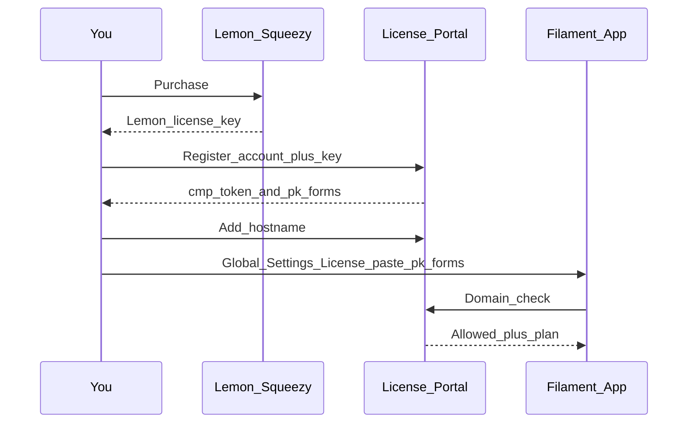

Activating Flex Forms is the step that turns a successful [Installation](/get-started/installation) into a working Studio. Until activation is complete, you can still open **Global Settings** and manage configuration — but saving forms, publishing, and accepting new public submissions stay locked.

This guide walks through every piece of the activation story in detail: where to paste the key in Filament, what never belongs in that field, how the [License Portal](/plans/license-portal) ties Lemon Squeezy to your hostnames, the [Setup Wizard](/get-started/setup-wizard) shortcut, seat limits by [plan](/plans/overview), what breaks without a valid license, and a long troubleshooting section for the issues teams hit most often.

<Banner>
  Do **not** paste your Lemon Squeezy license key or your Composer token (`cmp_…`) into Filament. Only the **Public API key** (`pk_forms_…`) belongs in **Global Settings → License → License public key**.
</Banner>

---

## What “activated” means

Flex Forms treats an install as activated when **both** of the following are true:

1. A valid **Public API key** (`pk_forms_…`) is saved in Filament under **Global Settings → License**.
2. The **exact hostname** in the browser address bar (the host staff open to use Studio) is registered on your account in the [License Portal](https://license.bjanczak.com/flex-forms/panel).

Missing either piece keeps Studio locked. A correct key on the wrong host (or a correct host with the wrong credential type pasted into the field) fails the same way — so treat key paste and domain registration as one checklist, not two optional extras.

You need credentials from the License Portal after purchase:

| Credential | Looks like | Used for |
|------------|------------|----------|
| Lemon Squeezy license key | From checkout / My Orders | Portal **registration** only (email + password + this key) — never Filament |
| Composer token | `cmp_…` | **Generated by the portal** — private package downloads only |
| Public API key | `pk_forms_…` | **Generated by the portal** — unlock Studio in Filament |
| Registered hostnames | Exact DNS names | Seat-based allowlist checked on every license validation |

<Tip>
  If you have not finished Composer install yet, start with [Installation](/get-started/installation), then return here. Activation assumes the package is already present in your Filament panel.
</Tip>

---

## Exact UI path in Filament

Paste the Public API key only in this place. The field label is **License public key**; the placeholder shows `pk_forms_…`.

<Steps>
  <Step title="Open your Filament admin panel">
    Sign in to the Filament panel where Flex Forms is registered (the same panel you configured during installation).
  </Step>

  <Step title="Open Flex Forms from the sidebar">
    In the Filament left sidebar, open the **Flex Forms** navigation group (or the label your app configured — many installs keep the default **Flex Forms** group). You should see Studio destinations such as forms list / Studio entry points and the Flex Forms **left rail**.
  </Step>

  <Step title="Open Global Settings from the Flex Forms left rail">
    Inside Flex Forms, use the **left rail** (not the main Filament sidebar alone). Click **Global Settings** — usually shown with a gear icon. This opens the installation-wide settings page described in [Global Settings](/get-started/global-settings).
  </Step>

  <Step title="Select the License tab">
    Global Settings uses vertical tabs. Click the **License** tab. Deep links may look like `?tab=license` depending on your panel URL.
  </Step>

  <Step title="Paste into License public key">
    Find the field labeled **License public key**.

    - Placeholder in the UI: `pk_forms_…`
    - Expected value: `pk_forms_` followed by **32 hexadecimal characters** (0–9, a–f)
    - Paste only that value — no quotes, no leading `Bearer`, no trailing spaces

    <Check>
      After paste, the field should start with `pk_forms_` and look like a single continuous token. If you see `cmp_` or a Lemon-looking key, stop and re-copy **Your Public API Key** from the portal.
    </Check>
  </Step>

  <Step title="Save, then reload">
    Save Global Settings. Reload the page (a full browser refresh is safest). Studio unlocks when the current hostname is also registered in the portal. If a license toast still appears, jump to [Troubleshooting](#troubleshooting) — the most common cause is a hostname mismatch, not a bad paste.
  </Step>
</Steps>

<Warning>
  **Wrong credentials to avoid in this field**

  - **Lemon Squeezy license key** — used only to create / recover the License Portal account, or to **Change license key** after an upgrade. It never unlocks Studio when pasted into Filament.
  - **Composer token (`cmp_…`)** — used only for `composer config --auth` / CI secrets so your app can download packages from `composer.bjanczak.com`. Pasting it into **License public key** will not activate the product and can confuse future debugging.
</Warning>

---

## License Portal: register, copy key, add hostnames

The [License Portal](https://license.bjanczak.com/flex-forms/panel) is where purchase becomes usable credentials. Full portal workflows live on [The License Portal](/plans/license-portal); below is the activation-focused path.

<Steps>
  <Step title="Create or sign in to the portal">
    Open [license.bjanczak.com/flex-forms/panel](https://license.bjanczak.com/flex-forms/panel).

    **Register** with all three of:

    1. **Email** — preferably the same address as Lemon Squeezy checkout.
    2. **Password** — for the portal account (this is not your Filament password).
    3. **Lemon Squeezy license key** — from the Lemon receipt / My Orders.

    After registration, the portal **generates** your working credentials:

    - **Composer token** (`cmp_…`) — for package downloads only ([Installation](/get-started/installation)).
    - **Public API key** (`pk_forms_…`) — for Filament only (this guide).

    The Lemon key proves the purchase. It is **not** a Filament API key and **not** a Composer password. Do not paste it into **License public key**.
  </Step>

  <Step title="Copy Your Public API Key">
    In the dashboard, locate **Your Public API Key** — the value the portal generated for you. It always starts with `pk_forms_`.

    Copy the full value. You will paste it into Filament as described above (or into the [Setup Wizard](/get-started/setup-wizard) on first launch).

    <Info>
      One Public API key covers every hostname registered on the account. You do not need a separate `pk_forms_…` per domain.
    </Info>
  </Step>

  <Step title="Register every hostname you use">
    Add the **exact** host where the Filament panel (and public fill, if on the same app host) runs. Examples:

    | Environment | Example hostname | Notes |
    |-------------|------------------|-------|
    | Production | `admin.example.com` or `example.com` | Prefer the host staff actually type in the browser |
    | Staging | `staging.example.com` | Counts as its own seat |
    | Local (Herd / Valet) | `my-app.test` | `*.test` hosts are normal for local work |
    | Preview / client | `client-preview.example.com` | Each distinct host uses one seat |

    <Warning>
      Hostnames are **exact match**. `www.example.com` and `example.com` are different seats. `admin.example.com` does not cover `example.com`. Prefer registering the host that appears in the address bar when you open Studio — redirects and CDN front doors can surprise you if you register the “pretty” marketing domain instead of the panel host.
    </Warning>
  </Step>

  <Step title="Confirm plan seats before adding more hosts">
    Each registered hostname consumes one activation seat. See [Seat limits & moving domains](#seat-limits--moving-domains). If the portal refuses a new host, free a seat or [upgrade your plan](/plans/overview).
  </Step>
</Steps>

<Tip>
  Lemon may show the license as **inactive** when **zero** domains are registered. That usually means “valid purchase, unused activations,” not “payment failed.” Add at least one hostname to move out of that state.
</Tip>

---

## Setup Wizard alternative (same key)

On a first launch without a Public API key, Flex Forms often opens the [Setup Wizard](/get-started/setup-wizard). The wizard asks for the same credential:

- Field conceptually equivalent to **License public key**
- Same value: `pk_forms_…` from the portal
- Same rules: never Lemon key, never `cmp_…`

You can:

1. Complete the wizard when it appears, **or**
2. Skip / leave the wizard and finish later under **Global Settings → License**

Both paths write the same setting. The wizard may also offer early Appearance / public URL choices; those remain editable afterward in [Global Settings](/get-started/global-settings). Activation itself is only the Public API key plus registered hostnames.

<Check>
  If the wizard is not showing but Studio is locked, open **Global Settings → License** directly. Global Settings stays reachable even when the license is invalid, so you can always recover.
</Check>

---

## Full activation checklist

Use this end-to-end list when onboarding a new environment (production, staging, or a teammate’s local `*.test` host).

<Steps>
  <Step title="Purchase (if you have not yet)">
    Buy a plan from the [Flex Forms store](https://shop.bjanczak.com/checkout/buy/3d3a0d72-c9d5-4cfd-90c9-26869c444bb0). Keep the Lemon license key from the receipt.
  </Step>

  <Step title="Register in the License Portal">
    Create the portal account with **email**, **password**, and the Lemon key. The portal generates `pk_forms_…` and `cmp_…` — copy both; only `pk_forms_…` goes into Filament.
  </Step>

  <Step title="Install the package">
    Follow [Installation](/get-started/installation) so Flex Forms appears in Filament.
  </Step>

  <Step title="Register hostnames">
    Add every panel host you will open in a browser, with exact spelling (www vs non-www, staging vs prod, local `*.test`).
  </Step>

  <Step title="Paste the Public API key in Filament">
    Path: **Filament → Flex Forms left rail → Global Settings → License → License public key** (placeholder `pk_forms_…`). Save and reload.
  </Step>

  <Step title="Confirm Studio works">
    Open **Forms**, create or edit a form, and try a save. If a license toast appears, compare the browser hostname to the portal list character-for-character, then reload after fixing.
  </Step>
</Steps>

---

## Seat limits & moving domains

Activation seats are per **hostname**, not per form and not per user account in Filament.

| Plan | Activation seats |
|------|------------------|
| **Standard** | 2 |
| **Pro** | 6 |
| **Enterprise** | 100 |
| **Lifetime** | 10 |

Practical implications:

- Production + staging typically need **two** seats (Standard is enough for that pair).
- Each extra preview host, client subdomain, or local `*.test` name uses another seat.
- `www` and apex are two seats if both are used for the panel.
- Lifetime is **not** Enterprise seat count — Lifetime includes **10** activations with Pro-class features; see [Plans & pricing](/plans/overview) and [Compare plans](/plans/standard-pro-enterprise).

### Moving a domain

You are not permanently locked to the first hostname you registered.

1. In the License Portal, **remove** the old hostname to free a seat.
2. **Add** the new hostname.
3. Keep the same `pk_forms_…` in Filament unless you rotated the Public API key.
4. If you rotated the key, paste the **new** `pk_forms_…` into **Global Settings → License** and save.

<Tip>
  Upgrading for more seats: buy the higher plan in the [store](https://shop.bjanczak.com/checkout/buy/3d3a0d72-c9d5-4cfd-90c9-26869c444bb0), then in the portal use **Change license key** and paste the new Lemon key. Domains already on the account typically stay; seats and plan entitlements refresh on the next license check — no Filament redeploy required for the seat increase itself.
</Tip>

---

## What breaks without a valid license?

When the Public API key is missing/invalid, or the current hostname is not allowlisted (or entitlement has lapsed), Flex Forms intentionally locks runtime mutation paths while preserving your configuration escape hatch.

| Area | Behavior without a valid license |
|------|----------------------------------|
| Studio save / publish | **Locked** — you cannot persist form edits or publish changes |
| Public fill / new submissions | **Blocked** — live forms stop accepting new responses |
| Composer downloads (`cmp_…`) | **Stop** when entitlement lapses (renew / fix portal access to restore package updates) |
| **Global Settings** | **Still reachable** — always available so you can paste a corrected `pk_forms_…` and recover |
| Data already in your database | **Never deleted** — historical submissions and form definitions remain |

<Info>
  This fail-safe is deliberate: a bad paste or expired subscription should never strand you without a way to open **License** and fix the key. See also the License note on [Global Settings](/get-started/global-settings).
</Info>

---

## Troubleshooting

Work through these in order when Studio stays locked after you believe activation is done.

<AccordionGroup>
  <Accordion title="I pasted a key but Studio is still locked">
    1. Confirm the saved value is under **Global Settings → License → License public key** and starts with `pk_forms_`.
    2. Confirm you saved the form and fully reloaded the browser tab.
    3. Look at the hostname in the address bar — it must match a portal domain **exactly** (including `www` vs bare domain, and including `.test` for local).
    4. Clear application caches if your environment caches config: `php artisan optimize:clear`.
    5. Confirm you did **not** paste `cmp_…` or the Lemon key into the License field.
    6. Open Studio again and retry save. If a toast still mentions license / domain, the portal list is still the first place to fix.
  </Accordion>

  <Accordion title="Portal / Lemon shows the license as inactive">
    Add at least one domain in the License Portal. **Inactive** with a valid purchase and **zero** registered hosts usually means “valid, unused,” not a failed payment.

    If the purchase was cancelled, refunded, expired, or the account is restricted, activation will not succeed until billing is restored — that is different from the zero-domain inactive state. Refresh the portal after adding a host; if it still looks wrong after a paid order, contact support with your Lemon order email.
  </Accordion>

  <Accordion title="I rotated my Public API key">
    Rotating **Your Public API Key** in the portal immediately invalidates the old `pk_forms_…`.

    1. Copy the new key from the portal.
    2. Paste it into **Global Settings → License → License public key**.
    3. Save and reload every environment that still had the old value (production, staging, local).

    Hostnames already registered do not need to be re-added solely because of a rotation — only the key in Filament must be updated.
  </Accordion>

  <Accordion title="Wrong key format / validation error on save">
    The app expects:

    - Prefix: `pk_forms_`
    - Then: **exactly 32 hexadecimal characters** (0–9 and a–f / A–F depending on copy)

    Common paste mistakes:

    - Truncated clipboard (missing the last few characters)
    - Leading or trailing whitespace / newline
    - Accidental wrap that inserts a space mid-key
    - Pasting `cmp_…` or the Lemon key instead

    Re-copy from the portal into a plain text field first if needed, then paste into **License public key**.
  </Accordion>

  <Accordion title="www vs non-www (or admin vs apex) mismatch">
    Exact match means what you see after the scheme:

    - `https://www.example.com/admin` → register `www.example.com`
    - `https://example.com/admin` → register `example.com`
    - `https://admin.example.com` → register `admin.example.com`

    If marketing DNS redirects `example.com` → `www.example.com` but staff bookmark the apex panel URL, register the host that actually remains in the bar when Studio loads — or register both if both are used (two seats).
  </Accordion>

  <Accordion title="Local *.test host not unlocking">
    Register the full local host (for example `wyachts-super-app.test` or `my-app.test`), not a guess like `localhost` unless that is truly what the browser shows.

    After adding the host in the portal, reload Filament. Local caches and long-lived config cache can still serve a previous negative check — run `php artisan optimize:clear` if you use optimized config/routes.
  </Accordion>

  <Accordion title="Staging works but production does not (or the reverse)">
    Each environment needs:

    1. The same (or correctly updated) `pk_forms_…` in **that** environment’s Global Settings.
    2. **That** environment’s hostname registered in the portal.

    Staging `staging.example.com` does not unlock production `admin.example.com`. Treat them as separate seats and separate checklist rows.
  </Accordion>

  <Accordion title="Setup Wizard keeps appearing or License tab looks empty">
    The wizard appears when no Public API key is stored yet. If you dismissed it without saving, open **Global Settings → License** and paste `pk_forms_…` there.

    If the field looks empty after you thought you saved, confirm you were on the **License** tab (not Appearance / Mail / Security / Public URLs / Insights) and that the save action completed without a validation error.
  </Accordion>

  <Accordion title="I pasted cmp_ into License public key">
    Remove it. Composer tokens do not activate Studio. Paste `pk_forms_…` instead.

    Keep `cmp_…` only in Composer auth / CI secrets as described in [Installation](/get-started/installation). If the Composer token was exposed in a ticket or screenshot, regenerate it in the portal and update every server / CI job that still uses the old token.
  </Accordion>

  <Accordion title="Caches still report an old license state">
    After changing the key or portal domains:

    1. Save Global Settings again if the key changed.
    2. Run `php artisan optimize:clear` (or your host’s equivalent clear for config / route / view / application cache).
    3. Hard-reload the browser (or try a private window) to rule out a stale tab.

    Then re-open Studio and attempt a save.
  </Accordion>

  <Accordion title="Need more domains than my plan allows?">
    Buy a higher plan in the [store](https://shop.bjanczak.com/checkout/buy/3d3a0d72-c9d5-4cfd-90c9-26869c444bb0), then in the portal use **Change license key** and paste the new Lemon key. Seat limits become **Standard 2 · Pro 6 · Enterprise 100 · Lifetime 10**. For needs beyond Enterprise’s 100 activations, contact support for a custom arrangement.
  </Accordion>

  <Accordion title="Subscription expired or Composer updates stopped">
    Renew or restore the purchase, confirm the portal account shows an active entitlement, and keep hostnames registered. Studio edits / publish and public fill stay blocked while entitlement is invalid; existing database data is not removed. Lifetime plans keep runtime and Composer updates permanently once activated.
  </Accordion>
</AccordionGroup>

---

## Related guides

<Panel>
  **Next steps and references**

  - [Installation](/get-started/installation) — Composer token, package require, first panel wiring
  - [Global Settings](/get-started/global-settings) — License tab among Appearance, Mail, Security, Public URLs, Insights
  - [Setup Wizard](/get-started/setup-wizard) — first-run alternative for the same `pk_forms_…`
  - [The License Portal](/plans/license-portal) — domains, Composer token, change license key
  - [Plans & pricing](/plans/overview) — Standard, Pro, Enterprise, Lifetime and what each unlocks
  - [Compare plans](/plans/standard-pro-enterprise) — seats and feature differences in depth
</Panel>
