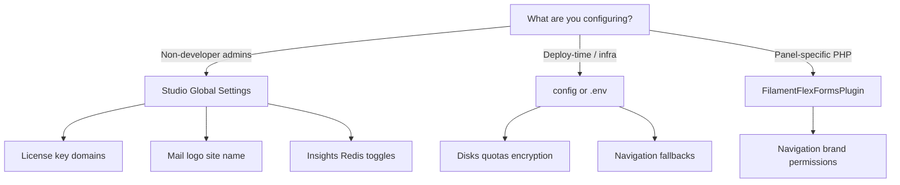

Flex Forms settings live in three places. Pick the one that matches **who changes it** and **how often** it changes.



## Decision tree

<Steps>
  <Step title="Use Global Settings when admins should change it in Studio">
    Open **Global Settings** from the Flex Forms left rail (gear icon). Best for:

    - **License** — Public API key (`pk_forms_…`)
    - **Appearance** — Site name, Studio theme, admin language
    - **Mail** — Logo for submission alert emails
    - **Security** — Require encryption on all forms
    - **Public URLs** — Custom fill path prefix
    - **Insights** — Redis mode, key prefix, cache TTL

    Third-party API keys (Mailchimp, Mapbox, reCAPTCHA, etc.) live under **[Integrations](/integrations/overview)** in the left rail — not Global Settings.

    Full tab reference: [Global Settings](/get-started/global-settings).
  </Step>

  <Step title="Use config / .env for deploy-time and infrastructure">
    Publish optional config or set env vars when values should **not** be edited in Studio — disks, quotas, strict permissions, Insights Redis connection, upload authorization callbacks.

    Every key is documented in [Config & env](/developers/config-env).

    ```bash
    php artisan vendor:publish --tag=filament-flex-forms-config
    ```
  </Step>

  <Step title="Use FilamentFlexFormsPlugin for panel-specific PHP">
    Register fluent options in your panel provider when each Filament panel needs different navigation, branding, or permission overrides:

    ```php
    use Bjanczak\FilamentFlexForms\FilamentFlexFormsPlugin;

    FilamentFlexFormsPlugin::make()
        ->navigationLabel('Lead forms')
        ->navigationGroup('Marketing')
        ->navigationSort(5)
        ->brandLogo('/images/studio-mark.svg')
        ->brandName('Acme Forms')
        ->authorizeAbilityUsing(fn ($ability, $user, $form) => /* … */ null);
    ```

    Plugin methods win over config/env for navigation and Studio rail branding. See [Admin customization](/developers/admin-customization) and [Studio permissions](/developers/studio-permissions).
  </Step>
</Steps>

## Quick reference

| Setting | Global Settings | config / .env | Plugin |
|---------|-----------------|---------------|--------|
| License public key | ✓ | — | — |
| Submission encryption policy | ✓ (toggle) | ✓ (force via env) | — |
| Upload disks & quotas | — | ✓ | — |
| `uploads.authorize` callback | — | ✓ (PHP) | — |
| Sidebar label / icon / group | — | ✓ (fallback) | ✓ (preferred) |
| Studio rail logo / name | — | ✓ (fallback) | ✓ (preferred) |
| Integration API keys | Integrations rail | — | — |
| Per-form behavior | Form Settings | — | — |

<Info>
  Env vars are ideal for **per-environment** differences (staging vs production disks). Global Settings are ideal for **tenant admins** who should not touch `.env`.
</Info>

## Publish tags

Run only what you need:

| Tag | Writes |
|-----|--------|
| `filament-flex-forms-config` | `config/filament-flex-forms.php` |
| `filament-flex-forms-assets` | Public JS/CSS (Studio, fill, embed) |
| `filament-flex-forms-translations` | PHP lang files under `lang/vendor/…` |
| `filament-flex-forms-js-locales` | Studio/fill JSON locale catalogs |
| `filament-flex-forms-mail` | Blade templates for submission emails |

Examples:

```bash
php artisan vendor:publish --tag=filament-flex-forms-config
php artisan vendor:publish --tag=filament-flex-forms-mail
php artisan vendor:publish --tag=filament-flex-forms-translations
```

Localization workflow: [Localization & RTL](/get-started/languages-rtl).

<Warning>
  Publishing config is optional — every key has defaults and env overrides. Publish when you need PHP callbacks (e.g. `uploads.authorize`) or non-env overrides.
</Warning>

<Panel>
**Next:** [Config & env](/developers/config-env) · [Global Settings](/get-started/global-settings) · [Multi-tenancy](/developers/multi-tenancy)
</Panel>
