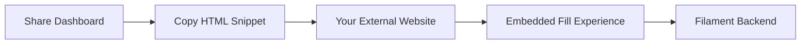

Embeds empower you to place the world-class Flex Forms fill experience directly onto your marketing pages, documentation sites, or bespoke applications—while keeping your data securely managed in your Filament backend.

## Choose Your Embed Mode

Flex Forms offers three distinct, highly optimized embedding experiences:

<CardGroup cols={3}>
  <Card title="Standard Inline" icon="app-window">
    Inject the form directly into your page layout. It intelligently flows and resizes with your surrounding content.
  </Card>
  <Card title="Modal Popup" icon="message-square">
    Trigger a sleek, floating overlay from any button click. Perfect for lead magnets and contact forms.
  </Card>
  <Card title="Full Page Takeover" icon="maximize">
    Command absolute focus. The form consumes the entire viewport for high-converting, distraction-free flows.
  </Card>
</CardGroup>

---

## The Implementation Flow



<Steps>
  <Step title="Ensure the Form is Published">
    Embeds rely on the live schema. Drafts cannot be embedded.
  </Step>
  
  <Step title="Access the Share Dashboard">
    Navigate to the **Share** tab for your form and select your desired embed mode.
  </Step>
  
  <Step title="Deploy the Snippet">
    Copy the generated HTML snippet. Paste it into your website's codebase, CMS HTML block, or Blade view.
    
    *Note for React/Vue developers: Avoid `dangerouslySetInnerHTML` if possible; prefer injecting the snippet into a standard HTML wrapper component.*
  </Step>
  
  <Step title="Smoke-Test in Production">
    Load your website, submit a test entry, and verify that the data appears in your Submissions Inbox and Insights dashboard.
  </Step>
</Steps>

---

## Technical Integration

The Share UI generates production-ready snippets dynamically scoped to your form.

<CodeGroup>
```html Standard Inline Embed
<!-- Place this where you want the form to appear -->
<div data-flex-forms-embed="FORM_PUBLIC_ID"></div>

<!-- Include the Flex Forms runtime once per page -->
<script src="https://admin.your-app.com/vendor/flex-forms/embed.js" defer></script>
```

```html Modal Popup Embed
<!-- Attach the popup trigger to any button -->
<button data-flex-forms-popup="FORM_PUBLIC_ID" class="your-custom-btn-class">
  Contact Sales
</button>

<!-- Include the Flex Forms runtime once per page -->
<script src="https://admin.your-app.com/vendor/flex-forms/embed.js" defer></script>
```
</CodeGroup>

<Warning>
  **Always copy your snippet directly from the Share UI.** The examples above use placeholder IDs and URLs. Your actual snippet will contain cryptographically secure IDs and your specific domain routing.
</Warning>

---

## Advanced: Query Parameter Prefilling

Maximize conversion rates by putting query parameters on the **embed or popup** iframe URL (not the plain fill link). You can automatically pass UTM tags, known email addresses, or plan selections into the embedded form.

Read the [Query Parameters Guide](/features/share/query-params) or consult the [Developer API Reference](/developers/query-params) for implementation details.

<Panel>
  **Deep Dive:** [Compare Embed Modes](/features/share/embed-modes) · [Embed API Reference](/developers/embed-api)
</Panel>
