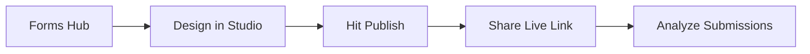

Once you have completed [Installation](/get-started/installation) and [Activate license](/get-started/activate-license), you can create your first form in Studio.

## Step-by-Step Guide

<Steps>
  <Step title="Open the Forms Hub">
    In Filament, open **Forms** from the primary navigation. This is the list of all your Flex Forms.
  </Step>
  
  <Step title="Create a new form">
    Click **Create Form** and enter a title (for example, `Contact Sales`). 
    
    <Check>
      Flex Forms generates a public slug from the title. You can change it later in Share settings.
    </Check>
  </Step>
  
  <Step title="Design in the Studio">
    You will land in the **Studio** drag-and-drop builder. Drag blocks from the catalog (Short Text, Email, Matrix Choice, File Uploads, and more) onto the canvas.
  </Step>
  
  <Step title="Configure Field Rules">
    Click any field to open its settings panel. Set labels, required state, placeholders, and validation.
  </Step>
  
  <Step title="Preview">
    Switch to **Preview Mode** to see the form as respondents will, without publishing it.
  </Step>
  
  <Step title="Publish">
    Click **Publish**. The public fill URL becomes active.
  </Step>
  
  <Step title="Share and check submissions">
    Open the **Share** tab to copy the fill link or an embed snippet. Submit a test response and confirm it appears in the **Submissions Inbox**.
  </Step>
</Steps>

---

## Example Outcome

After this guide you should have a published form like:

| Component | Example Output |
|-----------|----------------|
| **Title** | Contact Sales |
| **Fields** | Name, Business Email, Company Size, Message |
| **Status** | Published (Live) |
| **URL** | `https://your-app.com/forms/contact-sales` |

<Tip>
  Next: [Multi-Page & Stepper Forms](/guides/multi-page-stepper) and the [Logic Board](/features/studio/logic-board).
</Tip>

---

## Troubleshooting

<AccordionGroup>
  <Accordion title="I don't see the 'Create Form' button">
    Ensure that the Flex Forms plugin is registered in your Filament Panel Provider, and that your current user role has permissions to access the Forms navigation group. Also, verify that your license is active.
  </Accordion>
  <Accordion title="The Publish button is disabled or throwing errors">
    An invalid or missing license blocks state mutations to protect your data. Double-check your setup by reviewing the [Activate License](/get-started/activate-license) guide.
  </Accordion>
</AccordionGroup>

<Panel>
  **Next Steps:** [Deep Dive into Studio](/get-started/open-studio) · [Publishing & Sharing](/get-started/publish-and-share) · [Embedding Forms](/get-started/embed)
</Panel>
