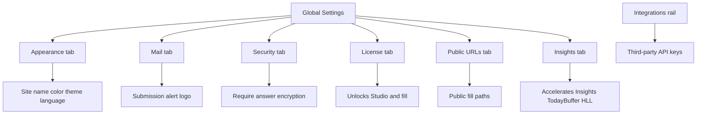

**Global Settings** is the installation-wide control panel for Flex Forms. Every form inherits these defaults. Open it from the Flex Forms left rail (gear icon).

Settings are split into **vertical tabs with icons** — use the tab that matches the job. Google Analytics, Mapbox, reCAPTCHA, and other third-party credentials live under **[Integrations](/integrations/overview)**, not here.

## Tabs at a glance

| Tab | What you configure |
|-----|--------------------|
| **Appearance** | Site name (email brand), Studio primary color, light / dark / auto theme, and Studio admin language |
| **Mail** | Logo for team submission alert emails (WebP, max edge from package config; Spatie Media Library when enabled) |
| **Security** | Require encryption on all forms (hard policy for multi-tenant / compliance) |
| **License** | Public API key (`pk_forms_…`), plus shortcuts to the license portal |
| **Public URLs** | Optional custom path prefix for all public fill links |
| **Insights** | Redis mode for Insights (TodayBuffer / HLL when On), HyperLogLog, today hashes, connection, key prefix, and cache TTL — plugin cache is separate unless `FLEX_FORMS_CACHE_REDIS_MODE=follow_insights` (or `on`) |

Deep links keep the active tab in the URL (for example `?tab=mail`, `?tab=security`, or `?tab=insights`).

---

## How Global Settings is organized

## Setup workflow

<Steps>
  <Step title="Open Global Settings">
    In the Flex Forms left rail, click **Global Settings**.
  </Step>

  <Step title="Appearance">
    Set the **Site name** used as the brand in submission notification emails (leave empty to use your app name). Set the Studio primary color and theme (auto / light / dark). Pick the Studio admin language — public fill language is still per form under Form Settings → General. See [Localization & RTL](/get-started/languages-rtl).
  </Step>

  <Step title="Mail">
    Upload an **email logo** for team alerts (header and footer). If you skip this, emails show your **Site name** as text instead. Images are converted to WebP and fitted into a square box (default max edge 600px). When Spatie Media Library is enabled for Flex Forms uploads, the same Spatie path is used.
  </Step>

  <Step title="Security">
    Optionally enable **Require encryption on all forms** so every form encrypts submission answers at rest. Equivalent hard policy via env: `FLEX_FORMS_FORCE_SUBMISSION_ENCRYPTION=true` (locks the toggle on). Per-form control: [General Settings → Encrypt submission answers](/features/settings/general). Multi-tenant recipe: [Multi-tenancy](/developers/multi-tenancy).
  </Step>

  <Step title="License">
    Open the **License** tab. This is the permanent home for your Public API key (same value the [Setup Wizard](/get-started/setup-wizard) collects on first run).

    **Field:** **License public key**  
    **Placeholder:** `pk_forms_…`  
    **Expected format:** `pk_forms_` + exactly 32 hexadecimal characters  

    How to fill it:

    1. Sign in to the [License Portal](https://license.bjanczak.com/flex-forms/panel) (register with email + password + your **Lemon** key if you have not yet — the portal then **generates** `pk_forms_…` and `cmp_…`).  
    2. Copy **Your Public API Key** (`pk_forms_…`) — not **Install via Composer** (`cmp_…`) and not the Lemon key.  
    3. Paste into **License public key**, save Global Settings, reload the browser.  
    4. Confirm the hostname in the address bar is listed under your portal domains. Staging, production, and local `*.test` hosts are separate seats.

    Without a valid key + matching hostname, Studio save/publish stays locked, but **this Global Settings page remains reachable** so you can always recover.

    Full walkthrough, seat limits, and troubleshooting: [Activate license](/get-started/activate-license). Portal reference: [License Portal](/plans/license-portal).

    <Warning>
      Do **not** paste your Lemon Squeezy license key or `cmp_…` into this field. Lemon is only for portal registration; Composer uses `cmp_…`; Filament uses the portal-generated `pk_forms_…`.
    </Warning>
  </Step>

  <Step title="Public URLs">
    Enable a custom prefix early (e.g. `forms`, `s`) if you want fill URLs under `/{prefix}/{slug}`.

    <Warning>
      Changing the prefix after forms are already shared breaks existing live links.
    </Warning>
  </Step>

  <Step title="Insights (production / high traffic)">
    Leave Redis on **Auto** unless your host team asked for a specific profile. Turning Redis **On** accelerates Insights unique counts (TodayBuffer / HyperLogLog). It does **not** own the shared Flex Forms plugin cache by default — set `FLEX_FORMS_CACHE_REDIS_MODE=follow_insights` (or `on`) if you want Studio / integration / fill cache on that Redis connection. Details: [Redis production guide](/guides/redis-production) and [Redis scaling](/features/insights/redis-scaling).
  </Step>

  <Step title="Integrations (separate page)">
    API keys for Mailchimp, Mapbox, Google Analytics, and the rest are configured under **Integrations** in the same left rail — not inside Global Settings. See the [Integrations catalog](/integrations/overview).
  </Step>
</Steps>

<Callout type="info">
  **Fail-safe access:** Global Settings stays reachable even if the license is missing or invalid, so you can always paste a new public key and recover the install.
</Callout>

<Panel>
  Related: [Automated Emails & PDFs](/features/settings/emails-pdf) · [Activate License](/get-started/activate-license)
</Panel>
