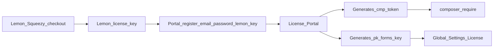

This guide installs Flex Forms into your Laravel / Filament app with Composer. Unlocking Studio is a separate step — [Activate license](/get-started/activate-license) — after you have the Public API key from the portal.


<Banner>
  Need a license? [Buy Flex Forms](https://shop.bjanczak.com/checkout/buy/3d3a0d72-c9d5-4cfd-90c9-26869c444bb0), then open the [License Portal](https://license.bjanczak.com/flex-forms/panel).
</Banner>

## After purchase: Lemon key vs portal keys (read this first)

Checkout happens on **Lemon Squeezy**. Lemon emails you a **Lemon license key** (also listed under My Orders).

**That Lemon key is never pasted into Filament and never used as a Composer password.**

What you do instead:

1. Open the [License Portal](https://license.bjanczak.com/flex-forms/panel).
2. **Register** with:
   - your **email** (same as Lemon checkout when possible),
   - a **password** for the portal,
   - your **Lemon Squeezy license key**.
3. After registration, the portal **generates** two credentials for you:
   - **Composer token** (`cmp_…`) — only for `composer config --auth` / CI, so you can download the package.
   - **Public API key** (`pk_forms_…`) — only for Filament (**Global Settings → License → License public key**), so Studio unlocks on registered domains.

| Key | Source | Use in Filament? | Use for Composer? |
|-----|--------|------------------|-------------------|
| Lemon Squeezy license key | Lemon receipt / My Orders | **No** | **No** |
| Composer token (`cmp_…`) | Generated by the **License Portal** | **No** | **Yes** |
| Public API key (`pk_forms_…`) | Generated by the **License Portal** | **Yes** (License field only) | **No** |

<Warning>
  If you paste the Lemon Squeezy key into **License public key**, Studio will not activate. Re-copy **Your Public API Key** (`pk_forms_…`) from the portal instead.
</Warning>



Full portal reference: [The License Portal](/plans/license-portal).

---

## Step-by-step installation

### 1. Buy and register on the License Portal

1. Purchase from the [Flex Forms store](https://shop.bjanczak.com/checkout/buy/3d3a0d72-c9d5-4cfd-90c9-26869c444bb0).
2. Copy your **Lemon Squeezy license key** from the receipt email or **My Orders**.
3. Go to [license.bjanczak.com/flex-forms/panel](https://license.bjanczak.com/flex-forms/panel).
4. Create an account: **email** + **password** + paste the **Lemon license key** when asked.
5. After signup, the portal shows your generated **Composer token** (`cmp_…`) and **Public API key** (`pk_forms_…`). Keep both; you will use `cmp_…` on this page and `pk_forms_…` in [Activate license](/get-started/activate-license).

<Info>
  Lemon may show the purchase as **inactive** until you register the first domain in the portal. That means “valid purchase, zero domains activated,” not a failed payment.
</Info>

### 2. Copy your Composer token

1. In the portal, open **Install via Composer**.
2. Copy the token starting with `cmp_` (and the ready-made commands if shown).
3. Store it in a password manager. You need it on every machine that runs `composer install` / `composer update` for this project (laptop, CI, Forge, etc.).

### 3. Point Composer at the private registry

From your Laravel project root:

```bash
composer config repositories.flex-forms composer https://composer.bjanczak.com
```

Or add this to `composer.json` under `"repositories"`:

```json
"repositories": {
    "flex-forms": {
        "type": "composer",
        "url": "https://composer.bjanczak.com"
    }
}
```

The key name `flex-forms` is only a local label. You can keep other Composer repositories alongside it.

### 4. Authenticate to the registry

Username is always the literal word `token` (not your email):

```bash
composer config --auth http-basic.composer.bjanczak.com token YOUR_COMPOSER_TOKEN
```

Replace `YOUR_COMPOSER_TOKEN` with the full `cmp_…` value from the portal.

This creates or updates `auth.json`. **Add `auth.json` to `.gitignore`.** Committing it publishes your download password.

A wrong token typically shows as **401 Unauthorized** when resolving `janczakb/filament-flex-forms`.

### 5. Require the package

```bash
composer require janczakb/filament-flex-forms
```

Exact package name: **`janczakb/filament-flex-forms`**.

You do **not** need to run `npm install` inside the package for normal use — Studio, fill, and embed assets ship prebuilt.

### 6. Publish assets and run migrations

```bash
php artisan flex-forms:install
```

What this does:

1. Publishes Flex Forms assets (`filament-flex-forms-assets`)
2. Optionally publishes translations with `--translations`
3. Runs `php artisan filament:assets`
4. Asks to run `php artisan migrate` (or runs them when non-interactive / `--force`)

Useful variants:

```bash
php artisan flex-forms:install --force
php artisan flex-forms:install --translations
```

Or migrate alone:

```bash
php artisan migrate
```

Optional config publish:

```bash
php artisan vendor:publish --tag=filament-flex-forms-config
```

Localization: [Localization & RTL](/get-started/languages-rtl).

### 7. Register the plugin on your Filament panel

Open your panel provider (often `app/Providers/Filament/AdminPanelProvider.php`):

```php
use Bjanczak\FilamentFlexForms\FilamentFlexFormsPlugin;
use Filament\Panel;

public function panel(Panel $panel): Panel
{
    return $panel
        // ... existing ->id(), ->path(), ->login(), resources, etc.
        ->plugin(
            FilamentFlexFormsPlugin::make()
            // Optional:
            // ->navigationIcon('heroicon-o-envelope')
            // ->navigationLabel('Forms')
            // ->navigationGroup('Flex Forms')
            // ->navigationSort(10)
            // ->navigation(false)
        );
}
```

Reload the panel and confirm a **Forms** (or your custom label) entry appears.

If you use multiple Filament panels, register the plugin on each panel that should host Studio. License checks use the **hostname**, not the panel id — register every hostname in the portal.

Permissions for teams / Spatie: [Studio permissions](/developers/studio-permissions). Optional fail-closed: `FLEX_FORMS_PERMISSIONS_STRICT=true`.

### 8. Activate the license (required)

Composer install does **not** put `pk_forms_…` into Filament for you.

1. Register every hostname you use in the License Portal.  
2. Paste the portal-generated **Public API key** (`pk_forms_…`) into **Global Settings → License → License public key**.  

Do **not** paste the Lemon Squeezy key into that field.

Full UI path and troubleshooting: **[Activate license](/get-started/activate-license)**. First visit without a key often opens the [Setup Wizard](/get-started/setup-wizard).

---

## Prerequisites

Confirm these before or while you install.

| Requirement | Notes |
|-------------|--------|
| **Laravel** | Versions supported by the package `composer.json` (typically Laravel 11+ / 12+). |
| **Filament v5** | A working panel you can log into. |
| **PHP 8.3+** | Required by the package. |
| **Composer 2** | Needed for private registry auth. |
| **Database** | Migrations create Flex Forms tables. |
| **Queue + schedule** | Recommended in production for integrations, Insights, and mail. Local `sync` is fine for a first smoke test. |

---

## Which key goes where

| Credential | Looks like | Where you get it | Where you use it | Secret? |
|------------|------------|------------------|------------------|---------|
| **Lemon license key** | From Lemon receipt | Lemon email / My Orders | Portal **registration** only (email + password + this key) | Treat as secret |
| **Composer token** | `cmp_…` | **Generated by the portal** after signup | `composer config --auth`, CI secrets | **Yes — never commit** |
| **Public API key** | `pk_forms_` + 32 hex | **Generated by the portal** after signup | **Global Settings → License → License public key** | Only works for your whitelisted hosts |

<Warning>
  Never put `cmp_…` or the Lemon key into Global Settings. Never commit `auth.json`. If a Composer token leaks, regenerate it in the portal — the old token is revoked immediately.
</Warning>

---

## Production checklist after install

<AccordionGroup>
  <Accordion title="Queues">
    Run a queue worker in production. Integrations, some Insights work, and mail jobs expect the queue to process. Local `QUEUE_CONNECTION=sync` is acceptable for a first smoke test only.
  </Accordion>
  <Accordion title="Scheduler">
    Ensure `php artisan schedule:run` is cron’d every minute (Forge / Cloud / Kubernetes CronJob). Flex Forms relies on scheduled maintenance for Insights and related tasks.
  </Accordion>
  <Accordion title="Trusted proxies">
    Behind Cloudflare, AWS ALB, or nginx, configure Laravel [Trusted Proxies](https://laravel.com/docs/requests#configuring-trusted-proxies) so `Request::ip()` is the real visitor. Flex Forms uses IP for submission metadata, rate limits, and optional duplicate-by-IP. Misconfigured proxies make every visitor look like `10.x` / `127.0.0.1`.
  </Accordion>
  <Accordion title="Caches">
    After changing `.env` or published config: `php artisan optimize:clear` (or your usual deploy cache rebuild).
  </Accordion>
</AccordionGroup>

---

## CI / CD (GitHub Actions, GitLab, Forge)

Never commit `auth.json`. Store `cmp_…` as a secret, for example `FLEX_FORMS_COMPOSER_TOKEN`.

Example GitHub Actions fragment:

```yaml
- name: Authenticate Flex Forms
  run: |
    composer config repositories.flex-forms composer https://composer.bjanczak.com
    composer config --auth http-basic.composer.bjanczak.com token "${{ secrets.FLEX_FORMS_COMPOSER_TOKEN }}"

- name: Install Dependencies
  run: composer install --no-interaction --prefer-dist
```

On Laravel Forge / Envoyer-style hosts, set the same auth on the server once (or inject during deploy) so `composer install` on release succeeds.

When you **regenerate** a Composer token in the portal, update every secret and every server `auth.json` in the same change window.

---

## Upgrading

Already installed? When a new Flex Forms release ships, run `composer update janczakb/filament-flex-forms`, migrate, and `php artisan flex-forms:upgrade`. License keys do not need a database upgrade.

Full checklist, CI notes, dry-run, and troubleshooting: **[Upgrading](/get-started/upgrading)**.

---

## Troubleshooting

<AccordionGroup>
  <Accordion title="401 Unauthorized from composer.bjanczak.com">
    The `cmp_…` token is missing, mistyped, or revoked. Re-copy the auth command from **Install via Composer**, run it again, and update CI secrets. Confirm the username is literally `token`.
  </Accordion>
  <Accordion title="Package not found / could not find a matching version">
    Confirm the repository URL is `https://composer.bjanczak.com` and that `composer require janczakb/filament-flex-forms` uses that exact package name. Run `composer clear-cache` and retry.
  </Accordion>
  <Accordion title="Package installed but Studio is locked or missing">
    Install succeeded; activation did not. Paste `pk_forms_…` and register the hostname — [Activate license](/get-started/activate-license).
  </Accordion>
  <Accordion title="Class FilamentFlexFormsPlugin not found">
    Dump autoload (`composer dump-autoload`), confirm the require succeeded, and clear opcache if you use it in production.
  </Accordion>
  <Accordion title="Navigation item does not appear">
    Confirm `->plugin(FilamentFlexFormsPlugin::make())` is on the panel you are logged into. Check you did not set `->navigation(false)`. Clear Filament / view caches.
  </Accordion>
  <Accordion title="Migration errors">
    Ensure the DB user can create tables. Re-run `php artisan migrate` and read the failing migration name. Do not skip migrations permanently — Studio depends on them.
  </Accordion>
  <Accordion title="Exact package name?">
    `janczakb/filament-flex-forms`
  </Accordion>
</AccordionGroup>

---

## Related pages

| Topic | Page |
|-------|------|
| Paste `pk_forms_…` + domains | [Activate license](/get-started/activate-license) |
| First-run wizard | [Setup Wizard](/get-started/setup-wizard) |
| License field in Studio | [Global Settings](/get-started/global-settings) |
| Portal dashboard | [License Portal](/plans/license-portal) |
| Plans and seats | [Plans & pricing](/plans/overview) |
| First form | [Create your first form](/get-started/first-form) |

<Panel>
  **Next step:** [Activate license](/get-started/activate-license) — without it, Studio stays locked.
</Panel>
