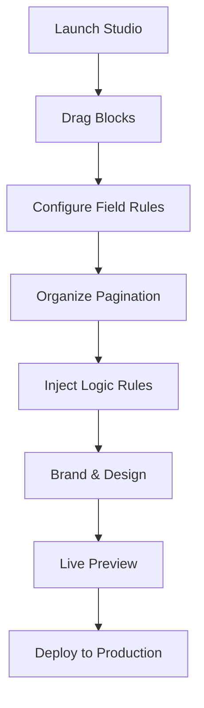

The **Studio** is the creative heart of Flex Forms. It is a zero-code, enterprise-grade interface where you architect data collection experiences. Open it from any form card in your Hub to start building.

Studio is built for laptop and desktop screens. On phones or very narrow windows you will see a short notice recommending a larger display — the builder is not optimized for mobile editing.

## The Interface Architecture

The Studio is divided into four highly optimized regions designed for maximum productivity:

<CardGroup cols={2}>
  <Card title="Component Catalog" icon="blocks">
    Drag over 40+ Studio blocks including Text, Number, Choice, Date, Media, and Advanced elements (like Mapbox Pins and CAPTCHA).
  </Card>
  <Card title="Interactive Canvas" icon="layout-template">
    Manage pagination and field flow. Drag seamlessly to reorder components; click to instantly focus and edit.
  </Card>
  <Card title="Inspector Panel" icon="sliders">
    Fine-tune per-field microcopy, strict validation rules, dynamic options, and structural layouts.
  </Card>
  <Card title="Logic & Design Hub" icon="git-branch">
    Use center tabs **Content** | **Workflow** | **Integrations** | **Share** | **Submissions**. Architect branching on **Workflow**, edit full When → Then in **Rules**, and brand from the canvas **Design** controls (logo, cover, Design panel).
  </Card>
</CardGroup>

---

## The Builder Workflow

<Steps>
  <Step title="Construct the Foundation">
    Drag essential fields (e.g., Email, Short Text) onto the canvas. Flex Forms automatically handles state and reactivity.
  </Step>
  
  <Step title="Configure Precision Rules">
    Click any field to activate the Inspector Panel. Enforce strict validation (e.g., specific email domains), update help text, and manage required states.
  </Step>
  
  <Step title="Experience the Respondent View">
    Toggle to Preview Mode. Walk through the form exactly as your users will, complete with live validation and conditional logic rendering.
  </Step>
  
  <Step title="Scale and Deploy">
    Continue layering complexity with logic boards and multi-page routing, or hit Publish to take your creation live immediately.
  </Step>
</Steps>

<Panel>
  **Deep Dive into Studio:** [Drag & Drop Pages](/features/studio/dnd-pages) · [Advanced Field Settings](/features/studio/field-settings) · [The Logic Board](/features/studio/logic-board)
</Panel>
