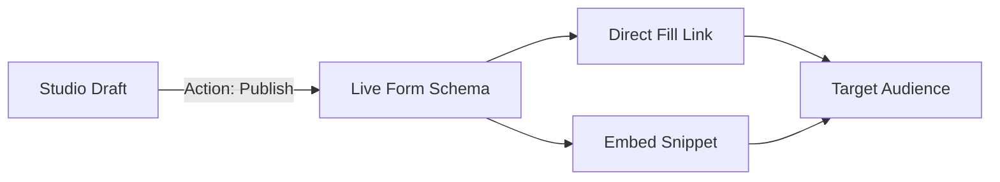

Publishing is the bridge between your Studio draft and the real world. Once published, your form is ready to be shared with your audience.

<Steps>
  <Step title="Publish from the Studio or Forms list">
    Click **Publish** in the Studio top bar, or open the **⋯** menu on the Forms index and choose **Publish**. The public fill URL becomes available immediately.
  </Step>
  
  <Step title="Navigate to the Share Hub">
    Return to the Form Hub and open the **Share** tab for your newly published form.
  </Step>
  
  <Step title="Distribute the Fill Link">
    Copy the direct **Fill Link**. You can send this via email campaigns, SMS, or link to it from buttons across your website.
  </Step>
  
  <Step title="Optimize for Social Media">
    First impressions matter. Customize the **Social Preview (Open Graph)** settings. Set a compelling title, description, and preview image so your form looks incredibly professional when shared on LinkedIn, X, or Slack.
  </Step>
  
  <Step title="Embed on Your Site (Optional)">
    If you prefer to keep users on your own domain, seamlessly embed the form. See the [Embed Guide](/get-started/embed) for details.
  </Step>
</Steps>

---

## The Publishing Architecture

<Tip>
  **Need to pause submissions?** You can unpublish a form at any time to instantly take it offline without deleting your historical data or configuration.
</Tip>

---

## Troubleshooting

<AccordionGroup>
  <Accordion title="My link returns a 404 Error">
    Ensure the form is actively published in the Studio. Unpublished and unknown slugs show Flex Forms’ branded 404 page (not your host app’s default error page). Also verify your `URL Prefix` in Global Settings hasn't changed. Read more about the [Fill Link Architecture](/features/forms/fill-link).
  </Accordion>
  <Accordion title="I published changes, but the old form is still showing">
    Perform a hard refresh in your browser. If you use a front-end CDN (like Cloudflare or Fastly), purge the cache for that specific form URL.
  </Accordion>
</AccordionGroup>

<Panel>
  **Next Steps:** [Explore Share & Embed](/features/share/overview) · [Discover Embed Modes](/features/share/embed-modes)
</Panel>
