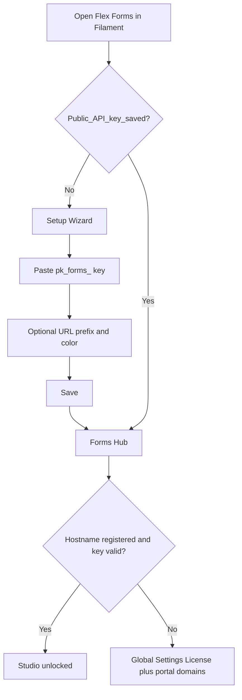

The **Setup Wizard** is Flex Forms’ short onboarding screen for a brand-new (or not-yet-activated) install. It exists so you do not have to hunt for the License tab on day one: paste your Public API key, optionally set a couple of brand defaults, save, and land in the Forms Hub.

It is **not** a second license system. Whatever you enter here is the **same** Public API key stored under **Global Settings → License**. Completing the wizard once is enough; you can always change the key later from Global Settings.

<Info>
  The wizard only appears when Flex Forms does **not** already have a Public API key saved in your app. After a valid `pk_forms_…` key is stored, you will not see the wizard again on normal visits — use [Global Settings](/get-started/global-settings) if you need to update the key or brand defaults.
</Info>

---

## When the wizard appears

Flex Forms checks whether a **Public API key** is already saved for this installation.

| Situation | What you see |
|-----------|----------------|
| Package installed, plugin registered, **no** Public API key saved yet | Setup Wizard (or a clear prompt that opens it) on first visit to the Flex Forms area |
| Public API key already saved (from a previous wizard run or Global Settings) | Forms Hub / Studio as usual — wizard skipped |
| Key saved but **wrong type**, truncated, or hostname not registered | Wizard may be gone, but Studio stays locked — fix via **Global Settings → License** and the [License Portal](https://license.bjanczak.com/flex-forms/panel) |

Typical moments you meet the wizard:

1. Right after [Installation](/get-started/installation), the first time you open Flex Forms in Filament.
2. On a fresh database / new environment where Global Settings never received a `pk_forms_…` key.
3. After someone cleared license settings (rare) so the saved Public API key is empty again.

You do **not** need the wizard if you prefer to go straight to **Global Settings → License** and paste the key there. Both paths write the same field.

---

## What you need before you start

Complete these before relying on the wizard (or you will save a key and still see a locked Studio):

1. **Package installed** — Composer require, migrate, panel plugin — see [Installation](/get-started/installation).
2. **License Portal account** — register with **email**, **password**, and your **Lemon Squeezy license key**. The portal then **generates** `cmp_…` and `pk_forms_…` — see [The License Portal](/plans/license-portal).
3. **Hostname registered** — the exact host in your browser address bar is on your portal domain list — see [Activate license](/get-started/activate-license).
4. **Public API key copied** — the portal-generated value starting with `pk_forms_…` (not the Lemon key).

<Warning>
  Paste **Public API key** (`pk_forms_…`) only. Never paste the Composer token (`cmp_…`) and never paste the Lemon Squeezy license key into the wizard or into Global Settings. The Lemon key is only for portal registration; Composer auth uses `cmp_…`.
</Warning>

---

## Exact fields in the wizard

### Public API key (required)

| | |
|--|--|
| **Field label** | **Public API key** |
| **Accepted value** | Starts with `pk_forms_` followed by **32 hexadecimal characters** |
| **Where to copy from** | [License Portal](https://license.bjanczak.com/flex-forms/panel) → **Your Public API Key** |
| **Same as** | **Global Settings → License → License public key** |

This is the only credential the wizard needs to activate Flex Forms inside Filament. One Public API key covers **all** domains on your portal account — you do not get a different `pk_forms_…` per hostname.

### Optional brand defaults

These are shortcuts so new installs look intentional on day one. You can skip them and set everything later in Global Settings.

| Wizard option | What it does | Where to edit later |
|---------------|--------------|---------------------|
| **Public URL prefix** | Optional path segment for public fill links (for example `forms` → `/{prefix}/{slug}`) | **Global Settings → Public URLs** |
| **Studio color** (primary color) | Default accent color for the Studio chrome | **Global Settings → Appearance** |

<Info>
  Changing the **public URL prefix** after forms are already shared can break live links. Prefer setting the prefix early, or leave it empty until you know the path you want. Details: [Global Settings](/get-started/global-settings).
</Info>

---

## Step-by-step

<Steps>
  <Step title="Install the package first">
    Finish [Installation](/get-started/installation) so the Flex Forms plugin is registered on your Filament panel and migrations have run. The wizard cannot activate a package that is not installed.
  </Step>

  <Step title="Prepare the License Portal">
    Sign in at [license.bjanczak.com/flex-forms/panel](https://license.bjanczak.com/flex-forms/panel). Copy **Your Public API Key** (`pk_forms_…`). Add the exact hostname staff will open (production, staging, or local `.test`). Portal walkthrough: [The License Portal](/plans/license-portal). Domain rules: [Activate license](/get-started/activate-license).
  </Step>

  <Step title="Open the wizard">
    Open the Flex Forms area in Filament. If no Public API key is saved yet, the Setup Wizard appears (or a prompt leads you into it).

    If you somehow land in Forms without the wizard and Studio is still locked, open **Global Settings → License** instead — that is the same Public API key field.
  </Step>

  <Step title="Paste Public API key">
    In the field labeled **Public API key**, paste the full `pk_forms_…` value from the portal. Do not trim characters. Do not add spaces. Confirm the prefix is `pk_forms_`, not `cmp_`.
  </Step>

  <Step title="Optionally set brand defaults">
    Set a **public URL prefix** and/or **Studio color** if you already know your branding. Skip if you are unsure — you can configure **Appearance** and **Public URLs** anytime under [Global Settings](/get-started/global-settings).
  </Step>

  <Step title="Save and continue">
    Save. You should land in the **Forms Hub**. Next: [Create your first form](/get-started/first-form).

    If Studio or publish still looks locked after save, the key may be wrong **or** the browser hostname is not on the portal list — see Troubleshooting below and [Activate license](/get-started/activate-license).
  </Step>
</Steps>

---

## Relationship to Global Settings → License

Think of the Setup Wizard as a **first-run shortcut** to one tab of Global Settings.

| Concern | Setup Wizard | Global Settings |
|---------|--------------|-----------------|
| Public API key | Field **Public API key** | Tab **License** → **License public key** |
| URL prefix | Optional on wizard | Tab **Public URLs** |
| Studio color | Optional on wizard | Tab **Appearance** |
| Available when license is invalid / missing | Yes (so you can activate) | **Yes** — Global Settings stays reachable so you can always fix the key |
| Shown after key is already saved | No (skipped) | Always available from the Flex Forms left rail |

Updating the key in **Global Settings → License** overwrites what the wizard saved. There is no separate “wizard-only” key.

<Panel>
  Deep dive on every Global Settings tab: [Global Settings](/get-started/global-settings). Full activation checklist (portal domains + Filament key): [Activate license](/get-started/activate-license).
</Panel>

---

## Domain registration still required

Saving `pk_forms_…` in the wizard (or in Global Settings) only stores the key **in your application**.

The License Portal must still list the **exact hostname** where Filament is open. If the key is correct but the host is missing or mistyped, license checks fail and Studio / publish stay locked.

Examples of exact hosts (each is its own seat):

- Production: `admin.example.com` or `example.com`
- Staging: `staging.example.com`
- Local: `my-app.test`

<Warning>
  `www.example.com` and `example.com` are different seats. Prefer the hostname staff actually type into the browser. Register it in the portal **before** or immediately after you paste the Public API key.
</Warning>

---

## Troubleshooting

<AccordionGroup>
  <Accordion title="I pasted a key but the wizard / Studio still rejects it">
    Confirm you used a **Public API key** (`pk_forms_…`), not:

    - Composer token (`cmp_…`) from **Install via Composer**
    - Lemon Squeezy license key from your receipt / My Orders

    Re-copy from the portal’s **Your Public API Key** section. The expected shape is `pk_forms_` + 32 hex characters. Avoid trailing spaces or a truncated clipboard paste.
  </Accordion>

  <Accordion title="Key saves, but Studio stays locked (hostname mismatch)">
    Look at the hostname in the browser address bar and compare it character-for-character with the portal domain list. Add the missing host, or remove a typo and re-add. Then reload Filament.

    The wizard does not register domains for you — only the [License Portal](https://license.bjanczak.com/flex-forms/panel) does. Full steps: [Activate license](/get-started/activate-license).
  </Accordion>

  <Accordion title="How do I reopen or fix activation without the wizard?">
    Once a Public API key is stored, the Setup Wizard usually does not show again. Open the Flex Forms left rail → **Global Settings** → **License** tab → paste or replace **License public key** → save → reload.

    Global Settings remains available even when the license is invalid, so you can always recover.
  </Accordion>

  <Accordion title="I skipped the optional brand fields — is that OK?">
    Yes. URL prefix and Studio color are optional. Set them later under **Global Settings → Public URLs** and **Appearance**. They do not affect whether the license is valid.
  </Accordion>

  <Accordion title="Can I skip the wizard entirely?">
    Yes. After install, go to **Global Settings → License**, paste `pk_forms_…`, save, and ensure the hostname is registered. Then continue to [Create your first form](/get-started/first-form).
  </Accordion>

  <Accordion title="I rotated the Public API key in the portal">
    Paste the new `pk_forms_…` into **Global Settings → License** (the wizard will not automatically reappear). Update every environment that stores the old key.
  </Accordion>
</AccordionGroup>

---

## What success looks like

After a correct Public API key **and** a matching registered hostname:

- You can open **Forms**, create and edit forms in Studio
- Publish / share / embed paths work according to your plan
- Brand defaults (if you set them) show up in Studio color and public fill URLs

If anything is still locked, treat it as an activation problem, not an install problem — return to [Activate license](/get-started/activate-license) and [The License Portal](/plans/license-portal).

<Panel>
  **Next:** [Activate license](/get-started/activate-license) · [Installation](/get-started/installation) · [Create your first form](/get-started/first-form) · [Global Settings](/get-started/global-settings)
</Panel>
