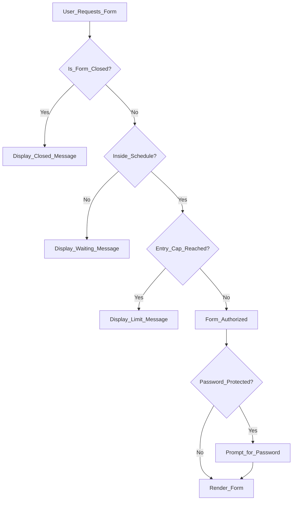

Flex Forms doesn't just collect data; it protects it. The **Access Gates** system provides enterprise-grade security controls directly in your Form Settings. 

Every gate is enforced at the server level. Even if a malicious user tries to bypass your website's frontend, the Flex Forms engine will slam the door shut.

---

## Security gates

You can layer these gates together to create highly specific scenarios (e.g., *"Only allow 50 entries, and only on weekends, and only if they have the password"*).

<Steps>
  <Step title="Password Protection">
    Lock your form behind a cryptographic key. Perfect for internal HR surveys or VIP event registrations. The plaintext password is never exposed to the internet.
  </Step>
  <Step title="Automated Scheduling">
    Don't stay up until midnight to launch a campaign. Define an exact Start Date, End Date, and Timezone. You can even uncheck Saturdays and Sundays to ensure your B2B forms only collect leads during office hours.
  </Step>
  <Step title="Entry Caps (Scarcity)">
    Selling 100 limited-edition products? Set a strict maximum entry cap. The exact millisecond the 100th person submits, the form locks down globally. You can cap total entries, or limit velocity (e.g., *10 entries per day*).
  </Step>
  <Step title="Duplicate Prevention">
    Running a democratic vote or a giveaway? Prevent users from submitting multiple times by locking the form to their IP Address, or more accurately, to their Email Address. Prefer email when accuracy matters. Behind a CDN or load balancer, configure [trusted proxies](/get-started/installation#trusted-proxies-production) so visitor IPs are real — private/proxy ranges are ignored for IP locks so one submit cannot block everyone.
  </Step>
  <Step title="Manual Override (The Kill Switch)">
    If a campaign goes viral and you are overwhelmed with leads, simply flip the **Close Form** switch to instantly halt all new traffic.
  </Step>
  <Step title="CAPTCHA (one provider)">
    After connecting reCAPTCHA and/or Turnstile under left-rail **Integrations**, enable CAPTCHA in **Form Settings → Access** and pick a single provider for that form. Details: [Access settings](/features/settings/access).
  </Step>
</Steps>

---

## The Respondent Experience

When a user hits a gate, they don't see a scary error page. Instead, they see a beautifully branded, customizable message that you control.

<CardGroup cols={2}>
  <Card title="Tailored Messaging" icon="message-bot">
    Customize exactly what respondents see when they arrive too early ("Coming Soon!"), too late ("Campaign Ended"), or when capacity is reached ("Sold Out!").
  </Card>
  <Card title="Seamless Redirects" icon="arrow-up-right-from-square">
    Alternatively, if a user hits a gate (or successfully completes the form), you can automatically redirect them back to your main website or a specific landing page.
  </Card>
</CardGroup>

<Tip>
  **Entry-cap concurrency:** When an entry cap is enabled, Flex Forms takes a short exclusive database lock on the form row **only for the final count check + insert**. File promotion and other disk work happen outside that lock so high traffic does not serialize every submitter. Forms without a cap never take this lock. Optional Redis powers Insights scaling (uniques / today buffers), not entry-cap authority.
</Tip>

<Panel>
  **Next Steps:** [Managing Submissions](/features/submissions/overview) · [Building with Logic](/guides/logic-and-calculated)
</Panel>
