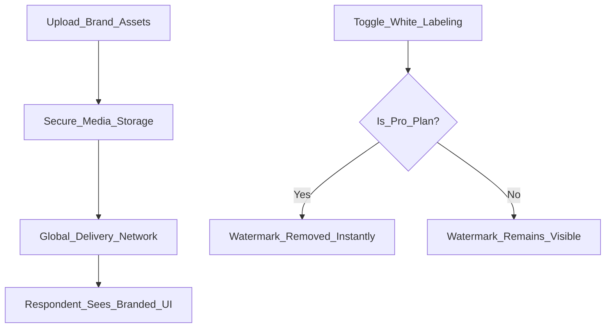

A form is a direct reflection of your brand's quality. Flex Forms provides powerful, non-technical design tools so public fill looks like part of your product — not a generic survey template.

**Design panel + custom CSS are included on Standard, Pro, and Enterprise.** Only removing the “Powered by Flex Forms” watermark requires <Badge color="purple">Pro</Badge> or Enterprise.

<Columns cols={2}>
  <Card title="All plans" icon="image">
    Upload logos and covers, social previews, accent colors, typography, advanced layout, and custom CSS via the [Design panel](/features/studio/customize).
  </Card>
  <Card title="White-labeling" icon="eye-slash">
    <Badge color="purple">Pro</Badge> / Enterprise. Remove the "Powered by Flex Forms" watermark for a clean public experience. See [Hide branding](/plans/hide-branding).
  </Card>
</Columns>

---

## Crafting the Visual Identity

You don't need to write a single line of CSS unless you want to. Visual identity is controlled through the [Design panel](/features/studio/customize) — including advanced layout and a sanitized custom CSS editor on every plan.

<Steps>
  <Step title="Upload the Brand Anchor (Logo)">
    Upload a crisp, square logo (up to 600px). This anchors the top of your form and establishes immediate trust with the respondent.
  </Step>
  <Step title="Set the Atmosphere (Cover Image)">
    Upload a cinematic, high-resolution header image (up to 2000px). Flex Forms automatically compresses this into next-gen WebP formats to ensure the page loads instantly on mobile devices.
  </Step>
  <Step title="Define the Accent Color">
    Select a Hex color that exactly matches your brand guidelines. The engine will instantly apply this color to all interactive elements, progress bars, and buttons.
  </Step>
  <Step title="Optimize for Social Media">
    Upload a dedicated **Social Preview Image** (1200x630px). When you paste your form link into Slack, LinkedIn, or iMessage, this image will unfurl to create a highly clickable, beautiful preview card.
  </Step>
</Steps>

---

## White-Labeling (Hiding Branding)

By default, the bottom of every form features a small, subtle "Made with Flex Forms" badge.

If you are an agency building forms for high-paying clients, or an enterprise requiring strict brand purity, you cannot have third-party watermarks on your assets.

<Steps>
  <Step title="Access General Settings">
    From Studio, open **Form settings (gear) → General** (not the Studio canvas Design rail).
  </Step>
  <Step title="Toggle White-Labeling">
    Simply toggle **Flex Forms Branding** to *Off*. 
  </Step>
  <Step title="Instant Removal">
    The engine will instantly scrub all traces of Flex Forms from the public fill page, embeds, and popup modals. 
  </Step>
</Steps>

<Callout type="warning">
  **License Enforcement:** White-labeling is strictly enforced by the global license server. If you are on a Standard plan, toggling this switch will have no effect. You must upgrade to a **Pro** or **Enterprise** license to unlock this capability.
</Callout>

<Panel>
  **Next Steps:** [Comparing Pricing Plans](/plans/standard-pro-enterprise) · [Mastering the Studio](/features/studio/overview)
</Panel>
