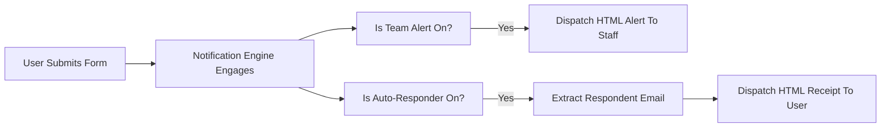

When a user submits a form, silence is the absolute enemy of trust.

Flex Forms features a dual-engine notification system that can simultaneously dispatch a data-rich alert to your internal team and a branded confirmation receipt to the respondent — both as polished HTML (plus plain text).



---

## The Dual-Engine Architecture

Control both pathways from **Form Settings → Email notifications**.

### 1. Internal Team Alerts (Self Notifications)

Notify sales or support the millisecond a lead arrives. The engine attaches a structured HTML table of every answer below your custom message.

### 2. Respondent Auto-Responders

Thank the user instantly. Bind the target to an [Email Block](/features/blocks/email), craft the copy, and optionally **Attach PDF of answers** (HTML receipt + PDF attachment).

Merge tags in subject/message: `{form_title}`, `{form_name}`, `{submission_id}`, `{submitted_at}`.

---

## Customize HTML visually

Publish the Blade email templates and edit them like any other HTML:

```bash
php artisan vendor:publish --tag=filament-flex-forms-mail
```

Files land in `resources/views/vendor/filament-flex-forms/mail/` (`submission-admin`, `submission-respondent`, shared `partials`). Laravel prefers your published copies over the package defaults.

---

## Delivery notes

<AccordionGroup>
  <Accordion title="How does the engine know the respondent email?">
    From the Email Block you select under **Or send to answer from field**, and/or any addresses in **To**. Invalid addresses are skipped to protect sender reputation.
  </Accordion>
  <Accordion title="Do these emails trigger on abandoned forms?">
    No — only completed submissions. Partial drafts never send mail.
  </Accordion>
  <Accordion title="Can I send leads to Slack instead?">
    Yes — use the [Integrations Hub](/features/settings/integrations) alongside or instead of SMTP alerts.
  </Accordion>
</AccordionGroup>

<Panel>
  **Next Steps:** [Integrations overview](/integrations/overview) · [Reviewing submissions](/features/submissions/overview)
</Panel>
