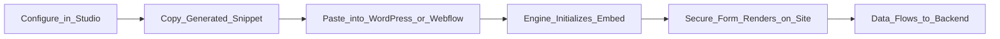

You don't need to hire a developer to put a form on your website. Flex Forms generates copy-and-paste snippets that work instantly on any platform—WordPress, Webflow, Shopify, Framer, or a custom React app.

Your Filament server remains the central brain. When you update a form in the Studio, it instantly updates across every website where it is embedded.



---

## Choosing Your Embed Architecture

From the **Share** tab in the Studio, you can generate snippets for three distinct visual architectures.

<Table>
  <thead>
    <tr>
      <th>Mode</th>
      <th>How it looks</th>
      <th>Best Use Case</th>
    </tr>
  </thead>
  <tbody>
    <tr>
      <td>**Standard (Inline)**</td>
      <td>Flows naturally inside your webpage content.</td>
      <td>"Contact Us" pages, long-form articles, or footer signups.</td>
    </tr>
    <tr>
      <td>**Popup (Button/Link)**</td>
      <td>Hides the form until a user clicks a specific trigger, opening a sleek modal.</td>
      <td>High-converting landing pages where space is limited.</td>
    </tr>
    <tr>
      <td>**Full Page**</td>
      <td>Consumes the entire browser window perfectly.</td>
      <td>Dedicated routing (e.g., creating a standalone `yourdomain.com/apply` page).</td>
    </tr>
  </tbody>
</Table>

---

## The Zero-Code Workflow

<Steps>
  <Step title="Publish the Form">
    Embeds are a live, public feature. Ensure your form is officially **Published** in the Studio before attempting to embed it.
  </Step>
  <Step title="Configure the Aesthetics">
    In the Share tab, tweak the settings. Need to remove the form's background so your website's beautiful gradient shows through? Toggle **Transparent Background**. Need to hide the form's title? Toggle **Hide Title**.
  </Step>
  <Step title="Copy the Snippet">
    Click the "Copy Code" button. Flex Forms automatically writes perfectly structured HTML based on your exact toggle choices.
  </Step>
  <Step title="Paste and Launch">
    Open your website builder (e.g., Webflow's HTML Embed element, or WordPress's Custom HTML block) and paste the code. Save the page, and your form is live.
  </Step>
</Steps>

---

## What the Snippets Look Like

You don't need to understand HTML to use these, but here is what Flex Forms is generating for you behind the scenes:

<CodeGroup>
```html title="Standard Inline Embed"
<iframe
  data-flex-form-src="https://your-app.com/forms/contact-us/embed?dynamicHeight=1"
  loading="lazy"
  width="100%"
  height="800"
  frameborder="0"
  title="Contact us"
  allow="fullscreen"
></iframe>
<script async src="https://your-app.com/vendor/flex-forms/embed.js"></script>
```

```html title="Popup Trigger Button"
<script async src="https://your-app.com/vendor/flex-forms/embed.js"></script>
<button
  type="button"
  data-flex-form-open="contact-us"
  data-flex-form-layout="modal"
  data-flex-form-width="376"
  data-flex-form-position="bottom_right"
>
  Open form
</button>
```
</CodeGroup>

<Tip>
  **The Magic of Dynamic Height:** By default, Standard embeds include the `dynamicHeight` flag. This instructs the iframe to constantly talk to your website, automatically stretching or shrinking the container as the user moves between form pages, completely eliminating ugly scrollbars.
</Tip>

<Panel>
  **Next Steps:** [Injecting Data via URL Parameters](/features/share/query-params) · [Analyzing Embed Traffic](/features/insights/overview)
</Panel>
