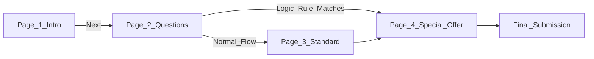

Long, single-page forms are terrifying to users and lead to massive abandonment rates. 

Flex Forms allows you to easily chop any form into multiple pages. When combined with the [Logic Engine](/guides/logic-and-calculated), you can even skip irrelevant pages entirely based on the user's answers.

---

## Designing the Wizard Experience

<Steps>
  <Step title="Split the Pages in Studio">
    Open the **Pages** sidebar in the Studio. Simply drag and drop your existing blocks into new Page columns. There is no limit to how many pages you can create.
  </Step>
  <Step title="Select a Stepper Style">
    In **Studio → Form settings (gear) → General**, choose how you want to visualize progress (only when the form has more than one page):
    - **Numbered Tiles:** Circled step numbers (Step 1, Step 2, Step 3).
    - **Progress Bar:** A continuous line that fills as respondents move through pages.
    - **None:** Hide the stepper for a chat-style experience.
  </Step>
  <Step title="Define Brand Colors">
    Set the **Stepper Accent Color** to your brand Hex code so the wizard matches your identity.
  </Step>
</Steps>

---

## Frictionless Progression

If you are building a rapid-fire quiz or a triage form, forcing users to click "Next" after every single question is annoying.

Toggle **Auto-Jump** on in the Behavior settings. The exact millisecond a user clicks a multiple-choice answer, the form will instantly and smoothly transition to the next page, creating a polished, app-like experience.

<Callout type="warning">
  **Intelligent Validation:** You don't need to worry about users skipping required fields. The engine strictly validates the *current visible page* before allowing the user to progress. It intelligently ignores required fields that are hidden by Logic or located on future pages.
</Callout>

<Panel>
  **Next Steps:** [Building Quizzes & Calculators](/guides/quiz-recipe) · [Monitoring Page Drop-offs](/guides/reading-insights)
</Panel>
