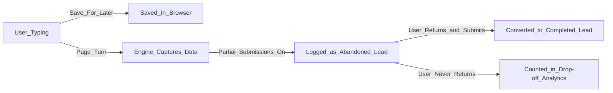

In the real world, users get distracted. They close tabs, their batteries die, or they realize they need to go find a PDF document before they can finish your application.

Flex Forms provides two distinct safety nets to ensure you never lose a hard-earned lead.

<Columns cols={2}>
  <Card title="Client-Side: Save for Later" icon="save">
    (Enabled by default). Quietly saves the user's keystrokes directly into their own browser. If they accidentally close the tab, they can re-open the link and instantly resume.
  </Card>
  <Card title="Server-Side: Partial Submissions" icon="inbox">
    (Disabled by default). Actively transmits abandoned data to your server every time a user turns a page, allowing you to manually follow up with lost leads.
  </Card>
</Columns>

---

## 1. Save Answers for Later (The UX Guardian)

This feature is purely about user experience. It uses secure LocalStorage to remember what the user typed.

- **Privacy First:** This data never leaves the user's computer until they hit submit. You cannot view it in your admin panel.
- **Anonymous Resumes:** The user doesn't need to create an account or log in. As long as they return using the same device and browser, their answers will magically reappear.
- **No step flash:** On reload, the fill page shows a short restoring state, then opens directly on the saved step — respondents do not see the form jump from page 1 through auto-jumps.

---

## 2. Partial Submissions (The Marketer's Guardian)

If you are spending $50 on ads to acquire a lead, you cannot afford to lose them on page 3 of your form.

<Steps>
  <Step title="Enable Partial Tracking">
    Go to **Form Settings $\rightarrow$ General** and toggle **Partial Submissions** on.
  </Step>
  <Step title="The Capture Engine">
    Every time a user clicks "Next" to turn a page, the engine silently transmits everything they've typed so far to your secure database.
  </Step>
  <Step title="Manual Follow-Up">
    Open your Inbox. You will see these entries clearly flagged as "Partial". If they filled out their email address on Page 1 before abandoning on Page 3, you can easily email them and ask if they need help completing the application.
  </Step>
  <Step title="Automated Recovery">
    For advanced workflows, use the [Integrations Engine](/features/settings/integrations) to automatically push "Partial" leads into a specific Mailchimp "Abandoned Cart" sequence.
  </Step>
</Steps>

<Callout type="warning">
  **Data Privacy Compliance:** Partial submissions allow you to read data before a user explicitly hits "Submit". You must ensure your organization's privacy policy clearly states that you capture in-progress form data, and you should leverage the [Automated Data Retention](/features/settings/general) feature to automatically purge old partial leads to remain GDPR compliant.
</Callout>

<Panel>
  **Next Steps:** [Analyzing the Drop-off Funnel](/guides/reading-insights) · [Setting up CRM Integrations](/features/settings/integrations)
</Panel>
