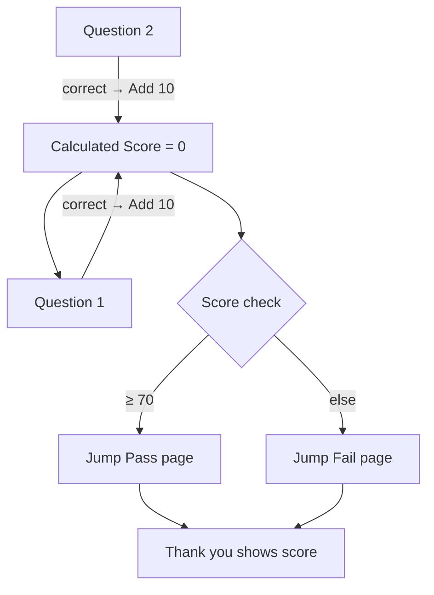

Build scored quizzes and live calculators with three Studio pieces: **Calculated fields**, **Conditional logic → Calculate**, and optional **Jump to page**.

This matches the usual scored quiz pattern: one **Score** field, then **Add** points when an answer is correct. See [Calculated fields](/features/studio/calculated-fields) for the same mental model.

---

## Scenario 1: Scored quiz

<Steps>
  <Step title="Create Calculated Score">
    Drag **Calculated** → name it **Score** (field name `score`) → **Number** → **=** `0`.  
    Public Fill never shows Calculated fields — the score appears on thank you via `{score}`.
  </Step>
  <Step title="Add quiz questions">
    Multiple choice (or similar) for each item.
  </Step>
  <Step title="Add points with Calculate">
    For each correct answer:  
    **When** that question **is** *(correct option)* → **Then Calculate** **Σ Score** **Add** `10`  
    (use Subtract / other ops if you need penalties).
  </Step>
  <Step title="Route by score">
    **When** Score **≥** `70` → [Jump to page](/features/studio/logic/actions/jump-to-page) Pass.  
    Another rule (or else path) → Fail / other result page.  
    Keep **Calculate** rules **before** Jump rules. Mark Pass / Fail pages as **terminal**.
  </Step>
  <Step title="Show score on Thank you">
    In the thank-you message, use a merge tag with the **field name**:  
    `Attempt recorded. Final score: {score}/100.`  
    After submit, Fill replaces `{score}` with the calculated value.
  </Step>
</Steps>

<Tip>
  Merge tags use the answer **name** (e.g. `{score}`, `{email}`), not the Studio block id. Calculated values always stay in the submission and thank-you tags even though Fill never renders the field.
</Tip>

---

## Scenario 2: Dynamic pricing

<Steps>
  <Step title="Collect inputs">
    Quantity, plan, add-ons, etc.
  </Step>
  <Step title="Calculated Total">
    **Calculated** → **Number** → initial `0` or a Formula such as `{price} * {quantity}`.
  </Step>
  <Step title="Conditional adjustments">
    e.g. **When** plan **is** Pro → **Calculate** Total **Multiply** `1.2`, or Formula `({price} * {quantity}) - {discount}`.
  </Step>
  <Step title="Show or charge">
    Echo Total on thank-you with `{total}`, or map it to payment **price** when your payment block supports Calculated targets. Public Fill does not render the Calculated field itself.
  </Step>
</Steps>

---

## Scenario 3: Eligibility gate

<Steps>
  <Step title="Ask the qualifier">
    e.g. monthly budget.
  </Step>
  <Step title="Explain low fits">
    **When** budget is too low → **Show** a message block. Prefer **Require** / **Jump** over hiding Next/Submit.
  </Step>
  <Step title="Optional score">
    Use a Calculated lead score the same way as the quiz (Add points per answer), then branch or sync. Fill never shows Calculated fields.
  </Step>
</Steps>

<Panel>
  [Calculated fields](/features/studio/calculated-fields) · [Calculate action](/features/studio/logic/actions/calculate) · [Harbor quiz recipe](/features/studio/logic/recipes/harbor-quiz) · [Logic guide](/guides/logic-and-calculated)
</Panel>
