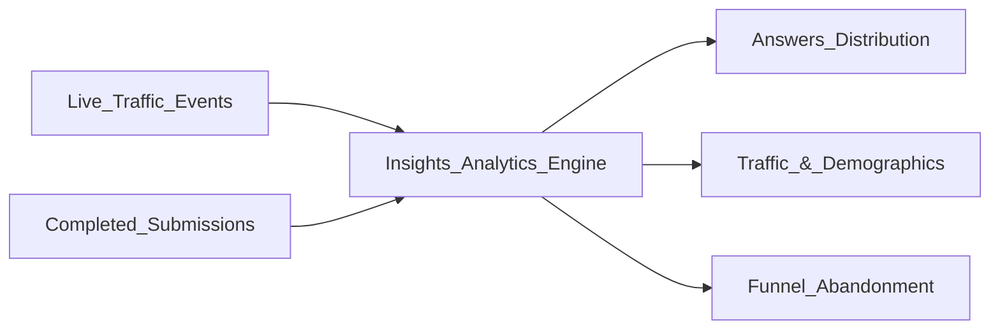

The Insights Dashboard provides enterprise-grade BI (Business Intelligence) without requiring you to write a single SQL query. 

Understanding how to read the three core panels—**Answers**, **Visits**, and **Drop-offs**—is the key to turning a 2% conversion rate into a 20% conversion rate.

---

## Decoding the KPIs

At the top of the dashboard, you will see your core performance metrics. The engine automatically calculates the **Delta** (the green/red percentage arrows) by comparing your current date range against the exact previous period of equal length.

<Table>
  <thead>
    <tr>
      <th>Metric</th>
      <th>What it actually means</th>
    </tr>
  </thead>
  <tbody>
    <tr>
      <td>**Visits**</td>
      <td>The total number of unique times the form was loaded on a screen.</td>
    </tr>
    <tr>
      <td>**Starts**</td>
      <td>The number of times a user actually typed a keystroke or clicked an answer.</td>
    </tr>
    <tr>
      <td>**Conversion Rate**</td>
      <td>The holy grail. (Submissions ÷ Visits). If 100 people visit, and 5 submit, your rate is 5%.</td>
    </tr>
    <tr>
      <td>**Completion Rate**</td>
      <td>(Submissions ÷ Starts). This tells you how many people who *began* the form actually finished it. A high conversion rate but a low completion rate means your form is too long or too confusing.</td>
    </tr>
  </tbody>
</Table>

---

## The Drop-Off Funnel (Identifying Friction)

The **Drop-offs** tab is a diagnostic X-Ray of your form's UX. It generates a literal funnel visualization of every single question.

<Steps>
  <Step title="Locate the Cliff">
    Look at the visual bars. If Page 1 has a 98% continuation rate, and Page 2 drops to a 40% continuation rate, you have found a "Cliff".
  </Step>
  <Step title="Identify the Offending Question">
    Drill down into the specific block. Did you ask for their Phone Number? Did you ask a highly sensitive question too early in the relationship?
  </Step>
  <Step title="Apply the Fix">
    Go to the Studio. Either make the offending question **Optional**, move it to the very last page, or use the [Logic Board](/guides/logic-and-calculated) to ensure it only shows up for highly qualified leads.
  </Step>
</Steps>

<Callout type="info">
  **Bot Intelligence:** You don't need to worry about Google crawlers or spam bots ruining your conversion rate metrics. The Insights engine utilizes a highly advanced filtration layer that automatically scrubs known bots, ensuring your KPIs reflect actual, human behavior.
</Callout>

<AccordionGroup>
  <Accordion title="Why don't Visits match my Google Analytics exactly?">
    Google Analytics relies heavily on third-party cookies, which are frequently blocked by ad-blockers and iOS privacy features. Flex Forms Insights operates server-side, meaning it is immune to ad-blockers and often provides a much more accurate picture of actual form loads.
  </Accordion>
  <Accordion title="Are abandoned entries included in the Answers tab?">
    No. The Answers tab strictly displays data from users who successfully hit the final "Submit" button. Abandoned data is exclusively handled in the Drop-offs tab and the [Partial Submissions](/guides/partials-save-later) engine.
  </Accordion>
</AccordionGroup>

<Panel>
  **Next Steps:** [Sharing Dashboards with Clients](/guides/share-insights) · [Enterprise Scaling for High Traffic](/guides/redis-production)
</Panel>
