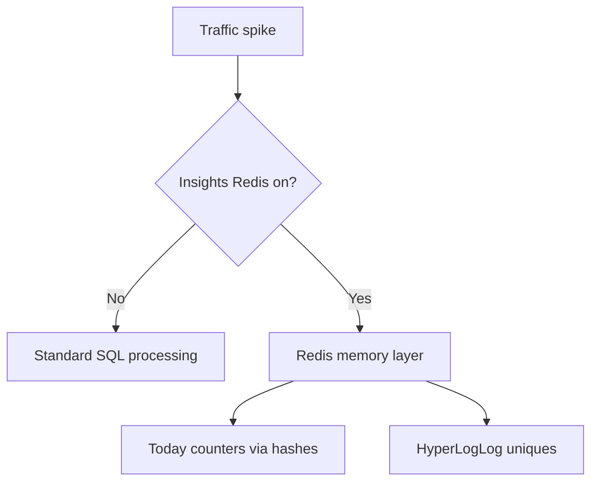

Standard form builders often buckle under sudden concurrent traffic (product launches, TV spots, influencer campaigns).

Flex Forms is built for those spikes. By default the Insights engine is fast on SQL. When **Insights Redis** is enabled, heavy analytics move into memory so dashboards stay responsive while respondents keep submitting.

---

## What Redis accelerates

<AccordionGroup>
  <Accordion title="Today metrics (O(1) hashes)">
    **Standard:** Recalculated with database queries — fine at moderate volume, can contend under extreme load.
    **With Redis:** Live counters in memory hashes for near-instant Insights loads regardless of event volume.
  </Accordion>
  <Accordion title="Unique visitors (HyperLogLog)">
    **Standard:** Expensive distinct counts on raw events.
    **With Redis:** Probabilistic HyperLogLog cardinality — the same class of algorithm used at large scale elsewhere on the web.
  </Accordion>
  <Accordion title="Entry caps (scarcity)">
    **Standard:** Database counts to decide if a form cap is reached.
    **With Redis:** Atomic counters keep caps accurate even when many people submit in the same millisecond.
  </Accordion>
</AccordionGroup>

---

## Performance defaults (always on)

Redis is **optional**. Flex Forms still uses your app’s normal Laravel Cache for Studio hubs, fill form snapshots, listing counts, and integration catalogs — so installs without Redis stay correct, just not as fast under extreme Insights load.

When you enable Insights Redis, those same cache keys can ride the Redis connection for lower latency. Versioned namespaces (forms index, fill by slug, submission counts, transaction counts, contacts, integrations) invalidate in one bump when you publish, save, or ingest — so respondents and Studio never see stale published schemas for long.

---

## How to turn it on

You can configure Redis from the product UI **or** from the server environment.

<Steps>
  <Step title="Decide if you need it">
    A few hundred submissions a day: SQL mode is enough. Tens of thousands in an hour: enable Redis.
  </Step>
  <Step title="Studio (Global Settings → Insights)">
    Open **Global Settings** → **Insights** tab. Set Redis mode to **Auto** (recommended), **On**, or **Off**, then adjust connection name, key prefix, HyperLogLog, today hashes, and cache TTL if your host team requires it. See [Global Settings](/get-started/global-settings).
  </Step>
  <Step title="Environment (optional override)">
    DevOps can also force scaling from Laravel `.env`:

    <ParamField path="FLEX_FORMS_INSIGHTS_SCALING_REDIS" type="boolean" required>
      When `true`, the engine routes Insights acceleration to Redis (in addition to whatever you set in Global Settings).
    </ParamField>
  </Step>
  <Step title="Failover">
    Redis is for speed only. Durable rollups still land in SQL. If Redis disappears mid-spike, Flex Forms falls back to SQL without dropping submissions.
  </Step>
</Steps>

<Callout type="info">
  **HyperLogLog:** Unique counts at scale without huge RAM. Leave it enabled unless your team has a specific reason to turn it off.
</Callout>

<Panel>
  **Next:** [Access gates](/guides/access-gates) · [Reading Insights](/guides/reading-insights) · [Redis scaling overview](/features/insights/redis-scaling)
</Panel>
