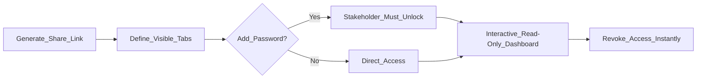

When a marketing campaign ends, clients and executives want to see the results. Instead of spending hours taking screenshots and building PowerPoint presentations, Flex Forms allows you to issue a **Secure Share Link**.

This provides the stakeholder with a beautiful, read-only, interactive version of the Insights Dashboard—without requiring them to create an account or log into your admin panel.

---

## Generating the Presentation

<Steps>
  <Step title="Open the Share Hub">
    Navigate to the Insights tab for your form and click the **Share Insights** button in the top right corner.
  </Step>
  <Step title="Scope the Permissions">
    You have absolute granular control over what the client sees. 
    *Example: You can expose the **Visits** and **Drop-offs** tabs to prove traffic volume, but hide the **Answers** tab to ensure the client cannot read sensitive PII or confidential responses.*
  </Step>
  <Step title="Apply security">
    Leave the link open, or require a password. Password-protected links show a lock screen before the dashboard.
  </Step>
  <Step title="Link lifetime">
    Shared Insights links expire after **30 days** by default. Revoke access earlier anytime from the share panel.
  </Step>
</Steps>

---

## The Stakeholder Experience

When the executive or client opens the URL, they land in a branded Insights view you control. 

While they cannot edit the form, they *can* interact with the data. They can adjust Date Ranges, apply Live Filters, and explore the charts exactly as if they were inside the platform.

<Callout type="warning">
  **Bulletproof Security:** When you uncheck a tab (like "Answers"), the data is not just visually hidden using CSS. The Flex Forms engine completely redacts the payload at the server level. Even if a highly technical client inspects the browser's network requests, it is mathematically impossible for them to extract the hidden data.
</Callout>

---

## Managing Active Links

You retain complete control over the distribution of your data.

From the Share Hub, you can view a real-time ledger of every active link currently in circulation. If a client contract is terminated early, simply click **Revoke**. The link is instantly destroyed globally, and anyone attempting to view it will receive a standard 404 error.

<Panel>
  **Next Steps:** [Mastering the Insights Dashboard](/guides/reading-insights) · [Exporting to CSV](/features/submissions/export-csv)
</Panel>
