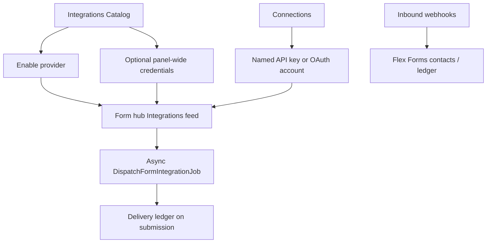

The **Integrations** rail is where Flex Forms authenticates providers, stores reusable Connections, and wires each form’s outbound feeds. Submissions always save first; delivery runs asynchronously so a slow CRM never freezes the public fill page.

This page is the map of everything that ships today. Each provider below has its own setup guide.

## How it fits together

| Layer | Where | What it does |
|-------|-------|--------------|
| **Catalog** | Integrations → Catalog | Enable/disable providers; optional shared credentials (fallback when a feed has no Connection) |
| **Connections** | Integrations → Connections | Named, encrypted accounts (Production vs Sandbox, client A vs B). Prefer this for multi-account |
| **Form feed** | Form hub → Integrations | Per-form routing, field maps, Connection picker, conditions |
| **Delivery ledger** | Submission detail | Succeeded / failed / skipped attempts + **Replay** |
| **Scheduled sync** | Background | Refreshes remote pickers (lists, channels, sheets) for Connection-aware catalogs |
| **Inbound** | `POST /flex-forms/integrations/{driver}/webhook` | Provider → Flex Forms (HubSpot, Slack, Webhooks) |

Platform unlockers (**reCAPTCHA**, **Turnstile**, **Mapbox**, **Pexels**, **Stripe**) stay **Catalog-only** — they unlock Studio/fill features, not multi-account CRM feeds.

**Stripe exception:** payment options live on the [Stripe Payment](/features/blocks/stripe-payment) block. Stripe never appears on the form Integrations tab. Ledger: [Transactions](/features/transactions/overview).

Related: [Conditional feeds](/integrations/conditional-feeds) · [Custom integrations](/developers/custom-integrations) · [Inbound webhooks](/developers/inbound-webhooks)

---

## Complete provider catalog

### Email marketing & newsletters

| Integration | Auth | Connections | Typical feed |
|-------------|------|-------------|--------------|
| [Mailchimp](/integrations/mailchimp) | API key (`-usXX`) | Yes | Audience, merge tags, tags, double opt-in |
| [Campaign Monitor](/integrations/campaign-monitor) | API key | Yes | Client lists + custom fields |
| [GetResponse](/integrations/getresponse) | API key (Standard / MAX) | Yes | Campaign + custom fields |
| [ConvertKit](/integrations/convertkit) | API key / secret | Yes | Forms, sequences, tags |
| [EmailOctopus](/integrations/emailoctopus) | API key | Yes | List + extra fields |
| [MailerLite](/integrations/mailerlite) | API token | Yes | Groups + custom fields |
| [ActiveCampaign](/integrations/activecampaign) | API URL + key | Yes | Lists, tags, custom fields |
| [Emma](/integrations/emma) | Public + private keys | Yes | Groups + fields |
| [Brevo](/integrations/brevo) | API key | Yes | Lists / contacts |

### Transactional email

| Integration | Auth | Connections | Typical feed |
|-------------|------|-------------|--------------|
| [SendGrid](/integrations/sendgrid) | API key (`SG.`) | Yes | Dynamic templates / mail send |
| [Mailgun](/integrations/mailgun) | API key + domain | Yes | Messages API |

### CRM & sales

| Integration | Auth | Connections | Typical feed |
|-------------|------|-------------|--------------|
| [HubSpot](/integrations/hubspot) | Private App token | Yes | Contacts / forms + optional [inbound](/developers/inbound-webhooks) |
| [Salesforce](/integrations/salesforce) | OAuth / client credentials | Yes | Lead / Contact / custom objects |
| [Capsule CRM](/integrations/capsule-crm) | Personal access token | Yes | Parties + opportunities |

### Collaboration, sheets & helpdesk

| Integration | Auth | Connections | Typical feed |
|-------------|------|-------------|--------------|
| [Google Sheets](/integrations/google-sheets) | OAuth refresh | Yes | Spreadsheet + sheet append |
| [Slack](/integrations/slack) | Bot token and/or webhook | Yes | Channel alerts + optional inbound |
| [Trello](/integrations/trello) | API key + token | Yes | Cards on a list |
| [Breeze](/integrations/breeze) | API token | Yes | Tasks |
| [Help Scout](/integrations/helpscout) | Access token | Yes | Conversations + custom fields |
| [Zapier](/integrations/zapier) | Catch hook URL | Yes | Catch Hook + field map |
| [Webhooks](/integrations/webhooks) | Shared secret (optional) | Yes | Signed JSON outbound + inbound |

### Security, analytics, media & payments

| Integration | Auth | Connections | Role |
|-------------|------|-------------|------|
| [Google Analytics](/integrations/google-analytics) | Measurement ID + MP secret | Catalog | Measurement Protocol events |
| [Meta](/integrations/meta) | Pixel / CAPI token | Catalog | Browser + Conversions API |
| [Mapbox](/integrations/mapbox) | Access token | Catalog | Address / map blocks |
| [Pexels](/integrations/pexels) | API key | Catalog | Studio stock covers |
| [reCAPTCHA](/integrations/recaptcha) | Site + secret | Catalog | Form Access CAPTCHA |
| [Turnstile](/integrations/turnstile) | Site + secret | Catalog | Form Access CAPTCHA |
| [Stripe](/integrations/stripe) | Secret + webhook | Catalog | Stripe Payment Element + Transactions |

---

## Recommended setup path

<Steps>
  <Step title="Open Integrations">
    Flex Forms left rail → **Integrations** (separate from [Global Settings](/get-started/global-settings)).
  </Step>
  <Step title="Enable in Catalog">
    Turn the provider on. For a single shared account you may paste credentials here.
  </Step>
  <Step title="Prefer Connections for multi-account">
    Create a labeled Connection (Production, Sandbox, Client X). Credentials stay encrypted on the Connection.
  </Step>
  <Step title="Wire the form feed">
    Open the form → hub **Integrations** → enable the provider → pick **Connection** → map lists/fields → save.
  </Step>
  <Step title="Verify delivery">
    Submit a test fill. Open the submission → delivery ledger → confirm success or use **Replay**.
  </Step>
</Steps>

<Callout type="info">
  Changing the **Connection** on a feed reloads remote pickers (audiences, channels, sheets) for that account. Scheduled sync keeps those catalogs warm in the background.
</Callout>

---

## Reliability & security (what “enterprise” means here)

<CardGroup cols={2}>
  <Card title="Async dispatch" icon="timer">
    Jobs run after ingest. Queue workers absorb vendor latency; respondents never wait on Salesforce.
  </Card>
  <Card title="Delivery ledger + Replay" icon="rotate-cw">
    Every attempt is recorded. Soft failures (timeouts, 429, 5xx) can be retried; permanent 4xx stay failed for intentional Replay.
  </Card>
  <Card title="Circuit breaker" icon="shield">
    Repeated failures open a breaker per integration / Connection so one bad account does not flood the queue.
  </Card>
  <Card title="Outbound HTTP hygiene" icon="globe">
    Shared client: explicit timeouts, connect timeout, retries on transient errors, no redirects (SSRF), consistent User-Agent.
  </Card>
  <Card title="Encrypted credentials" icon="lock">
    Connection secrets use encrypted casts. Catalog secrets are redacted in Studio responses.
  </Card>
  <Card title="Conditional feeds" icon="git-branch">
    Send only when answers match rules — see [Conditional feeds](/integrations/conditional-feeds).
  </Card>
</CardGroup>

### Timeouts vs intervals (why both exist)

| Mechanism | What it is | Why it is enterprise |
|-----------|------------|----------------------|
| **HTTP timeout** | Max seconds a single outbound API call may run (typically 12–25s); config `filament-flex-forms.outbound_http.timeout` | Protects queue workers from hung vendors; fail → retry / ledger instead of blocking forever |
| **Connect timeout** | Max seconds to open TCP/TLS (5s); config `filament-flex-forms.outbound_http.connect_timeout` | Fails fast on dead hosts |
| **Job backoff** | Wait between job retries (e.g. 15s / 60s / 180s) | Gives rate-limited APIs room to recover |
| **OAuth device `interval`** | Provider-mandated poll spacing ([RFC 8628](https://datatracker.ietf.org/doc/html/rfc8628)) | Polling faster gets you `slow_down`; Flex Forms increases the interval when the provider asks |

Timeouts are **not** a substitute for async jobs, and intervals are **not** HTTP timeouts — they solve different failure modes.

---

## Build your own

Need a provider that is not listed? Register a custom driver with the same FieldMapper, Connections, delivery ledger, and circuit breaker as shipped integrations.

<CardGroup cols={2}>
  <Card title="Creating integrations" icon="code" href="/developers/custom-integrations">
    Discover drivers from `app/FlexForms/Integrations` and ship first-party quality feeds.
  </Card>
  <Card title="Field mapping" icon="table" href="/developers/field-mapping">
    Transform and nest payloads with FieldMapper.
  </Card>
  <Card title="OAuth tokens" icon="key" href="/developers/oauth-token-management">
    Encrypted Connections, refresh locks, reconnect.
  </Card>
  <Card title="SDK helpers" icon="wrench" href="/developers/integration-sdk-helpers">
    GraphQL client, device-code OAuth, SAML assertion consumer.
  </Card>
  <Card title="Inbound webhooks" icon="inbox" href="/developers/inbound-webhooks">
    `SupportsInboundWebhooks` + idempotency ledger.
  </Card>
  <Card title="Events & hooks" icon="bolt" href="/developers/events-hooks">
    Listen after ingest, publish, and deliveries.
  </Card>
</CardGroup>
