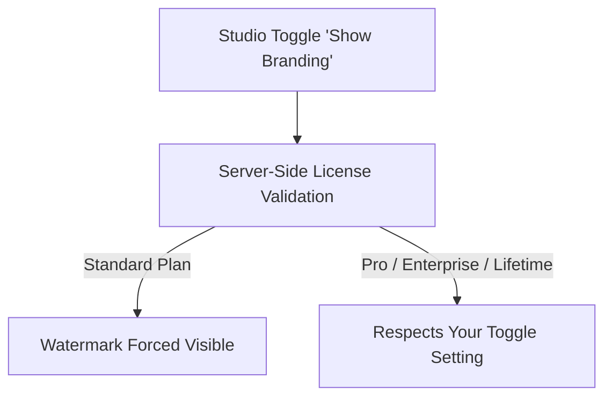

To provide a completely immersive and seamless brand experience for your respondents, <Badge color="purple">Pro</Badge>, **Enterprise**, and **Lifetime** licenses allow you to remove the "Powered by Flex Forms" watermark from every public fill page, popup, and embed.

*Note: On a Standard license, the watermark is always visible. This is enforced securely by the licensing server.*

## The Enforcement Architecture

---

## How to Remove the Watermark

<Steps>
  <Step title="Verify Your Active Plan">
    Ensure your account is on Pro, Enterprise, or Lifetime by checking the [License Portal](https://license.bjanczak.com/flex-forms/panel).
  </Step>
  
  <Step title="Access Form Settings">
    From Studio, open **Form settings (gear) → General** (form settings, not the Studio Design rail).
  </Step>
  
  <Step title="Disable the Watermark">
    Uncheck the **Show branding** option. 
    
    If you are on Pro, Enterprise, or Lifetime, the watermark disappears immediately from all live forms and embeds. If you are on a Standard plan, the system saves your preference, but the watermark will remain visible until you upgrade.
  </Step>
  
  <Step title="Verify in Production">
    Reload your embedded form on your live production domain to confirm the watermark is gone.
  </Step>
</Steps>

<Warning>
  **Security Note:** White-labeling validation occurs server-side on every request, authenticated against your specific domain. It cannot be spoofed via client-side CSS or JavaScript. If your domain's license check fails, the watermark may safely reappear as a fallback.
</Warning>

---

## Troubleshooting

<AccordionGroup>
  <Accordion title="I upgraded to Pro, but the watermark is still visible">
    License validations are cached briefly to ensure high performance. It may take a few minutes for the cache to clear. To force a refresh instantly, go to your **Global Settings** and re-save your Public Key.
  </Accordion>
  <Accordion title="Does white-labeling affect my Filament Admin UI?">
    No. This setting exclusively affects the public-facing forms (the fill pages and embeds) that your respondents see. The internal Studio and Hub within your Filament panel will always display Flex Forms branding.
  </Accordion>
  <Accordion title="Is this setting per-form or account-wide?">
    The toggle to hide branding is a **per-form** setting. However, whether the system *honors* that toggle is determined account-wide based on your active license plan.
  </Accordion>
</AccordionGroup>

<Panel>
  **Next Steps:** [Upgrade Your Plan](/plans/standard-pro-enterprise) · [Design & branding](/guides/design-pro)
</Panel>
