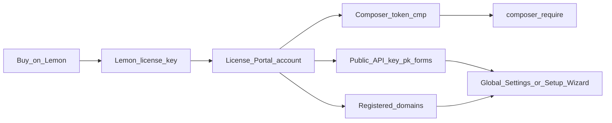

The [License Portal](https://license.bjanczak.com/flex-forms/panel) is your customer dashboard for Flex Forms. After you buy on Lemon Squeezy, everything that unlocks package downloads and Studio activation lives here: Composer authentication, your Public API key, the list of allowed hostnames, and tools to change or refresh credentials.

This page walks through the portal **after purchase**, section by section, so you always know which credential goes where.

<Banner>
  Open the portal: [license.bjanczak.com/flex-forms/panel](https://license.bjanczak.com/flex-forms/panel). Need a license first? [Buy Flex Forms](https://shop.bjanczak.com/checkout/buy/3d3a0d72-c9d5-4cfd-90c9-26869c444bb0).
</Banner>

---

## After you buy on Lemon Squeezy

Lemon Squeezy handles checkout and issues a **Lemon license key**. Use that key only when you **register** on the License Portal (together with your email and a portal password). After signup, the portal **generates** the Composer token (`cmp_…`) and Public API key (`pk_forms_…`) you actually use to install and activate Flex Forms.

The Lemon key is **not** a Composer password and **not** the key you paste into Filament.

<Steps>
  <Step title="Complete checkout">
    Purchase from the [Flex Forms store](https://shop.bjanczak.com/checkout/buy/3d3a0d72-c9d5-4cfd-90c9-26869c444bb0). Choose one of the four plans: Standard, Pro, Enterprise (yearly), or Lifetime (one-time).
  </Step>

  <Step title="Find your Lemon license key">
    Open the Lemon receipt email or **My Orders**. Copy the **Lemon license key**. You will use it only to create or relink your portal account (and later for **Change license key** if you upgrade).
  </Step>

  <Step title="Create the portal account">
    Go to [license.bjanczak.com/flex-forms/panel](https://license.bjanczak.com/flex-forms/panel). Register with:

    - your **email** (same as Lemon checkout when possible),
    - a **password** for the portal,
    - your **Lemon license key**.

    The portal then **generates** your Composer token (`cmp_…`) and Public API Key (`pk_forms_…`). The Lemon key is only for this registration (and later **Change license key**) — never for Filament or Composer auth.
  </Step>

  <Step title="Grab the generated credentials">
    Copy:

    1. **Composer token** (`cmp_…`) — for [Installation](/get-started/installation)
    2. **Public API Key** (`pk_forms_…`) — for [Activate license](/get-started/activate-license) / [Setup Wizard](/get-started/setup-wizard)

    Treat `cmp_…` like a password. `pk_forms_…` is safe to store in Filament Global Settings; it only unlocks hosts you whitelist.
  </Step>

  <Step title="Register hostnames">
    Add every exact domain / subdomain / local host where Filament will run Flex Forms, up to your plan’s seat limit (table below). Then install with Composer and paste `pk_forms_…` into Filament.
  </Step>
</Steps>

<Info>
  Lemon may show the purchase key as **inactive** until the first domain is added in the portal. That usually means “valid purchase, zero activations yet” — not a failed payment. See [Inactive vs Active](#inactive-vs-active-lemon-status) below.
</Info>

---

## Portal sections (what each one is for)

Use this map when you are inside the dashboard. Every section has a single job.

### Install via Composer (`cmp_…`)

| | |
|--|--|
| **What you get** | A private **Composer token** starting with `cmp_` |
| **What it unlocks** | Authenticated downloads from `composer.bjanczak.com` so `composer require` can install Flex Forms |
| **Where you use it** | `composer config --auth`, Forge / CI secrets, server `auth.json` — see [Installation](/get-started/installation) |
| **Secret?** | **Yes.** Never commit it. Never paste it into Filament Global Settings. |

Open **Install via Composer** whenever you need to copy the current token or **regenerate** it after a leak. Regenerating **immediately revokes** the previous `cmp_…` value — update every server and CI job in the same change window.

### Public API Key (`pk_forms_…`)

| | |
|--|--|
| **What you get** | **Your Public API Key**, shaped as `pk_forms_` + 32 hexadecimal characters |
| **What it unlocks** | Studio and licensed runtime features **inside Filament**, once the current hostname is also on your domain list |
| **Where you use it** | **Setup Wizard** field **Public API key**, or **Global Settings → License → License public key** |
| **Secret?** | Safe to store in your app’s license settings. It only works for hostnames registered on your account. |

One Public API key covers **all** domains on the account. You do not create a separate `pk_forms_…` per environment.

### Domains list (license activations / seats)

| | |
|--|--|
| **What you manage** | Exact hostnames allowed to run Flex Forms under your plan |
| **Examples** | `admin.example.com`, `staging.example.com`, `my-app.test` |
| **Rules** | Exact match. `www.example.com` and `example.com` are different seats. Staging and production each use one seat. |
| **Moving a domain** | Remove the old hostname to free a seat, then add the new one. You are not locked to the first domain forever. |

Filament checks this list when validating the Public API key. Pasting `pk_forms_…` alone is not enough if the browser host is missing — details in [Activate license](/get-started/activate-license).

### Change license key

| | |
|--|--|
| **When to use** | You bought a **higher** (or different) plan and need the portal account to follow the new Lemon purchase |
| **How** | There is **no** in-portal checkout. Buy the new plan in the [store](https://shop.bjanczak.com/checkout/buy/3d3a0d72-c9d5-4cfd-90c9-26869c444bb0), then use **Change license key** and paste the **new Lemon license key** |
| **What stays** | Domains already on the account typically remain; plan features and seat limits refresh from the new entitlement |

Use this after upgrades (for example Standard → Pro for more seats or hide branding), not for day-to-day Composer or Filament work.

### Regenerate Composer token

| | |
|--|--|
| **Where** | Inside **Install via Composer** |
| **Effect** | Issues a new `cmp_…` and **revokes** the old one immediately |
| **You must** | Update `auth.json` / Composer auth on every machine and every CI secret that still holds the old token |

Prefer regenerating whenever a token may have been committed, shared in chat, or exposed in a log.

---

## Seat limits by plan

Each registered hostname consumes **one** license activation (seat), including staging and local hosts you add to the portal.

<Table>
  <thead>
    <tr>
      <th>Plan</th>
      <th>Billing</th>
      <th>License activations (domains)</th>
      <th>Notes</th>
    </tr>
  </thead>
  <tbody>
    <tr>
      <td>**Standard**</td>
      <td>$99 / year</td>
      <td>**2**</td>
      <td>Typical: one production + one staging (or local)</td>
    </tr>
    <tr>
      <td>**Pro**</td>
      <td>$199 / year</td>
      <td>**6**</td>
      <td>More environments / clients; includes [hide branding](/plans/hide-branding)</td>
    </tr>
    <tr>
      <td>**Enterprise**</td>
      <td>$799 / year</td>
      <td>**100**</td>
      <td>Multi-brand / high-volume; priority support</td>
    </tr>
    <tr>
      <td>**Lifetime**</td>
      <td>$899 one-time</td>
      <td>**10**</td>
      <td>Pro-level features including hide branding; package updates forever</td>
    </tr>
  </tbody>
</Table>

Full feature comparison: [Plans & pricing](/plans/overview). Need more seats than your plan allows? Upgrade via the store, then **Change license key** in the portal.

---

## Inactive vs Active Lemon status

Lemon Squeezy and the License Portal both surface status language that customers often misread. Here is what it usually means for Flex Forms.

### Inactive (common right after purchase)

When Lemon shows the license as **inactive** and you have **not** registered any domains yet:

- The purchase is typically **valid**
- **Zero** hostnames have been activated against that key
- Composer / portal access for a healthy account is **not** the same thing as “this Lemon row says inactive”
- Your next step is: open the portal → **add the first domain** → then paste `pk_forms_…` into Filament

<Info>
  **Inactive with a valid purchase and zero domains** almost always means “ready, unused” — not “payment failed” and not “downloads are disabled.”
</Info>

### Active

After domains are registered and entitlement checks succeed, Lemon / portal status moves toward an **active** (in-use) picture:

- At least one activation is associated with the license
- Filament hosts on the whitelist can validate against your Public API key
- Plan features (seats, hide branding where applicable) apply on successful checks

### When something is actually wrong

Treat these as real entitlement problems (not the normal “inactive until first domain” case):

- Purchase **cancelled**, **refunded**, or **expired** (yearly plan not renewed)
- Account **banned** or otherwise blocked by support
- Portal / Composer messaging that **downloads are disabled** (see FAQ below)

In those cases, refresh the portal after resolving billing with Lemon, or contact support with your purchase email. Do not paste the Lemon key into Filament hoping it will “force” activation — Filament only accepts `pk_forms_…`.

---

## Credential reference

Keep these four items mentally separate. Mixing them is the most common install / activation mistake.

<Table>
  <thead>
    <tr>
      <th>Credential</th>
      <th>Looks like</th>
      <th>Where you get it</th>
      <th>Where you use it</th>
      <th>Notes</th>
    </tr>
  </thead>
  <tbody>
    <tr>
      <td>**Lemon license key**</td>
      <td>Vendor string from Lemon receipt / My Orders</td>
      <td>Lemon Squeezy</td>
      <td>Portal register / **Change license key** only</td>
      <td>Proves purchase. Never Composer password. Never Filament field.</td>
    </tr>
    <tr>
      <td>**Composer token**</td>
      <td>`cmp_…`</td>
      <td>**Generated by the portal** after registration (see **Install via Composer**)</td>
      <td>`composer config --auth`, CI / server secrets</td>
      <td>**Secret.** Regenerate if leaked; old token dies immediately.</td>
    </tr>
    <tr>
      <td>**Public API Key**</td>
      <td>`pk_forms_` + 32 hex chars</td>
      <td>**Generated by the portal** after registration (see **Your Public API Key**)</td>
      <td>Setup Wizard or **Global Settings → License**</td>
      <td>One key for all domains on the account.</td>
    </tr>
    <tr>
      <td>**Registered domains**</td>
      <td>Exact hostnames</td>
      <td>Portal → domains / activations list</td>
      <td>Server-side whitelist for license checks</td>
      <td>Each host = one seat. Swap by remove + add.</td>
    </tr>
  </tbody>
</Table>

<Warning>
  Your Lemon Squeezy purchase key is used **only** for creating or recovering the portal account (and relinking after an upgrade). It is **never** used as a Composer password or as the Public API key in Filament.
</Warning>

---

## Day-to-day workflows

<Steps>
  <Step title="Access the dashboard">
    Log into [license.bjanczak.com/flex-forms/panel](https://license.bjanczak.com/flex-forms/panel) with the account you created after Lemon checkout.
  </Step>

  <Step title="Install the package">
    Copy `cmp_…` from **Install via Composer**, configure Composer auth, then follow [Installation](/get-started/installation).
  </Step>

  <Step title="Unlock Studio">
    Copy `pk_forms_…`, register hostnames, then paste the key via [Setup Wizard](/get-started/setup-wizard) or [Activate license](/get-started/activate-license) (**Global Settings → License**).
  </Step>

  <Step title="Swap or add domains">
    Stay within your seat limit. Remove unused hosts before adding new ones. Prefer the hostname staff actually open in the browser.
  </Step>

  <Step title="Upgrade the plan">
    Buy the higher tier in the [store](https://shop.bjanczak.com/checkout/buy/3d3a0d72-c9d5-4cfd-90c9-26869c444bb0), then **Change license key** with the new Lemon key so seats and features refresh.
  </Step>
</Steps>

---

## Troubleshooting & FAQs

<AccordionGroup>
  <Accordion title="Can I regenerate my Composer token if it leaks?">
    Yes. Open **Install via Composer** in the portal and regenerate. The old `cmp_…` is revoked immediately. Update every `auth.json`, Forge env, and CI secret that still uses the previous token, then run Composer again on each environment.
  </Accordion>

  <Accordion title="Do I need a unique Public API key for every domain?">
    No. A single Public API Key (`pk_forms_…`) covers **all** domains registered under your account. Add each hostname to the domains list; keep pasting the same `pk_forms_…` into each Filament install (or share one key across environments that use the same portal account).
  </Accordion>

  <Accordion title="What happens if the License Portal goes offline?">
    Flex Forms is built for resilience. After a successful license check, your app keeps a secure cache for roughly **up to a week**. Brief portal outages should not lock Studio or stop respondents from submitting. Prolonged outages past the cache window can block fresh validation until the portal is reachable again.
  </Accordion>

  <Accordion title="Composer says downloads are disabled — when does that happen?">
    Downloads are disabled when the purchase entitlement is no longer valid — for example cancelled, refunded, expired (yearly plan lapsed), or the account is banned. That is **not** the same as Lemon showing **inactive** with zero domains on a healthy new purchase. Refresh the portal after fixing billing; if it persists on a valid purchase, contact support with your checkout email.
  </Accordion>

  <Accordion title="Lemon still says inactive after I paid">
    Add at least one domain in the portal. Inactive with a valid purchase and an empty domain list almost always means “not activated yet.” If payment truly failed, Lemon / email will say so — do not confuse that with the unused-activation state.
  </Accordion>

  <Accordion title="I upgraded but seats did not increase">
    Confirm you completed **Change license key** with the **new** Lemon key from the upgraded order. Buying alone does not always relink the portal account until that step is done. Then re-check the domain list and [Plans & pricing](/plans/overview).
  </Accordion>

  <Accordion title="Studio is locked even though I pasted pk_forms_…">
    The hostname in the browser must match a portal domain exactly, and the key must be the Public API key (not `cmp_…` or the Lemon key). See [Activate license](/get-started/activate-license) and [Setup Wizard](/get-started/setup-wizard).
  </Accordion>
</AccordionGroup>

<Panel>
  **Related:** [Installation](/get-started/installation) · [Activate license](/get-started/activate-license) · [Plans & pricing](/plans/overview) · [Setup Wizard](/get-started/setup-wizard)
</Panel>
