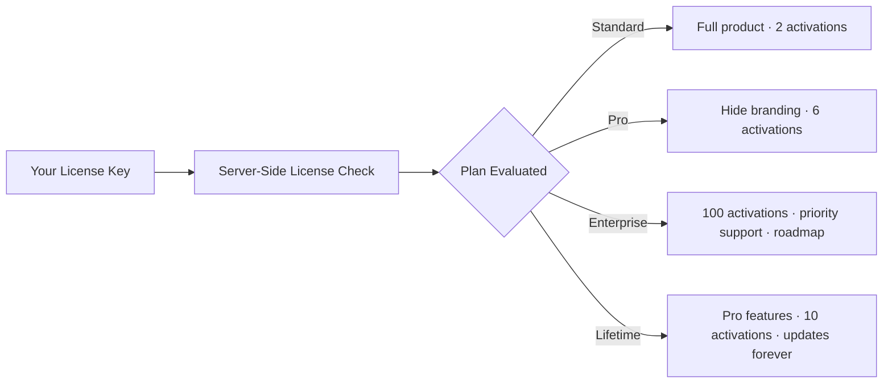

Your plan is tied to your license key and checked whenever a domain activates Flex Forms. Feature flags (such as hide branding) and activation seats are enforced server-side across Studio, API routes, and public fill pages.

**Four plans:** Standard **$99**/yr · Pro **$199**/yr · Enterprise **$799**/yr · Lifetime **$899** one-time.

Studio, Insights, integrations, and Design ship on every paid plan. Plans mainly change domain activations, white-label, support priority, and yearly vs one-time billing. Cards, inclusion list, and option comparison: [Plans & Pricing](/plans/overview).

## What each plan unlocks

<Callout type="info">
  Upgrading unlocks hide branding and additional activation seats on the next license check — no app redeploy required.
</Callout>

---

## Detailed plan comparison

<CardGroup cols={2}>
  <Card title="Standard" icon="badge-check">
    <Badge color="gray">$99 / year</Badge>

    Full Flex Forms product: Studio, publishing, embeds, submissions, Insights, Contacts, integrations, and the **Design** panel (including advanced layout and custom CSS).

    - **2** license activations (domains)
    - Public fill shows the Flex Forms badge
  </Card>

  <Card title="Pro" icon="sparkles">
    <Badge color="purple">$199 / year</Badge>

    Everything in Standard, plus white-labeling and more seats — enough for production, staging, and a few client or preview hosts.

    - **6** license activations (domains)
    - [Hide branding (white-label)](/plans/hide-branding)
  </Card>

  <Card title="Enterprise" icon="building-2">
    <Badge color="blue">$799 / year</Badge>

    Everything in Pro for multi-brand and high-volume deployments.

    - **100** license activations (domains)
    - Priority support (email or private Slack)
    - Prioritized feature requests
    - Help shape the roadmap
  </Card>

  <Card title="Lifetime" icon="infinity">
    <Badge color="green">$899 one-time</Badge>

    Pay once for Pro-class features and forever package updates — without a yearly renewal.

    - **10** license activations (domains)
    - [Hide branding](/plans/hide-branding)
    - Package updates forever
    - Not Enterprise priority support / roadmap seats
  </Card>
</CardGroup>

---

## Frequently asked questions

<AccordionGroup>
  <Accordion title="How is billing structured?">
    **Standard**, **Pro**, and **Enterprise** are yearly subscriptions (**$99** · **$199** · **$799**). **Lifetime** is **$899** one-time with forever package updates. See [Plans & Pricing](/plans/overview). Checkout at the [Flex Forms Store](https://shop.bjanczak.com/checkout/buy/3d3a0d72-c9d5-4cfd-90c9-26869c444bb0) is authoritative for the amount charged.
  </Accordion>
  <Accordion title="How many domains can I activate?">
    **Standard: 2 · Pro: 6 · Enterprise: 100 · Lifetime: 10.** Each hostname (including staging) uses one seat. Manage the list in the [License Portal](/plans/license-portal). Need more than 100? Contact us for a custom Enterprise arrangement.
  </Accordion>
  <Accordion title="Do I need Pro only for staging + production?">
    Not necessarily. Standard already includes **2** activations, so one production host and one staging host fit Standard. Choose Pro when you need more seats and/or a clean public UI without “Powered by Flex Forms”. Choose Lifetime when you want Pro features + **10** seats without renewing yearly.
  </Accordion>
  <Accordion title="What happens if my license expires?">
    Yearly plans renew annually. If the subscription expires or the license fails validation, Studio edits and publishing are blocked, **public fill and new submissions pause**, and Composer package downloads stop until you renew. **Lifetime** keeps runtime and Composer updates permanently. Historical data already in your database is never deleted.
  </Accordion>
  <Accordion title="Can I try before I buy?">
    Flex Forms does not typically offer a free trial due to the source-available nature of Composer packages. Reach out via [Support](/resources/support) for procurement needs.
  </Accordion>
</AccordionGroup>

<Panel>
  **Next steps:** [Plans & Pricing](/plans/overview) · [White-labeling](/plans/hide-branding) · [License Portal](/plans/license-portal)
</Panel>
